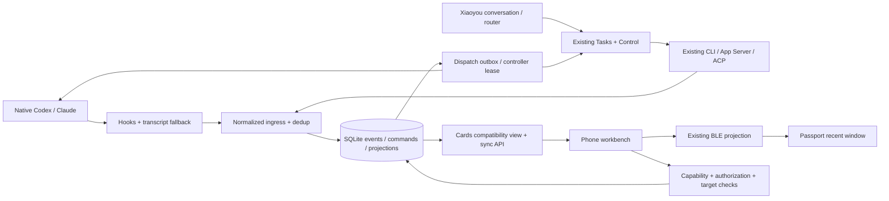
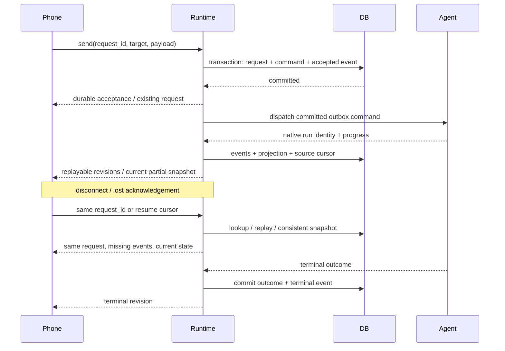

<p align="right">
  <a href="xiaoyou-harness-review.zh_CN.md">简体中文</a> · <strong>English</strong>
</p>

# Xiaoyou local harness review and incremental architecture proposal

Review date: 2026-10-16, Asia/Shanghai. Status: design and isolated validation; no production implementation or deployment.

## Decision and scope

Make the owner's existing local harness dependable first: accepted requests survive a restart, follow-ups are never silently dropped, desktop observations have truthful state, and clients converge after reconnecting. Keep the existing Runtime, execution controls, permission bridge, Android relay, and Passport BLE transport. Introduce a small internal connector contract after these reliability boundaries work. A public Agent SDK, marketplace, remote orchestration ecosystem, and GUI control are deferred.

The product goal remains one entry point for work started either by Xiaoyou or inside native agent applications. Observation, permission decisions, resuming a historical session, and steering a live run are separate capabilities. None implies the others.

The preceding Chat conversation was read. It explicitly narrows the immediate goal to the owner's personal local connector and CLI/process, native RPC, and hook/log integration. The downloadable Brief attachment in that conversation was not available as a local file; this proposal uses the visible conversation and the current request and does not claim to have read the attachment.

## Audited revisions and evidence boundaries

| Source | Verified baseline | Meaning |
| --- | --- | --- |
| ai-passport GitHub | `feature/usage-history`, `e1f5238c781d784338f325ac289e0f140a0b3382` | GitHub branch API, repository homepage, and local HEAD agree. `main` is the upstream hardware baseline, not the active Runtime line. |
| ai-passport local checkout | Same HEAD plus existing uncommitted Runtime, Android, documentation, and tooling changes | Local source is reviewed separately. None of these changes was authored or reverted by this review. |
| Coucou | `main`, `f09ac0b451128781b88b0f8a77f69bab622b9f24`, checked on 2026-10-16 | Local clone is `a95d309a4752c23ae28453819245339800557609`. GitHub comparison through `f09ac0b` shows none of the cited harness/phone-link files changed. |
| Local source versions | Runtime `0.6.1`; Android `0.14.0`, code `25` | Source labels only. Installed phone/firmware and the running Python process's loaded revision are unverified. |
| Runtime presence | A Python listener was observed on port `8765` | Proves a listener, not model readiness, end-to-end correctness, or which dirty source was loaded. |

All local line numbers below refer to the reviewed working tree. [The evidence manifest](xiaoyou-harness-evidence.json) records hashes of relevant source files so later edits can be distinguished. Coucou links are pinned to the reviewed commit. The audit did not restart the Runtime, send work to native sessions, install hooks, publish an app, or flash a device.

Primary references: [active ai-passport branch](https://github.com/yanyuliu01/ai-passport/tree/e1f5238c781d784338f325ac289e0f140a0b3382/runtime), [Coucou revision](https://github.com/Louis-CFM/coucou/tree/f09ac0b451128781b88b0f8a77f69bab622b9f24), [Coucou revision comparison](https://github.com/Louis-CFM/coucou/compare/a95d309a4752c23ae28453819245339800557609...f09ac0b451128781b88b0f8a77f69bab622b9f24).

## Confirmed code findings

"Reproduced" means an isolated probe of real classes with temporary state and execution disabled. It does not establish that a particular reported phone symptom had this cause.

| ID / priority | Finding and consequence | Code evidence / validation |
| --- | --- | --- |
| R1 / P0 | Accepted messages, client-ID deduplication, and pending lanes are memory-only. Restarting creates a new accepted message for the same ID; lost acknowledgements can therefore lead to repeated execution. Session/transcript JSON does not make request acceptance durable. | [service.py](../../runtime/xiaoyou_runtime/api/service.py): `Service.__init__` L63-74, `_enqueue` L161-218, `_trim` L385-394. `Cards.__init__` L69-85 marks interrupted managed cards failed rather than recovering accepted intent. **Reproduced:** same-process dedup works; a new Service produces a different ID and no accepted prompt was persisted. Applies to GitHub and local tree. |
| R2 / P0 | The ninth queued `after` follow-up is silently discarded while `Tasks.amend` returns `after`. Xiaoyou can tell the owner the instruction was accepted when it was lost. | [tasks.py](../../runtime/xiaoyou_runtime/helpers/tasks.py): `MAX_PENDING` L22; `amend` L122-125. **Reproduced:** nine successful return values, eight stored items. The queue behavior exists at GitHub HEAD; local edits add `run_id` and desktop handoff but do not fix it. |
| R3 / P1 | Deduplication uses only `client_id`, without conversation or payload validation. Reusing an ID for another conversation returns the original conversation's message rather than a conflict. Retention trimming also ends dedup protection. | `Service._enqueue` L164-165 and `_trim` L393-394. **Reproduced:** submit to B with A's client ID returns A. Normal phone UUID generation makes accidental collision unlikely; deliberate retry mismatch is still an API contract defect. |
| R4 / P1 | Native desktop cards deliberately reject continuation. The current feature is observation plus an optional separate permission channel, not general control of native live sessions. | `Service._enqueue` L148-150; [RuntimeClient.java](../../companion/android/app/src/main/java/com/yanyuliu/pockethub/RuntimeClient.java): `send` L584-586; `test_service_refuses_desktop_control`. This is a confirmed capability gap, not a transport bug. |
| R5 / P1 | Session idle projects to card `done`; a finished turn is conflated with a finished task. Existing desktop labels already say "turn ended", so some UI is truthful, but generic card status and consumers can infer too much. | [desktop_sync.py](../../runtime/xiaoyou_runtime/events/desktop_sync.py): `STATES` L38-41; Codex completion L292-296; Claude stop handling L331-354; `_publish` L512. **Reproduced:** idle produces `done`. |
| R6 / P1 | New transcript discovery can take a 10-second cycle; existing sources are polled every 2 seconds. Tool/progress-only changes are held for up to 10 seconds. These bounds cannot establish the repository's 3-second propagation requirement for all committed changes. | `desktop_sync.py` L26-36, `_discover` L222-243, `_publish` L489-492. **Reproduced:** a tool change is suppressed at 1 second and emitted at 10 seconds. State and message changes bypass this minor-change throttle; do not blame every delay on it. |
| R7 / P1 | Hook ingestion replaces one latest snapshot per agent/session, not an event journal. Several transitions inside a poll interval can collapse. Feed similarly exposes latest card snapshots, not every lifecycle event. This is enough for a dashboard but insufficient for audit, exact run lifecycle, and replayable control. | [desktop_hook.py](../../runtime/xiaoyou_runtime/desktop_hook.py): `record` L142-148; [cards.py](../../runtime/xiaoyou_runtime/world/cards.py): `_touch` L162-168 and `changed` L320-345. Transcript adapters can recover some content but cannot recover an arbitrary missing approval transition. |
| R8 / P1 | Agent observability is inferred from version-specific local transcripts, bounded to 32 recent sources, and becomes unknown after 300 seconds. A silent model/tool and a dead process can look alike. The current conservative unknown state is preferable to inventing completion. | `desktop_sync.py` L28-36, `_discover` L238-242, `_event` L245-354, `_publish` L469-471. This confirms limitations; which upstream format or missing hook caused the owner's inaccurate status remains unverified. |
| R9 / P1 | Delivery uses separate in-memory message revisions and persisted card revisions, plus session and transcript files. Card changes rewrite retained cards under a condition lock. There is no transaction covering acceptance, final result, request identity, and delivery. | `Service._report` L404-430; `Cards._touch` L162-168; [store.py](../../runtime/xiaoyou_runtime/world/store.py): `_write` L27-31; `Xiaoyou._converse` L710. Disk contention and crash windows exist; their contribution to observed latency needs measurement. |
| R10 / P1 | Android serializes sends on one worker, uploads history before submitting the new message, and can wait up to 15 seconds for that history operation. Same-conversation Runtime lanes also preserve ordering. A slow prior turn or history transfer can delay a later message before the model sees it. | `RuntimeClient.java` L36, L596-624; `Service._drain` L432-445. The optimistic local message exists in the dirty tree at L595. Serialization is a correctness mechanism; do not remove it without preserving conversation order. |
| R11 / P1 | First-body latency has no shared 3-second acceptance timer. Plain chat can use 60 seconds, structured-plan repair makes a second model call, and fallback can add another attempt. Current local edits improve total-deadline enforcement and SSE, but do not prove end-to-end TTFT. | [agents.py](../../runtime/xiaoyou_runtime/helpers/agents.py): `DshAgent.run` L965-988; [dsh_stream.py](../../runtime/xiaoyou_runtime/helpers/dsh_stream.py) L140-207; [xiaoyou.py](../../runtime/xiaoyou_runtime/loop/xiaoyou.py): `_converse` L638-645, `_speak` L804-814. No-input and heartbeat total-deadline fixes are local-only. |

The present local DSH configuration parses successfully: `deepseek` uses `dsh`, streaming enabled, `deepseek-v4-pro`; chat timeout is 60 seconds. `cc` and `tailor` have no explicit model in their parsed AgentSpec. Historical failures mentioning `claude-opus-5-5` are evidence of those failed runs, not proof that this model is currently selected or universally unavailable. The actual effective model/provider/configuration and account access need a bounded preflight and a real smoke run. No model or credential was changed during this audit.

### Existing mechanisms worth preserving

- `Agent.run(Job)`, `Outcome`, `Control`, watchdog, process-tree cancellation, per-task sessions, `after` / `redo` / native steering, and background result relay already provide substantial harness behavior.
- [codex_app.py](../../runtime/xiaoyou_runtime/helpers/codex_app.py) L306-363 supports Runtime-owned thread resume, `turn/steer` with `expectedTurnId`, and turn interrupt. This is valuable execution control; it does not prove control over a separate desktop process.
- [dsh_app.py](../../runtime/xiaoyou_runtime/helpers/dsh_app.py) L192-214 and L245-285 already implement ACP handshake, resume/new, prompt, and cancel. Resume currently falls back to a new session on any `AgentError` at L254; distinguish unsupported/not-found from transient failure before relying on continuity.
- Desktop permission handling already has request/session/turn/tool identity, operation fingerprints, expiry, liveness, heartbeat, and eligibility checks: [desktop_approvals.py](../../runtime/xiaoyou_runtime/events/desktop_approvals.py) L97-137 and L289-298. Extend this boundary rather than replacing it.
- Feed waits wake on a condition; long polling is not intrinsically delayed by the maximum wait value. The 48 KiB budget is pagination, and one oversized card may exceed that budget. Preserve `more`, cursor behavior, and old-client support.
- Android already protects feed application with a source epoch, rejects older card sequences, and resets on cursor regression: `RuntimeClient.fetchFeed` L215-245; `HubStore.applyFeed` L427-455. Local SSE and retry additions need integration tests, not a second parallel transport rewrite.
- Completed-session desktop export is local uncommitted work, in `desktop_handoff.py`. It explicitly imports completed transcripts; successful export/opening is not proof that a live native session was attached.

## Coucou: what to reuse and where it stops

The following are code-level comparisons, not claims about an installed Coucou build.

| Mechanism | Evidence | Decision for Xiaoyou |
| --- | --- | --- |
| Hook normalization and fast local IPC | [HookServer.swift](https://github.com/Louis-CFM/coucou/blob/f09ac0b451128781b88b0f8a77f69bab622b9f24/NotchBuddy/Sources/App/HookServer.swift#L287) L287-400: owner-only Unix socket, same-UID validation, connection/payload limits, event dispatch. L511-655 normalizes prompt/tool/stop/interruption events. | Reuse the pattern: hooks carry semantic transitions; transcript reading is fallback/reconciliation. A socket acknowledgement there precedes the main-actor event update, so it is not a durable-event acknowledgement. |
| Non-destructive hook installation | `HookServer.swift` L1964-2032 previews merged configuration and compares its fingerprint before writing. Other users' hook entries are retained. | Use a preview, backup, compare-before-write, and removal of only Xiaoyou-owned entries when installation is later authorized. A configured hook still needs a real version-specific delivery check. |
| Multiple sessions under one visual group | [PillSessionRegistry.swift](https://github.com/Louis-CFM/coucou/blob/f09ac0b451128781b88b0f8a77f69bab622b9f24/NotchBuddy/Sources/App/PillSessionRegistry.swift#L5) L5-27, L98-138. It protects a sibling session when another stops and pins display ownership to the oldest session. Registry tests pass locally. | Borrow sibling lifecycle tests and stable display focus. Keep each Session/Run independent in the data model. Grouping by application is a view, never the canonical task identity. Silence sweeping is heuristic, not proof of completion. |
| iPhone snapshots | [SessionPublisher.swift](https://github.com/Louis-CFM/coucou/blob/f09ac0b451128781b88b0f8a77f69bab622b9f24/NotchBuddy/Sources/App/PhoneLink/SessionPublisher.swift#L54) L54-83 uses change-driven 500 ms debounce and latest pending snapshots. L217-245 keys records by pill and exposes instruction availability. | Borrow compact projections and explicit capability UI. Pill-keyed records do not represent every concurrent native session. Continuous debounce and CloudKit delay need measurement; no 3-second guarantee follows from this implementation. |
| Approval identity | [ApprovalRelay.swift](https://github.com/Louis-CFM/coucou/blob/f09ac0b451128781b88b0f8a77f69bab622b9f24/NotchBuddy/Sources/App/PhoneLink/ApprovalRelay.swift#L33) L33-37, L59-79: exact-operation fingerprint and bounded polling. Windows [hub.rs](https://github.com/Louis-CFM/coucou/blob/f09ac0b451128781b88b0f8a77f69bab622b9f24/windows/src-tauri/src/phone_link/hub.rs#L631) L631-661 rejects stale/mismatched decisions and refuses allow for truncated commands. | Borrow stale-decision tests and clear expiry handling; retain Xiaoyou's richer request identity and origin binding. Do not expose an allow action when the operation cannot be reviewed sufficiently. |
| Phone continuation | [InstructionRunner.swift](https://github.com/Louis-CFM/coucou/blob/f09ac0b451128781b88b0f8a77f69bab622b9f24/NotchBuddy/Sources/App/PhoneLink/InstructionRunner.swift#L85) L85-145 deletes cloud instructions before handling and starts `claude -p --resume`. [TurnRecorder.swift](https://github.com/Louis-CFM/coucou/blob/f09ac0b451128781b88b0f8a77f69bab622b9f24/NotchBuddy/Sources/App/PhoneLink/TurnRecorder.swift#L31) L31-37, L58-71 stores the most recently observed session per pill. | Do not copy the execution contract. Crash after deletion loses intent; ignored deletion failure plus restart lacks durable dedup; current-running checks cover only its own launched processes. Concurrent pill sessions can change the target between phone display and execution. These are code-established failure windows; live reproduction is pending. |
| Android network relay | [room.ts](https://github.com/Louis-CFM/coucou/blob/f09ac0b451128781b88b0f8a77f69bab622b9f24/android/relay/src/room.ts#L1) L1-5 and L93-98 explicitly keep no frame history and drop a frame when the peer is offline. Windows phone-link modules separately implement pairing, admission, crypto, snapshots, approvals, and chat. | Borrow transport/security separation where needed. A stateless encrypted relay is compatible with durable endpoints, but does not provide event replay itself. Do not describe all Coucou clients as CloudKit-only, or equate transport security with accepted-work recovery. |

Coucou is particularly useful as a desktop activity/attention interface. Xiaoyou already has broader managed execution and device communication. There is no evidence that replacing the Runtime with Coucou would solve Xiaoyou's request durability or first-response problems.

## Target model and state rules

| Entity | Identity and responsibility |
| --- | --- |
| Task | Stable owner goal; can span agents, sessions, runs, and artifacts. Existing card ID remains a legacy view ID. Completing a turn never automatically completes the goal. |
| Session | Conversation/context container at one native source: `(host_id, connector_instance_id, native_session_id)`. Records project, source, ownership, visibility, capabilities, and current controller. |
| Run | One execution attempt/turn: local UUID plus optional native turn ID. Links Task, Session, client request, attempt, parent run, and chosen model/provider. Retry creates another attempt; it does not overwrite the previous result. |
| Message | Stable ID, conversation, run, author, scope, revision, and explicit snapshot/delta format. Optimistic phone message reconciles by request identity. Equal text remains distinct. |
| Event | Immutable normalized fact with durable ingestion sequence; source identity and ordering, provenance, entity revision, payload, and observation quality. |
| Command | Durable requested action with unique ID, payload hash, target Session/Run, authorization, expiry, expected revision, and dispatch/result status. |
| Approval | Exact operation in one Run, request ID/nonce, tool and input fingerprint, origin, expiry, revocation and decision. An old decision cannot authorize a later identical command. |

Use independent state dimensions:

- Run phase: `queued`, `starting`, `running`, `waiting_approval`, `waiting_input`, `succeeded`, `failed`, `cancelled`, `interrupted`. Waiting for network or quota has an explicit reason.
- Observation health: `fresh`, `stale`, `unavailable`, `unsupported`; retain last known run state. No heartbeat is not a success or failure verdict.
- Session lifecycle: available, active, disconnected, archived. Session idle means no known active turn.
- Task lifecycle: open, active, needs attention, resolved, cancelled. Task resolution requires a defined completion policy or owner action.
- Delivery: local pending, durably accepted, dispatched, streaming, terminal, acceptance unknown.

Native protocol events and a live decision channel outrank transcript inference for the same Run. Compare native turn ID and per-run revision before timestamps. An old terminal event cannot close a newer run; source timestamps are informational and may be skewed. Keep raw source status alongside normalized status and a reason/confidence field. Unknown/new upstream event names preserve the last known state, lower observation confidence, and appear in diagnostics.



The last arrow to native applications is available only through a tested authorized native control channel. Observation alone never activates it. PC can retain its native applications; the phone workbench and an eventual thin PC status view share projections instead of duplicating an orchestrator.

## Reliable record and sync contract

Start with one local SQLite database in WAL mode; no message broker is required. Add tables for requests, commands/outbox, events, runs, source cursors, approvals, and projection checkpoints. A transaction writes acceptance and its idempotency record before returning durable acceptance. Another transaction records terminal result and resulting projection/outbox events before broadcasting completion. Use a single writer or explicit short write transactions; do not hold database locks during model calls, ASR, CLI startup, or network I/O.

Scope idempotency by authenticated client identity, Runtime, and conversation. Preserve `client_id` for old clients, record a canonical payload hash, return the original result for the same payload, and return `409 idempotency_conflict` on mismatch. Retain compact dedup tombstones beyond visible card/history eviction; document the supported retry horizon.

External side effects cannot be made exactly-once by a local database alone. After a crash between dispatch and result, query the native run/command if possible. Otherwise mark it `interrupted` or `acceptance_unknown` and offer an explicit recovery choice. Never automatically rerun a write-capable agent whose previous acceptance cannot be determined. Controller leases with generation fencing prevent Xiaoyou and another writer from issuing competing starts; they do not seize a native application's existing ownership.

Example **proposed**, additive event envelope:

```json
{
  "schema": 1,
  "runtime_id": "rt-example",
  "store_epoch": "db-example",
  "seq": 1052,
  "event_id": "evt-example",
  "source": {"host_id": "host-example", "connector": "codex-local", "event_id": "native-event-or-offset"},
  "task_id": "task-example",
  "session_id": "session-example",
  "run_id": "run-example",
  "request_id": "req-example",
  "entity_revision": 7,
  "type": "message.snapshot",
  "payload": {"message_id": "msg-example", "text": "Example", "final": false}
}
```

For hook sources, assign an ingestion UUID and retain source/run identity. For transcripts lacking IDs use source file generation/inode plus byte offset and a record digest; account for copied prefixes and truncation. Do not deduplicate messages merely by text. Acknowledge event ingestion only after commit. Persist the source cursor in the same transaction as the accepted events.

Add capability-negotiated `/v1/sync` and `/v1/events` semantics while keeping `/v1/feed`, message polling, and existing SSE. The exact endpoint names are a proposal:

- Snapshot returns a consistent projection and high-water cursor `(runtime_id, store_epoch, seq)` from one database snapshot. Subscribe from that cursor to avoid a snapshot/live gap.
- Events are ordered within one Runtime store; entity revisions prevent old partials from overwriting finals. There is no invented total order across independent hosts.
- Cursor below retention floor, changed store epoch, or source mismatch returns `reset_required` with a new snapshot path. A normal process restart retains epoch and sequence; replacing/restoring the database changes epoch.
- Client applies state and its cursor atomically. A parse/apply failure does not advance it. Unknown mandatory schema requires upgrade/reconciliation; optional fields remain ignorable.
- Deletes and visibility changes produce tombstones. Pagination uses a stable high-water boundary. Backpressure can coalesce superseded progress snapshots, but never commands, approvals, terminal facts, or accepted messages.
- Keep state/approval/final events small and prompt. Fetch transcript/history/artifact bodies separately; cap pages and disclose older backfill. Keep compression and bounded transfers.
- Current `partial` means complete-text replacement, including empty retraction. Introduce append-only deltas only through explicit negotiation. Preserve current old-peer behavior.
- First implement source epoch checks inside the same `HubStore` mutation that applies a feed; the existing check-before-apply still needs a source-switch race test.

Passport stays a bounded projection: current selection, attention state, recent text, truncation, and link freshness. Current firmware has 12 card slots, a small shared text pool, and short card IDs (`buddy_types.h` L32-34, L319-343). Map canonical UUIDs to stable legacy aliases in Runtime/phone; do not send UUIDs into a 12-byte field. A later negotiated firmware extension may add origin/generation/revision fields. Existing `buddy_cards_put` at `buddy_cards.h` L169 does not reject older revisions, so test relay ordering and resynchronization; this is not proof that BLE currently reorders application messages.



## Internal connector contract; public SDK later

Wrap existing implementations; do not make each agent reimplement task orchestration. The first internal interface needs `probe`, `discover_sessions`, `subscribe`, `start`, `resume`, `steer`, `cancel`, `decide`, and `reconcile`. Unsupported operations return a typed `unsupported` error. Network/auth/model-unavailable and transient errors remain distinct. Each command has an ID and target preconditions; each normalized event declares source and schema.

| Level | Actual operations | Initial boundary |
| --- | --- | --- |
| L1 observe | discover/read authorized sessions, lifecycle/tool/result events | Native desktop hooks/logs; no write or permission decision inferred from observation |
| L2 interact | A tested subset of resume, live steer, interrupt, decision, open-native | Declare each bit per Session and Run. A permission bridge can support decisions without supporting text continuation. |
| L3 managed | Start new work, bind controlled sessions, preserve policy, coordinate outcomes | Existing Runtime-owned Codex/Claude/DSH execution; does not imply management of every session of that agent |

Capability example, **not current configuration syntax**:

```json
{
  "id": "codex-local",
  "adapter": "existing_codex_app_server",
  "protocol_version": 1,
  "capabilities": {
    "observe_sessions": true,
    "start_task": true,
    "resume_session": true,
    "steer_owned_run": true,
    "attach_external_live_run": false,
    "approve_owned_run": true
  }
}
```

Effective capability = adapter declaration AND installed-version probe AND session ownership AND user grant AND current connection/controller generation. Cache expensive probes outside the chat critical path. Installation/version existence, protocol readiness, authentication, model readiness, and live session control are separate probe results.

Discovery is local and bounded: configured executable paths/PATH, explicitly authorized transcript roots, configured local RPC endpoints. Present detected candidates and required grants. Later hook installation merges configuration with a backup and compare-before-write; it never silently edits global settings. `connector check` and `connector add` are proposed commands, not currently implemented features. A new generic CLI should need a configuration and a conformance fixture; a genuinely new protocol still needs adapter code.

Validate three paths before considering an SDK: Runtime-owned Codex native RPC; native Claude hook observation plus its existing approval bridge; a fixture third-party CLI through `CommandAgent`. Then try a real additional agent after identifying its actual interfaces. Do not assume ACP, hooks, or active-session control from a product name.

## Product behavior

- **Global workbench:** stable project/task list with separate attention, active, and history filters; show source host, agent, ownership, model, and last observation time. Group by agent as an optional view. New activity increments a badge and never steals the selected task or scroll position.
- **Task detail:** goal, participating sessions, attempts, recent progress, messages, approvals, artifacts and final result. Show "turn ended" separately from "task resolved". Preserve raw agent output as an artifact when a summary is shown.
- **Phone continuation:** bind the displayed Session/Run IDs and revision to the action. Offer "continue this session" only after supported resume; offer "add while running" only for a live steer channel. For observation-only sessions, offer open-native or an explicit new linked task. Describe that context is copied when a new session is created.
- **Approval:** identify host, project, agent, exact operation, request age and expiry. Sending a decision shows "decision submitted" until source acknowledgement. A timed-out, revoked, mismatched, or insufficiently displayed operation cannot become an allow. Keep native fallback when phone control is unavailable.
- **Parallel work:** independent Session/Run rows, explicit queued and capacity states, per-task follow-up queue with visible rejection when full. Scope cancellation and edits to the selected run. Same-conversation ordering is retained; another task can progress independently.
- **Connections:** show transport readiness, feed freshness, and model readiness independently. Offline messages retain stable request identity; unknown acceptance is resolved before resend. Late callbacks are fenced by source generation.
- **Passport:** recent task/approval view and short truthful status; full transcript on the phone. Preserve existing pairing, voice, update and recovery paths.

## Minimal validation experiments

### Already executed

The [audit probe](../../tools/experiments/harness_reliability_probe.py) uses temporary state, real `Service`, `Tasks`, `Cards`, and `DesktopSync`, and disables dispatch. It calls no model, socket, device, or native session. It demonstrates implementation behavior rather than an end-to-end incident.

| Probe | Observed result | Interpretation |
| --- | --- | --- |
| Same request in one Service | Same message ID | Existing same-process dedup works |
| Same request after Service reconstruction | Different message ID; accepted text absent on disk | R1 reproduced |
| Same ID, different conversation | Original conversation returned | R3 reproduced |
| Nine `after` follow-ups | Nine accepted returns, eight retained | R2 reproduced |
| Desktop idle projection | `done` | R5 reproduced |
| Tool-only update at +1s / +10s | Suppressed / emitted | R6 reproduced |

Desktop-related Runtime tests: **97 passed**. Coucou's standalone `PillSessionRegistry` executable compiled and all its assertions passed. The initial full Runtime suite ran **432 tests**, reporting **8 failures and 32 errors** under the sandbox. All 32 errors show `PermissionError` for local socket binding, process inspection or related restricted operations. The eight failures wait for approval/progress paths. A subsequent unrestricted rerun of the same complete suite **passed all 432 tests in 57.533 seconds**; the sandbox failures did not reproduce. Existing tests therefore pass in the suitable environment while the isolated probes still reproduce R1/R2/R3/R5/R6: those boundaries need new regression coverage. Repository document checks pass; the earlier full static-gate attempt stopped at sandbox-restricted Runtime tests and skipped cJSON-dependent tests without IDF_PATH.

### Next bounded experiments, before implementing the wider architecture

| ID | Procedure and measurement | Pass / decision |
| --- | --- | --- |
| E0: installed harness readiness | Record sanitized versions and effective model source for DSH/Claude/Codex. Handshake without a model; then a tiny real read-only prompt in an isolated work directory for each authorized agent. Do not silently choose another model. | Report protocol, authentication, model, stream, cancel separately. A failed helper is visibly unavailable instead of repeatedly selected. Real-model smoke remains NOT RUN here. |
| E1: durable acceptance | Fault-inject before commit, after commit/before ACK, after dispatch, during partial, before/after final commit. Restart only an isolated test Runtime and retry the same ID; change payload once. | One accepted request; conflicts rejected; no duplicate dispatch where acceptance is known; unknown side-effect outcome is explicit. |
| E2: native observation | Two native sessions for the same agent, two projects, prompt/tool/approval/end/cancel. Omit hooks, duplicate them, delay an old terminal, rotate/truncate logs, update upstream fixture formats. | Separate session/run identities; precise waits only with evidence; stale observation never claims success; no sibling task closed. |
| E3: phone continuation | Controlled owned run: steer + expected turn; completed session: resume; native running observation-only session: unsupported. Race two controllers and change the selected phone task before ACK. | Correct immutable target; one controller; no accidental new process presented as live attachment. |
| E4: reconnect/replay | Two phone clients and a returning offline client. Lose accept ACK, disconnect midstream, restart isolated Runtime, expire cursor, send stale snapshot after final, repeat equal text, retract an empty partial, switch sources during apply. | One message per identity, newest revision wins, no missing accepted intent, no cursor advanced before apply. Current state converges <=3s after authenticated readiness. |
| E5: queue/load | Saturate same-conversation and other-conversation work; queue 9 follow-ups; emit tool bursts; deliver large reply/history/artifact; hold approval while model is slow. | Overflow explicitly rejected/preserved; cancellation, approval and feed remain responsive; no task or source contamination. |
| E6: real timing | Client monotonic timestamps from send/record-release through first meaningful body render; stage spans and request IDs, no private content. Warm/cold, text/phone voice/device voice, direct/remote, long history and slow provider. | At least 20 warm sends per affected path and 3 repetitions of each applicable fault/transition. Every successful TTFT <=3000ms; report p50/p95/max and every miss. Failures get truthful feedback <=3000ms and remain TTFT misses. |
| E7: mixed versions/device | Old App/new Runtime, new App/old Runtime, current firmware; reconnect BLE, phone foreground, Runtime sleep/wake; pairing, voice, app/firmware update interruption and recovery. | Preserve existing supported journeys; negotiated features degrade honestly. Device rendering and installation must be separately verified. |

Useful commands already available:

```bash
python3 tools/experiments/harness_reliability_probe.py
python3 -m unittest discover -s runtime/tests -p 'test_desktop_*.py'
cd runtime
python3 -m unittest discover -s tests
```

Performance acceptance comes from the [cross-stack contract](../development/cross-stack-reliability.md). Design targets: local acceptance p95 <=100ms after payload receipt; local event commit-to-publish p95 <=200ms; discovery after an installed hook event <=500ms; connected committed status/approval/message propagation and current-state reconciliation <=3000ms. These are proposed budgets, not measured guarantees. TTFT includes network, queue, context, ASR, fallback and render; a faster HTTP acknowledgement does not satisfy it. Measure provider-first-body separately to decide whether provider choice or orchestration is the actual bottleneck.

## Incremental PR plan and exit gates

Suggested implementation seams, created only when their PR needs them:

| Proposed file / existing boundary | Responsibility / checks |
| --- | --- |
| `runtime/xiaoyou_runtime/journal.py` + `store.py` | SQLite transactions, schema version, request payload hashes, outbox and source checkpoints; restart/crash/idempotency tests. Keep `client_instance_id` distinct from legacy `client_id`, which identifies a request. |
| `runtime/xiaoyou_runtime/events.py` | Event validation and per-Run reducer; duplicate, stale, terminal and unknown-source-event fixtures. No execution code. |
| `runtime/xiaoyou_runtime/connectors.py` | Internal capability registry wrapping `agents.py`, `codex_app.py`, `dsh_app.py`, and desktop adapters. Fail unsupported operations before dispatch. |
| `service.py` / `server.py` | Acceptance, conflict lookup and additive sync negotiation; keep current routes as compatibility projections. |
| Android `RuntimeClient` / `HubStore` / `ChatHistory` | Durable pending requests, atomic source-generation checks, identity/revision merge, client-side render timing and capability-based actions. |
| `main/buddy_*` and phone BLE projection | Initially retain the wire format; later negotiate bounded origin/revision extensions with host interop tests and device acceptance. |

| Order | Modules / bounded change | Required exit evidence |
| --- | --- | --- |
| PR0 / P0 | Readiness diagnostics and baseline tracing in `__main__.py`, agent probes, `service.py`, Android timing; sanitize model/version/source summary. Fix queue overflow reporting in `tasks.py` immediately. | Reproduce R2, prove ninth instruction is preserved or visibly rejected; classify current helper failures; E0/E5 baseline. No dependency on an SDK. |
| PR1 / P0 | Small durable request/command ledger, transactional acceptance and idempotency in `service.py`/`store.py`; preserve existing JSON projections initially. Add payload-conflict and retry lookup contract. | E1 crash matrix, R1/R3 regression, no automatic duplicate side effects; legacy endpoints unchanged. |
| PR2 / P1 | Session/Run identities and normalized events around existing `Control` callbacks and desktop ingress. Add event journal, source cursor checkpoint, observation quality. | E2, old-terminal/new-run and sibling tests; idle is not task completion; no privacy regression. |
| PR3 / P1 | Consistent snapshot + cursor replay + retention/reset/tombstone contracts; slim state events; Android atomic source-generation application and pending request recovery. | E4/E5, mixed endpoint compatibility, propagation/recovery measurements. Keep current long poll/SSE fallback. |
| PR4 / P1 | Capability bits and local registry wrappers around existing adapters. Add bounded discover/check and fixture CLI conformance. Add missing semantic hooks only after version validation. | E0/E2/E3; third-party fixture needs no change to router or phone domain logic. Hook installation is a separate explicit operation. |
| PR5 / P1 | Workbench task/session detail, attention UI, fixed selection, target-bound approval/continuation actions; later optional Passport capability extension. | E3/E6/E7; install and render evidence, legacy device aliases stay compatible. |
| PR6 / P2 | Broader connectors, cross-host routing or a public SDK only after three real connectors demonstrate stable shared needs. | Evidence that the internal contract is useful; no requirement to build an ecosystem for the owner's local use. |

PR0's overflow fix can land independently; PR1 and PR2 should remain small migrations. Use feature flags and shadow projections before switching authoritative readers. Avoid dual authoritative stores: document which data each phase owns and how migration verifies it. Archive original state, import transactionally/idempotently, and expose migration version. An old binary must not write a newer incompatible schema. Rollback before cutover uses preserved old state; after new writes, use a tested compatible binary or explicit export/migration rather than silently discarding events. No live Runtime restart is authorized by this design.

Each PR must preserve existing memory, prompts, approvals, cancellation, background results, artifact delivery, voice, pairing and updates. Run affected and adjacent host/integration tests, Android tests/build when changed, repository static checks, then the complete activated ESP-IDF gate for implementation delivery. App shipping and device-flash approval remain governed by the repository guides.

## Audit delivery status

Build: NOT RUN — no production implementation or candidate build.

Host tests: PASS — unrestricted Runtime suite 432/432; desktop subset 97/97; audit baseline probes and Coucou registry assertions PASS. This does not certify the complete firmware/static gate; its initial sandbox attempt was blocked by environment restrictions and missing IDF_PATH.

Device tests: NOT RUN.

Regression / first response <=3s / connection recovery / multi-end synchronization: NOT RUN on installed clients. Isolated source behavior and mock tests do not certify these requirements.

Unverified: effective helper-model access, running process revision, installed App/firmware identity, real rendered latency, native live-session attachment, real approval round trip, BLE and remote-network convergence, complete activated ESP-IDF gate. This review delivers design and reproducible probes, with no claim that the architecture is implemented.
