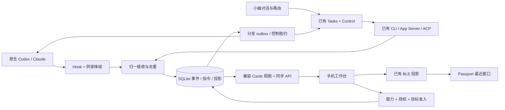
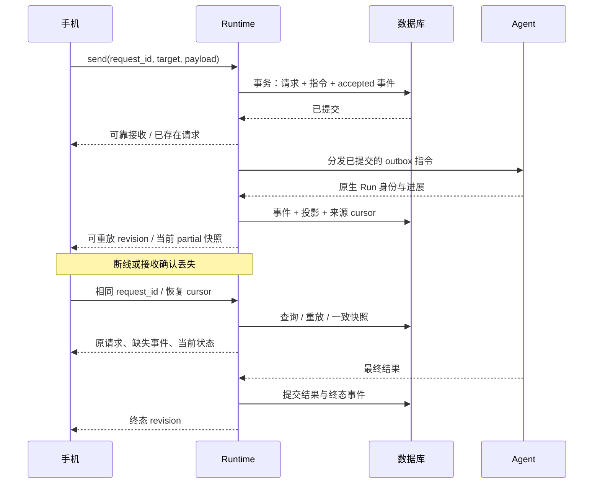

<p align="right">
  <strong>简体中文</strong> · <a href="xiaoyou-harness-review.md">English</a>
</p>

# 小幽本地 Harness 审查与渐进架构方案

审查日期：2026-10-16，Asia/Shanghai。状态：方案与隔离验证；尚未实施或部署业务改造。

## 结论与范围

先让主人现有的本地 harness 可靠可用：已经接收的请求能跨重启恢复，追加要求不会被悄悄丢掉，桌面观察状态可信，客户端断线后能够对齐。保留现有 Runtime、执行控制、权限桥接、Android 转发及 Passport BLE 通信。先修可靠性边界，再增加薄的内部接入层。公开 Agent SDK、插件市场、远程编排生态和 GUI 控制延后。

产品方向仍是统一接入小幽派发的工作，以及主人在原生 Agent 应用里开始的工作。观察、回答审批、恢复历史会话、给正在执行的一轮追加指令，是分别声明和验证的能力，不能互相推导。

已读取 Chat 模式里的「项目分析」。其中后续要求明确收敛到主人个人使用的本地接入层，以及 CLI／进程、原生 RPC、Hook／日志三条路径。该聊天中的 Brief 下载附件没有作为本地文件提供；本方案依据可见聊天和本次要求，不声称已经读取附件全文。

## 审查版本与证据边界

| 来源 | 核实的基线 | 含义 |
| --- | --- | --- |
| ai-passport GitHub | `feature/usage-history`，`e1f5238c781d784338f325ac289e0f140a0b3382` | GitHub 分支 API、仓库首页、本地 HEAD 一致。`main` 是上游硬件基线，不是当前 Runtime 开发线。 |
| ai-passport 本地工作区 | 相同 HEAD，叠加已有未提交的 Runtime、Android、文档和工具改动 | 单独审查本地源码；本次没有改写或回退这些既有改动。 |
| Coucou | `main`，`f09ac0b451128781b88b0f8a77f69bab622b9f24`，于 2026-10-16 核实 | 本地克隆为 `a95d309a4752c23ae28453819245339800557609`。GitHub 比较确认，到 `f09ac0b` 为止本文引用的 harness／phone-link 文件均未变化。 |
| 本地源码版本 | Runtime `0.6.1`；Android `0.14.0`、code `25` | 仅表示源码标签。手机和固件实际安装版本、Python 进程已经加载的源码版本未验证。 |
| Runtime 存在性 | 观察到 Python 在 `8765` 端口监听 | 只证明有监听服务，不能证明模型就绪、端到端正确，或进程加载了哪些未提交改动。 |

下文的本地行号指审查时的工作区。[证据清单](xiaoyou-harness-evidence.json)记录关键文件哈希，便于区分后续编辑。Coucou 链接固定到审查提交。本次没有重启 Runtime、向原生会话派工、安装 Hook、发布 App 或刷写设备。

主要来源：[ai-passport 活跃分支](https://github.com/yanyuliu01/ai-passport/tree/e1f5238c781d784338f325ac289e0f140a0b3382/runtime)、[Coucou 审查版本](https://github.com/Louis-CFM/coucou/tree/f09ac0b451128781b88b0f8a77f69bab622b9f24)、[Coucou 版本比较](https://github.com/Louis-CFM/coucou/compare/a95d309a4752c23ae28453819245339800557609...f09ac0b451128781b88b0f8a77f69bab622b9f24)。

## 已确认的代码问题

“已复现”表示在临时目录中使用真实类、关闭执行后的隔离探针结果，不等于确认某一次手机问题就是由它引起。

| 编号／优先级 | 问题与影响 | 代码证据／验证 |
| --- | --- | --- |
| R1／P0 | 已接收消息、client ID 去重和待执行队列只存在内存。重启后相同 ID 会生成新消息；丢失接收确认后重试，可能再次执行。会话／聊天 JSON 的持久化并不等于请求已可靠落盘。 | [service.py](../../runtime/xiaoyou_runtime/service.py)：`Service.__init__` L63-74、`_enqueue` L161-218、`_trim` L385-394。`Cards.__init__` L69-85 只把被中断的托管卡标失败，没有恢复已接收意图。**已复现**：进程内去重有效；重建 Service 后 ID 改变，已接收问题也未落盘。GitHub 与本地均存在。 |
| R2／P0 | 第九条排队的 `after` 追加要求被静默丢弃，`Tasks.amend` 仍返回 `after`。小幽可能告诉主人“已经追加”，实际上指令已经丢失。 | [tasks.py](../../runtime/xiaoyou_runtime/tasks.py)：`MAX_PENDING` L22；`amend` L122-125。**已复现**：9 次成功返回，队列只保留 8 条。GitHub HEAD 已存在；本地新增 `run_id` 和桌面交接没有修复它。 |
| R3／P1 | 去重键只有 `client_id`，未检查会话和请求内容。另一个会话复用 ID 会收到原会话消息，而非冲突错误。历史消息淘汰也会结束去重保护。 | `Service._enqueue` L164-165、`_trim` L393-394。**已复现**：B 会话用 A 的 ID，返回 A。手机正常生成 UUID，意外碰撞概率很低，但重试内容冲突仍属于 API 契约缺口。 |
| R4／P1 | 原生桌面卡明确拒绝续聊。目前功能是观察，加上可选的独立审批通道，并非普遍控制原生会话的实时执行。 | `Service._enqueue` L148-150；[RuntimeClient.java](../../companion/android/app/src/main/java/com/yanyuliu/pockethub/RuntimeClient.java)：`send` L584-586；`test_service_refuses_desktop_control`。这是已确认的能力缺口，不能当作网络故障处理。 |
| R5／P1 | 会话 `idle` 被投影为卡片 `done`，混用了“一轮回复结束”和“整个任务完成”。桌面专用标签已经写“本轮结束”，部分 UI 是准确的，但通用状态及其消费者仍可能过度解读。 | [desktop_sync.py](../../runtime/xiaoyou_runtime/desktop_sync.py)：`STATES` L38-41；Codex 完成处理 L292-296；Claude 结束处理 L331-354；`_publish` L512。**已复现**：idle 输出 done。 |
| R6／P1 | 新转录来源发现周期可达 10 秒；已有来源每 2 秒轮询；仅工具／进度变化最多延后到 10 秒发布。无法据此满足所有已提交变化 3 秒内传播的要求。 | `desktop_sync.py` L26-36、`_discover` L222-243、`_publish` L489-492。**已复现**：工具变化在 +1 秒被抑制，到 +10 秒发布。状态和消息变化绕过轻微变化限流，不能把所有延迟都归因于它。 |
| R7／P1 | Hook 为每个 Agent／Session 覆盖一个最新快照，不保存事件日志。一个轮询间隔内的多次转换可能被压缩。Feed 也提供最新卡片快照，不是完整生命周期事件。适合状态看板，但不足以支撑审批审计、准确 Run 生命周期和可重放控制。 | [desktop_hook.py](../../runtime/xiaoyou_runtime/desktop_hook.py)：`record` L142-148；[cards.py](../../runtime/xiaoyou_runtime/cards.py)：`_touch` L162-168、`changed` L320-345。转录适配器能补部分内容，无法补回任意遗漏的审批转换。 |
| R8／P1 | 桌面状态依赖特定版本的本地转录格式，只观察最近 32 个来源，300 秒无活动后变 unknown。安静的模型／工具与已经退出的进程可能难以区分。当前保守标 unknown 的策略应保留。 | `desktop_sync.py` L28-36、`_discover` L238-242、`_event` L245-354、`_publish` L469-471。代码局限已确认；主人遇到的状态错误具体由哪个格式差异或缺失 Hook 引起，尚未验证。 |
| R9／P1 | 消息内存 revision、卡片持久化 sequence、会话文件、聊天文件相互独立。卡片变化在条件锁内重写保留的卡片集合。没有事务共同覆盖接收、最终结果、请求身份和投递。 | `Service._report` L404-430；`Cards._touch` L162-168；[store.py](../../runtime/xiaoyou_runtime/store.py)：`_write` L27-31；`Xiaoyou._converse` L710。磁盘竞争与崩溃窗口存在，是否造成实际延迟仍需测量。 |
| R10／P1 | Android 在单一 worker 上串行发送，并在新消息提交前上传历史；该历史请求可等待 15 秒。Runtime 同会话也串行处理。上一轮缓慢、历史上传阻塞，都可能让下一条消息在到达模型前等待。 | `RuntimeClient.java` L36、L596-624；`Service._drain` L432-445。未提交版本 L595 已有本地乐观消息。串行化承担正确性职责，不能直接删掉而破坏同会话顺序。 |
| R11／P1 | 首段正文没有统一的 3 秒验收计时器。普通聊天可使用 60 秒，结构化计划错误后会再次调用模型，fallback 也可能增加尝试。本地修改改善总时限和 SSE，但不能证明端到端 TTFT 达标。 | [agents.py](../../runtime/xiaoyou_runtime/agents.py)：`DshAgent.run` L965-988；[dsh_stream.py](../../runtime/xiaoyou_runtime/dsh_stream.py) L140-207；[xiaoyou.py](../../runtime/xiaoyou_runtime/xiaoyou.py)：`_converse` L638-645、`_speak` L804-814。无输入／仅心跳流的总时限修复目前在本地未提交改动中。 |

当前本地 DSH 配置可正常解析：`deepseek` 使用 `dsh`、启用流式、模型为 `deepseek-v4-pro`，聊天超时 60 秒。`cc` 和 `tailor` 解析后的 AgentSpec 没有显式模型。历史上 `claude-opus-5-5` 的失败只证明当时那些运行失败，不能证明当前仍选了它，或该模型普遍不可用。实际生效的模型、provider、配置来源和账号可用性，应由有界预检及真实冒烟确认。本次未修改模型或凭据。

### 值得保留的现有机制

- `Agent.run(Job)`、`Outcome`、`Control`、watchdog、进程树取消、任务独立会话、`after`／`redo`／原生 steer、后台结果转述，已经提供大量成熟 harness 能力。
- [codex_app.py](../../runtime/xiaoyou_runtime/codex_app.py) L306-363 已支持 Runtime 托管线程恢复、带 `expectedTurnId` 的 `turn/steer`、中断一轮。这些执行控制值得保留，但不能推导为可控制另一个桌面进程。
- [dsh_app.py](../../runtime/xiaoyou_runtime/dsh_app.py) L192-214、L245-285 已实现 ACP 握手、resume／new、prompt、cancel。L254 对任意 `AgentError` 都会从 resume 回退新会话；承诺上下文连续性前，应区分“不支持／不存在”与临时故障。
- 桌面审批已有 request／session／turn／tool 身份、操作指纹、过期、进程存活、心跳及授权范围检查：[desktop_approvals.py](../../runtime/xiaoyou_runtime/desktop_approvals.py) L97-137、L289-298。应扩展这个边界。
- Feed 使用条件变量唤醒，long poll 的最大等待时间不等于固有延迟。48 KiB 是分页预算，单个超大卡片可超过预算。保留 `more`、游标及老客户端行为。
- Android 已有 feed 来源 epoch、旧卡 sequence 拒绝、游标倒退重置：`RuntimeClient.fetchFeed` L215-245、`HubStore.applyFeed` L427-455。本地 SSE／重试修改应补集成验证，避免再重写一套传输层。
- 完成会话导出到桌面属于本地未提交的 `desktop_handoff.py`。它明确只导出完成转录；导出／打开成功不代表已经附着原生实时会话。

## Coucou：复用机制与局限

以下是源码比较，不代表某个已安装 Coucou 版本的真机结果。

| 机制 | 证据 | 对小幽的判断 |
| --- | --- | --- |
| Hook 归一与快速本地 IPC | [HookServer.swift](https://github.com/Louis-CFM/coucou/blob/f09ac0b451128781b88b0f8a77f69bab622b9f24/NotchBuddy/Sources/App/HookServer.swift#L287) L287-400：仅属主可访问的 Unix socket、同 UID 检查、连接／载荷限制、事件分发；L511-655 归一 prompt／tool／stop／interrupt。 | 借鉴语义 Hook 优先、日志作为降级与补偿。其 socket ACK 早于主 actor 更新，不能视为事件已经持久化。 |
| 保留用户配置的 Hook 安装 | `HookServer.swift` L1964-2032 预览合并配置，写入前比较指纹，保留其他 Hook。 | 后续获得安装授权时使用预览、备份、写前比较、仅卸载小幽条目。配置了 Hook 仍需验证当前 CLI 版本是否实际发送事件。 |
| 一个视觉分组下的多个会话 | [PillSessionRegistry.swift](https://github.com/Louis-CFM/coucou/blob/f09ac0b451128781b88b0f8a77f69bab622b9f24/NotchBuddy/Sources/App/PillSessionRegistry.swift#L5) L5-27、L98-138：一个会话结束不清除还在运行的兄弟会话；最早会话保持显示所有权。其独立测试本地通过。 | 借鉴并行生命周期测试与稳定焦点；数据层仍保留每个 Session／Run。应用分组只是视图，不能作为规范任务身份。静默清理只是启发式，不能证明完成。 |
| iPhone 快照 | [SessionPublisher.swift](https://github.com/Louis-CFM/coucou/blob/f09ac0b451128781b88b0f8a77f69bab622b9f24/NotchBuddy/Sources/App/PhoneLink/SessionPublisher.swift#L54) L54-83：变化驱动、500ms debounce、只保留最新待发快照；L217-245 按 pill 建记录并声明可接指令。 | 借鉴轻量投影和能力 UI；pill 记录无法表达每个并行原生会话。连续变化下的 debounce 和 CloudKit 延迟需测量，不能直接承诺 3 秒。 |
| 审批身份 | [ApprovalRelay.swift](https://github.com/Louis-CFM/coucou/blob/f09ac0b451128781b88b0f8a77f69bab622b9f24/NotchBuddy/Sources/App/PhoneLink/ApprovalRelay.swift#L33) L33-37、L59-79：准确操作指纹和有界轮询；Windows [hub.rs](https://github.com/Louis-CFM/coucou/blob/f09ac0b451128781b88b0f8a77f69bab622b9f24/windows/src-tauri/src/phone_link/hub.rs#L631) L631-661 拒绝过期／错配决定，并禁止允许被截断命令。 | 借鉴迟到决定测试与过期交互；保留小幽已有更细的请求身份和来源绑定。无法充分查看操作时，不提供允许按钮。 |
| 手机接续 | [InstructionRunner.swift](https://github.com/Louis-CFM/coucou/blob/f09ac0b451128781b88b0f8a77f69bab622b9f24/NotchBuddy/Sources/App/PhoneLink/InstructionRunner.swift#L85) L85-145 先删云端指令再处理，并启动 `claude -p --resume`；[TurnRecorder.swift](https://github.com/Louis-CFM/coucou/blob/f09ac0b451128781b88b0f8a77f69bab622b9f24/NotchBuddy/Sources/App/PhoneLink/TurnRecorder.swift#L31) L31-37、L58-71 按 pill 记最近出现的会话。 | 不照搬执行契约。删除后崩溃可能丢意图；忽略删除失败加上重启，缺乏持久去重；“运行中”检查只覆盖自己启动的进程。同 pill 并发时，手机显示与执行之间目标会话可能变化。这些失败窗口可由代码确认，真实复现待做。 |
| Android 网络中继 | [room.ts](https://github.com/Louis-CFM/coucou/blob/f09ac0b451128781b88b0f8a77f69bab622b9f24/android/relay/src/room.ts#L1) L1-5、L93-98 明确不保存帧历史，另一端离线就丢帧。Windows phone-link 另有配对、接入、加密、快照、审批、聊天模块。 | 可借鉴传输与安全边界分离。无状态加密中继可配合端点持久化，但本身不提供事件重放。不能说 Coucou 所有手机路径都只用 CloudKit，也不能把传输安全等同于任务恢复可靠。 |

Coucou 更值得借鉴的是桌面活动与待处理事项界面。小幽已经具备更广的托管执行与设备通信能力；没有证据表明替换 Runtime 能解决请求持久化或首回复问题。

## 目标模型与状态规则

| 实体 | 身份与职责 |
| --- | --- |
| Task | 主人的稳定目标，可跨 Agent、Session、Run 和产物；现有 card ID 保留为兼容视图 ID。一轮结束不自动完成目标。 |
| Session | 某个原生来源的上下文容器：`(host_id, connector_instance_id, native_session_id)`。记录项目、来源、所有权、可见范围、能力与当前控制方。 |
| Run | 一次执行尝试／一轮：本地 UUID，加可选原生 turn ID；关联 Task、Session、请求、attempt、父 Run、实际模型／provider。重试新建 attempt，不覆盖上一次结果。 |
| Message | 稳定 ID、conversation、run、author、scope、revision，以及明确的 snapshot／delta 格式。手机乐观消息按请求身份合并；相同文字仍可属于不同消息。 |
| Event | 不可变的归一事实，带持久接收序号、来源身份和顺序、证据来源、实体版本、载荷及观察质量。 |
| Command | 持久化的动作请求，含唯一 ID、内容哈希、目标 Session／Run、授权、过期时间、期望版本、分发及结果状态。 |
| Approval | 某 Run 内的准确操作：request ID／nonce、tool／input 指纹、来源、过期、撤回及决定。旧决定不能批准下一次相同命令。 |

分开记录以下状态维度：

- Run：`queued`、`starting`、`running`、`waiting_approval`、`waiting_input`、`succeeded`、`failed`、`cancelled`、`interrupted`；网络或额度等待另带原因。
- 观察健康度：`fresh`、`stale`、`unavailable`、`unsupported`，保留最后已知 Run 状态。没有心跳不能判成功或失败。
- Session 生命周期：available、active、disconnected、archived；idle 只表示没有已知活跃轮次。
- Task：open、active、needs attention、resolved、cancelled；完成由明确策略或主人确认决定。
- 投递：local pending、durably accepted、dispatched、streaming、terminal、acceptance unknown。

同一 Run 的原生协议事件、真实决策通道，比日志推断优先。先比较原生 turn ID 与 Run revision，再看时间戳。旧终态不能关闭新 Run；来源时间可能偏移。保留原始状态、归一状态、原因和可信度。遇到未知上游事件，保持最后已知状态、降低观察可信度并提供诊断。



最后一条指向原生应用的控制路径，只在有经过测试且获准的原生控制通道时成立；观察不能激活控制。PC 继续使用原生应用；手机工作台及未来的薄 PC 状态界面共享投影，避免重复实现编排器。

## 可靠记录与同步契约

先用一个本地 SQLite WAL 数据库，不需要消息中间件。增量增加 requests、commands／outbox、events、runs、source cursors、approvals、projection checkpoints 表。接收事务写入请求和幂等记录后才返回可靠接收确认；终态事务写入最终结果、投影和待发事件后才广播完成。使用单 writer 或短事务，不在模型、ASR、CLI 启动、网络 I/O 期间持数据库锁。

幂等作用域包含认证客户端、Runtime 和 conversation。兼容旧 `client_id`，保存规范请求内容哈希；相同内容返回原结果，不同内容返回 `409 idempotency_conflict`。可见卡片／历史淘汰后仍保留紧凑去重 tombstone，并说明重试保护期限。

本地数据库无法独自保证外部副作用 exactly-once。分发后、结果写回前崩溃，应优先查询原生 Run／Command；查不到则标为 `interrupted` 或 `acceptance_unknown`，提供明确恢复选择。之前是否接收无法确定时，不自动重跑有写权限的 Agent。用带 generation fencing 的控制租约防止竞争启动；租约不能强行夺取原生应用当前所有权。

以下为**拟议新增**事件信封：

```json
{
  "schema": 1,
  "runtime_id": "rt-example",
  "store_epoch": "db-example",
  "seq": 1052,
  "event_id": "evt-example",
  "source": {"host_id": "host-example", "connector": "codex-local", "event_id": "native-event-or-offset"},
  "task_id": "task-example",
  "session_id": "session-example",
  "run_id": "run-example",
  "request_id": "req-example",
  "entity_revision": 7,
  "type": "message.snapshot",
  "payload": {"message_id": "msg-example", "text": "Example", "final": false}
}
```

Hook 来源分配接收 UUID 并保留来源／Run 身份。缺少 ID 的转录使用文件 generation／inode、字节 offset、记录摘要，并处理复制前缀、截断；禁止仅按文字去重。事件提交后才确认接收；来源 cursor 与事件同事务保存。

在现有 `/v1/feed`、消息轮询、SSE 旁，增量增加能力协商的 `/v1/sync`、`/v1/events` 语义；名称目前是提案：

- 快照在同一个数据库读快照中返回投影和高水位 `(runtime_id, store_epoch, seq)`，从该 cursor 订阅，消除快照与实时流之间的丢失窗口。
- 事件在一个 Runtime store 内有序；实体 revision 防止旧 partial 覆盖 final，不伪造独立主机之间的全局顺序。
- cursor 低于保留水位、store epoch 改变、来源不匹配，返回 `reset_required` 和新快照路径。普通进程重启保持 epoch／sequence；替换或恢复数据库应改变 epoch。
- 客户端把状态与 cursor 原子保存。解析／应用失败不推进游标。未知必需 schema 要求升级或对账，可选字段可忽略。
- 删除及可见性变化输出 tombstone；分页固定高水位边界。背压可合并被替代的进度快照，不能丢指令、审批、终态事实或已接收消息。
- 状态／审批／终态保持小而及时；转录、旧历史、产物正文单独获取。分页有界，明确历史回填状态，保留压缩与有界传输。
- 现有 `partial` 是全文替换，空串表示撤回；只有显式协商后才引入 append delta，保留老端语义。
- 先让来源 epoch 检查与 `HubStore` 应用 feed 成为同一原子动作；现有“先检查再应用”仍需来源切换竞态测试。

Passport 保持有界投影：当前选择、待处理状态、最近文字、截断与连接新鲜度。固件目前只有 12 张卡、小共享文本池及短 ID（`buddy_types.h` L32-34、L319-343）。规范 UUID 在 Runtime／手机映射为稳定旧 ID，不能直接写入 12 字节字段。后续协商固件扩展再加入来源／generation／revision。`buddy_cards.h` L169 的 `buddy_cards_put` 不检查旧版本，所以要验证转发顺序和全量恢复；这并不证明当前 BLE 已经发生应用消息乱序。



## 内部 Connector 契约，公开 SDK 延后

包装已有实现，不要求每个 Agent 重做编排。首版内部接口需要 `probe`、`discover_sessions`、`subscribe`、`start`、`resume`、`steer`、`cancel`、`decide`、`reconcile`。不支持的操作返回类型化 `unsupported`；网络、认证、模型不可用、临时故障分别表达。指令带 ID 和目标前置条件，事件声明来源与 schema。

| 等级 | 实际操作 | 初始边界 |
| --- | --- | --- |
| L1 观察 | 发现／读取获准会话，生命周期／工具／结果事件 | 原生桌面 Hook／日志；不从观察推导写权限或审批权 |
| L2 交互 | 经验证的 resume、live steer、interrupt、decide、open-native 子集 | 每个 Session／Run 单独声明。可回答审批并不代表可续聊。 |
| L3 托管 | 启动工作、绑定受控会话、保留策略、协调结果 | 已有 Runtime 托管 Codex／Claude／DSH，不代表能管理该 Agent 的所有原生会话 |

能力示例，**不是当前配置语法**：

```json
{
  "id": "codex-local",
  "adapter": "existing_codex_app_server",
  "protocol_version": 1,
  "capabilities": {
    "observe_sessions": true,
    "start_task": true,
    "resume_session": true,
    "steer_owned_run": true,
    "attach_external_live_run": false,
    "approve_owned_run": true
  }
}
```

有效能力 = Adapter 声明 ∩ 已安装版本探测 ∩ 会话所有权 ∩ 主人授权 ∩ 当前连接／控制 generation。昂贵探测放在聊天关键路径外缓存。安装／版本存在、协议就绪、认证、模型可用、实时会话可控，是分别报告的结果。

自动发现限于本地且有界：配置的可执行文件／PATH、明确授权的转录目录、配置的本地 RPC。展示候选及所需授权。后续安装 Hook 时合并配置、备份、写前比较，不静默改全局设置。`connector check`／`connector add` 只是拟议命令。新通用 CLI 理想上只需配置和一致性 fixture；新协议仍需适配代码。

先验证三条路径：Runtime 托管 Codex 原生 RPC；原生 Claude Hook 观察加现有审批桥；通过 `CommandAgent` 接入一个第三方 CLI fixture。之后确认真实新增 Agent 实际接口再接入，不根据名称假设支持 ACP、Hook 或活跃会话控制。

## 产品交互

- **全局工作台**：稳定的项目／任务列表，待处理、运行中、历史分开筛选，显示来源主机、Agent、所有权、模型、最近观察时间。按 Agent 分组作为可选视图；新活动增加角标，不抢当前任务和滚动位置。
- **任务详情**：目标、参与会话、执行尝试、进展、消息、审批、产物、最终结果。“本轮结束”和“任务已完成”分开；展示总结时，原始长结果仍作为产物保留。
- **手机接续**：动作绑定当前显示的 Session／Run ID 与 revision。验证 resume 后才显示“继续这个会话”；真实 live steer 才显示“运行中追加”。只读观察会话提供打开原生应用，或明确新建关联任务；复制上下文到新会话时要说明。
- **审批**：显示主机、项目、Agent、准确操作、请求时长和过期。提交后显示“决定已发送”，源端确认后才算生效。过期、撤回、错配、无法充分展示的操作不能变成允许。手机控制不可用时保留原生回退。
- **并行工作**：Session／Run 独立，明确排队及容量状态；追加队列满时可见拒绝。取消、修改只作用于选中 Run；保留同会话顺序，其他任务可独立推进。
- **连接**：传输就绪、feed 新鲜度、模型就绪分别显示。离线消息保留请求 ID；接收未知时先对账再重发，旧回调由来源 generation 隔离。
- **Passport**：近期任务／审批及简短可信状态，完整转录在手机查看；保留配对、语音、更新和恢复。

## 最小验证实验

### 已执行

[审查探针](../../tools/experiments/harness_reliability_probe.py)使用临时状态、真实 `Service`／`Tasks`／`Cards`／`DesktopSync`，并关闭分发，不调用模型、socket、设备或原生会话。它验证实现行为，不是端到端故障复盘。

| 探针 | 结果 | 结论 |
| --- | --- | --- |
| 一个 Service 中重复提交 | 相同消息 ID | 原有进程内去重有效 |
| 重建 Service 后重复提交 | 新消息 ID，已接收文字未落盘 | R1 已复现 |
| 不同 conversation 使用相同 ID | 返回原会话 | R3 已复现 |
| 9 条 `after` | 9 次接受，8 条保留 | R2 已复现 |
| 桌面 idle 投影 | `done` | R5 已复现 |
| 工具更新 +1s／+10s | 抑制／发布 | R6 已复现 |

Runtime 桌面相关测试 **97 项通过**。Coucou `PillSessionRegistry` 独立可执行测试已编译，全部断言通过。首次完整 Runtime 测试在沙箱中执行 **432 项**，报告 **8 failures、32 errors**。32 个 error 均含本地 socket 绑定、进程检查或其他受限操作的 `PermissionError`。8 个 failure 等待审批／进度出现。随后同一完整测试在沙箱外重跑，**432 项全部通过，耗时 57.533 秒**，此前失败没有复现。适当环境下现有测试通过，但隔离探针仍复现 R1／R2／R3／R5／R6，说明这些边界需要增加回归覆盖。仓库文档检查通过；此前完整静态门禁在受沙箱限制的 Runtime 测试处停止，且未配置 IDF_PATH，跳过了依赖 cJSON 的检查。

### 实施更大架构前的有界实验

| 编号 | 操作与测量 | 通过标准／决策 |
| --- | --- | --- |
| E0 安装态 harness 就绪 | 记录脱敏版本、DSH／Claude／Codex 实际模型来源；先不调用模型地握手，再在隔离目录对获准 Agent 做极小只读真实提示。不可静默换模型。 | 协议、认证、模型、流式、取消分别报告；失败助手明确不可用，避免重复派发。本文真实模型冒烟尚未执行。 |
| E1 可靠接收 | 在提交前、提交后 ACK 前、分发后、partial 中、终态提交前后注入故障，只重启隔离测试 Runtime；相同 ID 重试，并测试一次内容变化。 | 一个可靠接收请求，冲突拒绝；接收确定时不重复分发；副作用结果未知时明确展示。 |
| E2 原生观察 | 同 Agent 两个原生 Session、两个项目，测试 prompt／tool／approval／end／cancel；丢 Hook、重复、迟到旧终态、日志轮换／截断、上游格式 fixture。 | Session／Run 独立；有证据才报精确等待；观察过期不宣称成功；不关闭兄弟任务。 |
| E3 手机接续 | 托管运行中 steer＋期望 turn；完成会话 resume；只读原生活跃会话返回 unsupported。两个控制方竞争，ACK 前手机切换任务。 | 不可变目标正确、一个控制方、不把新进程冒充实时接管。 |
| E4 断线重放 | 两个手机客户端加一个离线回归端；丢接收 ACK、中途断流、重启隔离 Runtime、游标过期、final 后到旧快照、相同文字重复发送、空 partial 撤回、应用时切换来源。 | 每身份一条消息，新版本优先，已接收意图不丢，应用前不推进 cursor；认证就绪后 3 秒内对齐当前状态。 |
| E5 排队与负载 | 填满同会话及其他会话工作、排 9 条追加、工具高频变化、大回复／历史／产物、慢模型时审批。 | 满队列明确拒绝或保留；取消、审批、feed 可用；任务／来源不串线。 |
| E6 真实计时 | 客户端单调时钟从发送／松开录音到有意义正文上屏；记录阶段与 request ID，不记隐私正文。覆盖冷／热、文字／手机语音／设备语音、直连／远程、长历史、慢 provider。 | 受影响每路径至少 20 次热发送，适用故障／转换各 3 次；每个成功样本 TTFT ≤3000ms，报告 p50／p95／max 与所有超时。失败 3 秒内真实反馈，但仍算 TTFT 未达标。 |
| E7 混合版本与设备 | 老 App／新 Runtime、新 App／老 Runtime、当前固件；BLE 重连、手机回前台、Runtime 睡眠唤醒；配对、语音、App／固件更新中断及恢复。 | 保留支持的旧链路；新能力协商降级准确；安装和设备上屏另行验收。 |

当前可用命令：

```bash
python3 tools/experiments/harness_reliability_probe.py
python3 -m unittest discover -s runtime/tests -p 'test_desktop_*.py'
cd runtime
python3 -m unittest discover -s tests
```

性能验收遵循[三端可靠性契约](../development/cross-stack-reliability.zh_CN.md)。设计预算：载荷接收后本地接收确认 p95 ≤100ms；本地事件提交到发布 p95 ≤200ms；已安装 Hook 事件后的发现 ≤500ms；在线已提交状态／审批／消息传播及当前状态恢复 ≤3000ms。这些是拟议目标，尚未测得。TTFT 包含网络、队列、上下文、ASR、fallback 和渲染；更快的 HTTP ACK 不能算通过。单独测 provider 首正文，才能判断实际瓶颈在模型还是编排。

## 渐进 PR 计划与退出门槛

以下模块只在对应 PR 确实需要时创建：

| 拟议文件／既有边界 | 职责与验证 |
| --- | --- |
| `runtime/xiaoyou_runtime/journal.py` ＋ `store.py` | SQLite 事务、schema 版本、请求内容哈希、outbox、来源 checkpoint；重启／崩溃／幂等测试。`client_instance_id` 与用于标识请求的旧 `client_id` 分开。 |
| `runtime/xiaoyou_runtime/events.py` | 事件校验、每 Run reducer；重复、旧版本、终态、未知来源事件 fixture，不放执行逻辑。 |
| `runtime/xiaoyou_runtime/connectors.py` | 内部能力注册表，包装 `agents.py`、`codex_app.py`、`dsh_app.py` 和桌面适配器；分发前拒绝不支持的操作。 |
| `service.py`／`server.py` | 接收、冲突查询、增量同步协商；现有路由保留为兼容投影。 |
| Android `RuntimeClient`／`HubStore`／`ChatHistory` | 可靠待发请求、原子来源 generation 检查、身份／revision 合并、客户端上屏计时、按能力显示动作。 |
| `main/buddy_*` 与手机 BLE 投影 | 初期保留线协议；之后协商有界来源／revision 扩展，配套 host 互通及设备验收。 |

| 顺序 | 模块与有界改动 | 必须提供的证据 |
| --- | --- | --- |
| PR0／P0 | `__main__.py`、Agent probe、`service.py`、Android 增加就绪诊断和计时；脱敏报告模型／版本／来源。立即修 `tasks.py` 队列溢出反馈。 | R2 回归：第九条必须保留或可见拒绝；分类当前助手失败；E0／E5 基线。无需 SDK。 |
| PR1／P0 | 小型可靠请求／指令账本，在 `service.py`／`store.py` 实现事务接收与幂等；初期保留 JSON 投影。增加内容冲突及重试查询契约。 | E1 崩溃矩阵、R1／R3 回归，不自动重复副作用；旧接口保留。 |
| PR2／P1 | 在现有 `Control` 回调和桌面接收外围增加 Session／Run 身份、归一事件、事件日志、来源 cursor、观察质量。 | E2、旧终态／新 Run／兄弟会话测试；idle 不等于任务完成；无隐私回归。 |
| PR3／P1 | 一致快照、cursor replay、保留／reset／tombstone；轻量状态事件；Android 来源 generation 原子应用及待发请求恢复。 | E4／E5、新旧接口兼容、传播／恢复计时；保留 long poll／SSE 回退。 |
| PR4／P1 | 在已有适配器外围加能力位和本地注册表、有界 discover／check、fixture CLI 一致性验证；确认版本后再补语义 Hook。 | E0／E2／E3；第三方 fixture 不改路由或手机领域逻辑。Hook 安装作为独立显式操作。 |
| PR5／P1 | 工作台任务／会话详情、待处理 UI、稳定选择、绑定目标的审批／接续；之后可选 Passport 能力扩展。 | E3／E6／E7，安装和上屏证据，旧设备 ID 别名兼容。 |
| PR6／P2 | 三个真实 Connector 证明共性稳定之后，再考虑更多接入、跨主机路由或公开 SDK。 | 内部契约确有价值；主人本地使用无需先建设生态。 |

PR0 队列修复可以独立落地；PR1／PR2 保持小步迁移。先用功能开关和影子投影比对，再切权威读源。避免两套权威库：每阶段明确谁拥有数据及迁移校验。保存旧状态，事务化／幂等导入，记录迁移版本；旧二进制不能写不兼容新 schema。切换前可恢复旧状态；新库已有写入后，回退要用兼容二进制或明确导出迁移，不能悄悄丢事件。本方案不授权重启现用 Runtime。

每个 PR 都要保留记忆、prompt、审批、取消、后台结果、产物投递、语音、配对和更新。执行受影响及相邻 host／集成测试；Android 改动做测试／构建；仓库静态检查后，实施交付再跑已激活 ESP-IDF 的完整门禁。App 发布及刷写授权继续按仓库指南执行。

## 本次审查交付状态

Build: NOT RUN — 本次没有业务实现或候选包构建。

Host tests: PASS — 沙箱外 Runtime 432／432、桌面子集 97／97、审查基线探针及 Coucou registry 断言通过。这不等于完整固件／静态门禁通过；首次沙箱执行受环境权限与缺失 IDF_PATH 限制。

Device tests: NOT RUN。

回归／首回复 ≤3 秒／连接恢复／多端同步：已安装客户端上均 NOT RUN。源码隔离行为和模拟测试不能认证这些要求。

Unverified：助手实际模型可用性、运行进程版本、手机／固件安装身份、真实上屏延迟、原生实时会话附着、真实审批往返、BLE／远程网络对齐、已激活 ESP-IDF 的完整门禁。本文交付设计和可复现探针，不声称架构已经实现。
