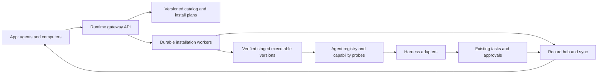
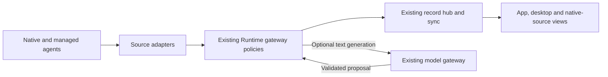

<a href="agent-gateway.zh_CN.md">简体中文</a> · <strong>English</strong>

# Agent gateway proposal

Status: design proposal, 2026-10-19. This document does not describe a shipped
installer or grant permission to install a CLI. The present increment implements
public helper activity in the existing record/sync path; installation management
is a later increment.

## Session continuation gateway (0.26.0 source)

Runtime 0.26.0 adds one session gateway inside each existing peer Runtime.
Xiaoyu's `find_sessions` / `continue_session` tools and authenticated
`GET /v1/sessions` / `POST /v1/sessions/<target>/continue` use the same selection
and dispatch boundary. This is source implementation status, not deployment or
native-window acceptance evidence. There is no additional daemon, transcript
store, or dispatch journal: shared-directory metadata, Cards, Record effects,
request idempotency, mesh and adapter protocols remain authoritative.

Search is bounded to 20 results, projects only session metadata, and includes
owner-visible native sources alongside the current conversation's managed tasks.
It does not expose another side chat's ordinary task content. Ambiguous matches
require an explicit target. A continuation requires a client request identity;
retries preserve the selected target and use the existing durable request and
effect records. The desktop encrypted relay validates this optional API and
keeps the same receipt across transport retries. Existing `/v1/messages` clients
remain compatible; relay hosts need the updated allowlist for the new endpoints.

All configured execution engines use this gateway for managed-task follow-up,
including Codex, Claude Code, DSH, Pi, command, echo and remote agents. Native
resume is a separate adapter capability: Codex, Claude Code, DSH and Pi advertise
it; command and echo do not. Native-source discovery currently imports Codex and
Claude Code. Advertising resume does not imply external discovery or GUI refresh
support for every harness. Remote tasks return through their existing mesh
binding; a directory-only remote source without that binding is unavailable and
must not silently become a local task.

A native continuation retains the observed session ID, working directory and
source-home scope. When the configured worker uses an isolated home, Codex and
Claude may bind to the verified discovery home without editing global settings
or copying transcripts. Conflicting explicit provider-routing settings, unknown
homes, unavailable sources and changed recovery bindings fail before dispatch.
Legacy records without a scope retain the configured adapter and cannot rebind.
An active or approval-blocked native source, or an existing active continuation,
blocks a second writer. A new Runtime execution record links to the original
native session; it is not a replacement native conversation. Returned native
session identity is checked before executing the resumed turn.

Delivery distinguishes submission, session binding, actual turn start,
approval waiting and unknown acceptance. Native idle means the turn ended,
not that the owner's overall task is complete. Recovery revalidates the original
binding before checking the existing dispatch fingerprint. Unsupported steering
or unavailable bindings produce an explicit failure instead of a new session.
Borrowed DSH sessions disable the legacy create-on-resume-error fallback and use
the original working directory. Borrowed Pi sessions require a unique existing
header with the exact ID and directory, then use `--session <path>`; they never
use the create-if-missing `--session-id` path. This follows the
[Pi session-selection implementation](https://github.com/badlogic/pi-mono/blob/main/packages/coding-agent/src/main.ts).

Automated coverage includes gateway selection, adapter capability boundaries,
original-home binding, request/effect replay, source identity, HTTP authorization
and encrypted-relay retry deduplication. Real native desktop rendering, phone
end-to-end delivery, first response within three seconds and live reconnect
acceptance still require testing with the deployed versions.

## Validation and local rollout, 2026-10-29

The candidate is based on `7575c61` plus these uncommitted gateway changes and
the deployed 0.25.0 speech-deadline fixes. Newer character-rule injection is
retained. Runtime 0.26.0 was deployed on the owner's Mac only after confirming no
local managed task or message was active. The original Runtime/subject identities
and configuration/state paths were retained. Read-only live queries found the
original Codex and Claude sources; a working Codex source was explicitly reported
as unavailable for a second writer. No test message was sent into an owner-native
conversation. Other computers and the installed desktop host were not upgraded.
The host source includes the optional relay allowlist; existing chat messages use
the gateway through Runtime without requiring that host upgrade.

| Check | Result and evidence |
| --- | --- |
| Build | PASS: desktop TypeScript/UI, Mac ARM64 frozen Runtime 0.26.0, complete `tools/validate.sh` firmware build and merged-image verification |
| Host tests | PASS: final Runtime suite 1,210; gateway/merge regression 60; desktop suite 122 using a frozen bundle; final staged-binary dual-Runtime interoperability |
| Regression | PASS for tested managed-task/selection, original source binding, capability boundaries, authorization, effect recovery and idempotent retry paths; existing live speech-deadline fixes preserved |
| First response <= 3s | NOT RUN on phone/native UI with a real model; echo/API acknowledgement is not TTFT evidence |
| Connection recovery | PASS in isolated dual-Runtime encrypted relay tests; deployed phone/native disconnect recovery NOT RUN |
| Multi-end synchronization | PASS for isolated API/relay records and source-bound routing; original native-window rendering and real phone delivery NOT RUN |
| Device tests | NOT RUN; no Android or firmware change/install/flash in this increment |
| Unverified | Real Codex/Claude/DSH/Pi execution and native-window refresh, all remote computers, phone rendering/TTFT/reconnect; installed App/firmware versions were not remeasured |

Final frozen source SHA-256:
`8577ef11ff5c5a899ec03fe2e59cedaa626171da6427365d49a87c3859e5cfa5`.
The final staged HTTP probe passed capability discovery, authorized search,
same-task continuation and durable retry. Its first process startup took 8.161 s.
Fresh-bundle interop attempts exceeded the unchanged 8-second startup fixture
limit; the full frozen desktop suite passed serially, and the final staged binary
passed the unchanged focused interop test after initialization. This remains a
startup limitation, not a three-second response pass.

During preservation of live fixes, regression tests caught omitted character-rule
injection; this was corrected before rollout. A concurrent directory-deletion
fixture also timed out; its focused rerun and the final complete Runtime suite
passed without deadline changes. Failed runs are retained locally alongside the
passing logs under `/private/tmp/session-gateway-*`.

The previous package is retained at
`companion/desktop/runtime-dist.before-gateway-0.26.0` in the local deployment
snapshot, with the previous source beside it. Rollback requires the same idle
check (or owner approval to interrupt), a graceful stop, restoring that package,
and restarting with the unchanged configuration. No credentials, history, pairing
or settings are cleared. No commit or push was made.

## Product boundary

The phone should let the owner choose a computer, discover agents, install a
supported CLI/harness, authenticate, inspect capabilities, and enable it for
Xiaoyu. The computer runs the executable; Android remains the control surface.
Each Runtime is a peer gateway, with its existing pairing, mesh,
approval, record, task, and sync services. A separate service or another model
loop is unnecessary for the first version.

Keep these concepts separate:

| Concept | Responsibility |
| --- | --- |
| Provider/model | Inference endpoint, credentials, models and usage |
| Harness/CLI | Tool loop, process and session protocol |
| Adapter | Translate one harness into Runtime capabilities and events |
| Gateway | Catalog, installation lifecycle, routing, permissions and audit |
| Agent instance | Named adapter, executable version, computer, workspace and model settings |

A new model behind an existing harness should not require another installation.
Installing a harness must not silently select a paid model or change existing
agents. New defaults follow the owner's non-Astra preference.

Follow commits `0402625`, `7372e1a`, `08d2b3c`, and `a71a8f2`: there is no home computer or
central coordinator. An explicit software installation targets a computer; the
logical agent and its desired configuration can have deployments on several
peers. All peers retain the shared nonsecret registry and operation checkpoints.
Scheduling uses actual host capabilities and a fenced operation lease. Losing
the lease stops side effects; a peer reconciles the last durable stage before
taking over. A native CLI session may require a fresh process with shared task
context; do not claim transparent live migration of unsupported native sessions.

This is an advanced connection/settings page requested by the owner. Ordinary
chat still addresses Xiaoyu; it does not gain a model/helper/effort picker.

## Existing foundations and gaps

`runtime/xiaoyu_runtime/helpers/agents.py` exposes `Agent`, `Job`, `Outcome`, and
`Control`; `config.py` defines `AgentSpec`. Current transports include Claude
stream JSON, Codex app-server, DeepSeek ACP, plain commands and remote Runtime.
`tasks.py` owns cancellation/steering; `record.py` owns record writes;
`approvals.py` owns approval handling; `identity.py` advertises capabilities.
`mesh.py` already gives computers distinct identities and forwards work.

Discovery/configuration currently expects installed executables and startup
configuration. There is no catalog, durable installation job, atomic executable
activation, or App installation page. A text-only command cannot promise tool
audit, steering, usage, or remote approval. Capabilities must express these gaps
instead of making every adapter look equally capable.

`model_gateway.py` now owns provider/model registration, routing, budget and
usage for direct inference; `binding_env(provider)` prepares harness environment
variables. Reuse that registry by provider reference, not a second endpoint/key
database. Binding environment variables alone does not enforce budgets for a
CLI's own requests: network activation requires the shared policy/accounting
boundary and native usage reconciliation. Keep network inference disabled until
that path is explicitly enabled and validated. The existing `iterate/` plugins
consume quality metadata; no second optimization loop is needed.

Commit `a71a8f2` adds the `events_v1` envelope/type registry, `/v1/events`,
mesh event replication, iteration-stage capability discovery and iteration
leases. Extend those contracts for gateway metadata rather than creating a
second collector. The existing iteration lease is not an installation fence:
its local fallback permits work when the Runtime is unreachable. Installation
and activation need operation-specific fencing that fails closed before side
effects; disconnected peers must not both activate the same shared operation.

## Proposed components

The registry exposes discovery, probe, launch, resume, steer, cancel and close.
Adapters normalize public message snapshots, tool start/result, approval,
artifact, usage and lifecycle events. Unsupported operations return explicit
capability errors. Provider reasoning and hidden context are excluded. Record
events carry Runtime, task, run, session, parent task/call and native event IDs;
the hub assigns sequence/revision and persists accepted terminal results.

The current `kind=activity` path records public messages, tool start/result,
dispatch and round end. It is a foundation, not complete nested-agent tracing:
parent/child correlation, catalog operations and universal adapter conformance
still need implementation. Existing `command` adapters cannot expose internal
steps they do not emit. Older observations cannot reconstruct discarded steps.

## Shared conversation metadata extension

The owner's 2026-10-22 clarification extends this boundary to one shared
presentation policy, including Codex and Claude Code native windows. The
[presentation contract](conversation-presentation.md#one-presentation-policy-across-all-surfaces)
owns author, turn/item boundaries, grouping, order, placement, status and rendered
acceptance. Implement that projection once in the existing Runtime gateway;
metadata synchronization alone is insufficient. Adapters translate source
events and expose verified native capabilities; clients render the common
projection. Unsupported native presentation dimensions remain incomplete rather
than being reclassified as successful context/history synchronization.

Runtime 0.23.0 implements the `presentation_v1` controlled-client projection
consumed by Android 0.31.1 and desktop 0.1.6. The existing sync, polling/SSE,
card and directory-history paths expose the policy without another record store.
Native-window integration is explicitly incomplete; the installed native
schema's read/resume/inject/name methods alone are not display conformance.

Owner requirement, 2026-10-21: project/conversation organization, titles and
summaries must use the same gateway policies for Codex, Claude Code and future
agents. Runtime 0.22.0 implements the directory/metadata subset through `/v1/directory`;
see the increment and explicit native-control gaps in the conversation design.
The broader engine-management API elsewhere in this document remains a proposal.
The product behavior is defined in
[conversation presentation](conversation-presentation.md).

Here, directory organization means the logical project/conversation catalog.
Actual filesystem cwd is a verified execution binding. The existing installation
catalog remains a separate concern; do not reuse its engine/version entries as
project or conversation records.

This adds shared in-process policy/services to the existing peer Runtime gateway,
not another daemon, central host or writable record registry. `Record` remains
the only durable write path. Peers replicate the same origin-owned metadata;
each frontend/observer must not independently generate it while polling.

### Deterministic facts and optional generation

| Concern | Shared policy |
| --- | --- |
| IDs, source bindings, native turn ranges, task state and capabilities | Derive from actual records/protocol evidence; never generated by a model |
| Project membership and cwd | Explicit owner/task provenance and verified checkout mapping; uncertainty stays unknown or a suggestion; no model-driven directory moves or permission changes |
| Title | Preserve owner naming and upstream provenance; use one common task-title/fallback policy; internal prompts never become titles |
| Short summary and handoff context | One scoped, source-linked generation policy with a structured result and deterministic fallback |
| Native presentation | Adapter applies only supported title/open/resume mechanisms; a generated shared title alone does not prove native discoverability |

Use purpose routes such as `conversation.title`, `conversation.summary` and
`task.handoff` through the existing model gateway for optional generation.
Do not start a Codex/CC work session just to name or summarize another session:
metadata generation must not create extra native sidebar conversations or user
messages. Keep shared summaries separate from authored task results and raw
evidence; a generated sentence cannot mark work complete or authorize a command.

Reuse configured provider, credential, locality, usage and budget policy. Prefer
deterministic rules and suitable local generation; network fallback must remain
within the configured authorization/privacy/budget scope. Preserve the owner's
non-Astra default even when a generic fallback route names a disallowed model.
The model gateway's existing availability/budget checks alone do not implement
this added purpose-specific policy; validate the eligible candidate set.

Generation is background work with bounded time/retries and a cached fallback,
not a prerequisite for message acceptance, first meaningful response, dispatch,
sync or opening the real native session. Missing models or invalid output keep
the task usable with a stable title and labelled unavailable/stale summary.

### One versioned result for all clients

The normalized contract references existing conversation/task/attempt/message
identities, project/source/checkout bindings, title and its provenance, and a
summary with source cutoff, source revision, policy revision and generation
state. Keep facts separate from generated text; retain original upstream names.
Expose this as a compatible projection/metadata extension of the record/sync
contract, not a parallel message format or second history database.

Deduplicate generation by purpose, record identity, input revision, policy
revision and output locale. The originating record's authority accepts the
result through the hub; another peer may perform authorized generation work but
cannot independently overwrite the origin. Check expected input/owner-title
revision before applying: a late summary cannot replace newer evidence or an
owner rename. Bound input to the authorized conversation/task window and retain
its coverage; do not send all project history to a model or count generated
summaries as new source evidence on the next pass.

Native name propagation is an explicit capability-aware operation on the bound
session, with expected source identity/version. Failure to apply a supported
name stays visible in Work records; never repair it by rewriting a transcript
or starting another user turn. Existing owner-managed native names remain
protected by the naming/authorization rules in the presentation contract.

### Adding another agent

A new adapter declares capabilities and implements supported discovery, event
normalization, execution/resume/control, native opening and optional native
naming. It reports actual IDs, cwd, state, public text, tool events and artifacts
with coverage limits. It does not implement another project classifier, title
generator, summarizer, prompt-based status inference or record store.

Conformance checks cover duplicate/reordered events, native-source aliasing,
unsupported capabilities, summary timeout/invalid structure, owner rename during
generation, stale input revisions, peer duplicate generation, absent models,
scope/permission preservation and no extra native session for metadata. Native
discovery/open/continuation still needs real surface acceptance; a common
gateway cannot manufacture a source capability. This extension is not yet built.

## App flow and API sketch

The App opens **Connections and settings → Agent management → Add engine**, chooses the target computer, then shows
supported engines and versions. Selecting one prepares a plan: download source,
version, size, digest, platform, destination, dependencies, permissions, and
rollback version. The owner can review it, install, authenticate using the
provider's supported flow, test readiness, and enable the instance. Show
installation, authentication, model readiness and connectivity separately.

All routes below are proposed, authenticated and versioned; advertise
`gateway_v1` before the App offers them. Older Runtimes keep today's helper page.

| Route | Behavior |
| --- | --- |
| `GET /v1/gateway/catalog` | Supported engines/versions/platforms and catalog revision |
| `GET /v1/gateway/agents` | Computer-scoped instance, installed version, readiness, capabilities |
| `POST /v1/gateway/plans` | Validate and return an immutable installation plan; execute nothing |
| `POST /v1/gateway/operations` | Execute the reviewed plan with an owner decision and idempotency key |
| `GET /v1/gateway/operations/<id>` | Durable status, bytes, stage, failure and recovery actions |
| `POST /v1/gateway/operations/<id>/cancel` | Cancel safely; keep the active version usable |
| `POST /v1/gateway/agents/<id>/activate` | Switch to a verified version when its use permits it |

Authentication uses supported provider mechanisms. Never send an OAuth token,
CLI home directory, browser cookie or private Runtime token through a catalog,
public mirror, APK or audit event. Login links/codes need expiry and task/source
binding; sensitive values stay on the target computer.

Keep nonsecret desired configuration, instance identity and operation stages in
mesh records. Executable paths, credentials and actual installed readiness stay
host-specific. After migration, report missing authentication or dependencies
truthfully. APK publication/rollback manifests and content hashes also need peer
replication and on-demand artifact transfer, as proposed by
[auto-iteration](auto-iteration.md); this increment's local `app publish` is not
yet network-wide artifact distribution.

Execution audit stays in the owner's private task record. Send only allowlisted
quality metadata (phase, duration, engine/version, outcome category and stable
IDs) to the usage collector/iteration plugins. Never copy command output, message
text, prompts or screenshots into usage telemetry.

## Installation and recovery contract

Use a curated catalog of pinned releases, supported platforms and verified
official sources. Do not accept arbitrary download URLs, shell fragments or
`curl | sh` from App text/model output. Platform-specific recipes list exact
arguments and dependencies; detect an existing installation first and leave
user-managed installations alone. Start with macOS and Windows, matching the
owner's computers; other platforms need separate validated recipes.

Bind a plan to target `runtime_id`, engine/version, catalog revision, platform,
digest, path, permissions and expiry. Reject changed or expired plans. Store the
operation and payload hash before acknowledging it. Retrying the same
idempotency key returns the same operation; a different payload returns conflict.
Installation approval never grants tools permission to operate on user files.

Run downloads/probes on bounded workers outside chat, feed and approval paths.
Use hash-named partial downloads, size/time limits, safe archive extraction,
signature/digest verification, version/protocol probes and staged version
directories. Atomically activate only after verification. One instance has one
mutation lock; running tasks retain their original executable/session. An update
waits for idle or installs alongside it. Cancellation/restart reconciliation
must distinguish downloaded, verified, activated and failed operations.

Keep the previous compatible executable and registry record. Rollback switches
the executable reference without clearing credentials, history or pending
approvals. Deletion is scoped to managed versions and requires an explicit owner
action. Mesh routes installation to the selected computer and reports its real
state; no network-wide broadcast installation.

## Delivery order and acceptance

The [product principles](../product-principles.md) remain draft v0.1 until the
owner accepts them. The following is a design comparison, not a new source of
authorization:

| Principles | Design response |
| --- | --- |
| P1, P2, P18 | Advanced engine management is explicitly requested; ordinary chat keeps one voice; adapters are replaceable |
| P5, P6, P7, P10 | Background installs, replay and remote transport; measure real first render/recovery and preserve current flows |
| P8, P9 | Reuse the existing approval area; show progress quietly in tasks; details open only on owner tap |
| P14, P15, P16 | Reuse model policy/usage; keep secrets local and telemetry content-free; only authorized artifacts go public |
| P17 | Peer registry/checkpoints, host capabilities, fenced leases and explicit native-session migration limits |
| P19, P20, P21 | Version-level acceptance and compatible rollback; separate source, build, publication and device evidence |

Raw commands/output in owner-requested audit may contain English identifiers.
Keep Chinese UI labels and original technical evidence; draft P12's scope for
raw evidence needs an explicit product decision before any automatic translation.

1. **Read-only inventory:** registry/probe API and App agent readiness. Preserve
   existing configured agents; report unsupported capabilities.
2. **One complete managed engine:** a pinned catalog recipe on macOS/Windows,
   plan/review/install/authenticate/probe/activate/cancel/rollback, with App UI.
3. **Additional adapters:** normalize existing transports and add conformance
   tests before another CLI is advertised as supported.
4. **Mesh and nested audit:** computer-scoped operation replay, source switches,
   task/call parent links, and child-agent activity where the harness exposes it.

Acceptance covers interrupted downloads, wrong hashes, archive traversal,
missing dependencies, expired approvals, duplicate requests, restart between
stages, cancellation, login expiry, two concurrent phones, remote computer loss,
mixed versions, rollback and active-task updates. Test offline/failure states
without requiring re-pairing. Slow installations must leave chat, approval and
sync responsive. Apply the [cross-stack reliability gate](cross-stack-reliability.md),
including real first render, recovery and two-client convergence measurements;
host mocks alone do not establish the three-second contract.
