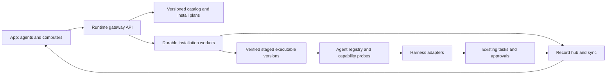

<a href="agent-gateway.zh_CN.md">简体中文</a> · <strong>English</strong>

# Agent gateway proposal

Status: design proposal, 2026-10-19. This document does not describe a shipped
installer or grant permission to install a CLI. The present increment implements
public helper activity in the existing record/sync path; installation management
is a later increment.

## Product boundary

The phone should let the owner choose a computer, discover agents, install a
supported CLI/harness, authenticate, inspect capabilities, and enable it for
Xiaoyou. The computer runs the executable; Android remains the control surface.
Each Runtime is a peer gateway, with its existing pairing, mesh,
approval, record, task, and sync services. A separate service or another model
loop is unnecessary for the first version.

Keep these concepts separate:

| Concept | Responsibility |
| --- | --- |
| Provider/model | Inference endpoint, credentials, models and usage |
| Harness/CLI | Tool loop, process and session protocol |
| Adapter | Translate one harness into Runtime capabilities and events |
| Gateway | Catalog, installation lifecycle, routing, permissions and audit |
| Agent instance | Named adapter, executable version, computer, workspace and model settings |

A new model behind an existing harness should not require another installation.
Installing a harness must not silently select a paid model or change existing
agents. New defaults follow the owner's non-Astra preference.

Follow commits `0402625`, `7372e1a`, `08d2b3c`, and `a71a8f2`: there is no home computer or
central coordinator. An explicit software installation targets a computer; the
logical agent and its desired configuration can have deployments on several
peers. All peers retain the shared nonsecret registry and operation checkpoints.
Scheduling uses actual host capabilities and a fenced operation lease. Losing
the lease stops side effects; a peer reconciles the last durable stage before
taking over. A native CLI session may require a fresh process with shared task
context; do not claim transparent live migration of unsupported native sessions.

This is an advanced connection/settings page requested by the owner. Ordinary
chat still addresses Xiaoyou; it does not gain a model/helper/effort picker.

## Existing foundations and gaps

`runtime/xiaoyou_runtime/agents.py` exposes `Agent`, `Job`, `Outcome`, and
`Control`; `config.py` defines `AgentSpec`. Current transports include Claude
stream JSON, Codex app-server, DeepSeek ACP, plain commands and remote Runtime.
`tasks.py` owns cancellation/steering; `record.py` owns record writes;
`approvals.py` owns approval handling; `identity.py` advertises capabilities.
`mesh.py` already gives computers distinct identities and forwards work.

Discovery/configuration currently expects installed executables and startup
configuration. There is no catalog, durable installation job, atomic executable
activation, or App installation page. A text-only command cannot promise tool
audit, steering, usage, or remote approval. Capabilities must express these gaps
instead of making every adapter look equally capable.

`model_gateway.py` now owns provider/model registration, routing, budget and
usage for direct inference; `binding_env(provider)` prepares harness environment
variables. Reuse that registry by provider reference, not a second endpoint/key
database. Binding environment variables alone does not enforce budgets for a
CLI's own requests: network activation requires the shared policy/accounting
boundary and native usage reconciliation. Keep network inference disabled until
that path is explicitly enabled and validated. The existing `iterate/` plugins
consume quality metadata; no second optimization loop is needed.

Commit `a71a8f2` adds the `events_v1` envelope/type registry, `/v1/events`,
mesh event replication, iteration-stage capability discovery and iteration
leases. Extend those contracts for gateway metadata rather than creating a
second collector. The existing iteration lease is not an installation fence:
its local fallback permits work when the Runtime is unreachable. Installation
and activation need operation-specific fencing that fails closed before side
effects; disconnected peers must not both activate the same shared operation.

## Proposed components

The registry exposes discovery, probe, launch, resume, steer, cancel and close.
Adapters normalize public message snapshots, tool start/result, approval,
artifact, usage and lifecycle events. Unsupported operations return explicit
capability errors. Provider reasoning and hidden context are excluded. Record
events carry Runtime, task, run, session, parent task/call and native event IDs;
the hub assigns sequence/revision and persists accepted terminal results.

The current `kind=activity` path records public messages, tool start/result,
dispatch and round end. It is a foundation, not complete nested-agent tracing:
parent/child correlation, catalog operations and universal adapter conformance
still need implementation. Existing `command` adapters cannot expose internal
steps they do not emit. Older observations cannot reconstruct discarded steps.

## App flow and API sketch

The App opens **Connections and settings → Agent management → Add engine**, chooses the target computer, then shows
supported engines and versions. Selecting one prepares a plan: download source,
version, size, digest, platform, destination, dependencies, permissions, and
rollback version. The owner can review it, install, authenticate using the
provider's supported flow, test readiness, and enable the instance. Show
installation, authentication, model readiness and connectivity separately.

All routes below are proposed, authenticated and versioned; advertise
`gateway_v1` before the App offers them. Older Runtimes keep today's helper page.

| Route | Behavior |
| --- | --- |
| `GET /v1/gateway/catalog` | Supported engines/versions/platforms and catalog revision |
| `GET /v1/gateway/agents` | Computer-scoped instance, installed version, readiness, capabilities |
| `POST /v1/gateway/plans` | Validate and return an immutable installation plan; execute nothing |
| `POST /v1/gateway/operations` | Execute the reviewed plan with an owner decision and idempotency key |
| `GET /v1/gateway/operations/<id>` | Durable status, bytes, stage, failure and recovery actions |
| `POST /v1/gateway/operations/<id>/cancel` | Cancel safely; keep the active version usable |
| `POST /v1/gateway/agents/<id>/activate` | Switch to a verified version when its use permits it |

Authentication uses supported provider mechanisms. Never send an OAuth token,
CLI home directory, browser cookie or private Runtime token through a catalog,
public mirror, APK or audit event. Login links/codes need expiry and task/source
binding; sensitive values stay on the target computer.

Keep nonsecret desired configuration, instance identity and operation stages in
mesh records. Executable paths, credentials and actual installed readiness stay
host-specific. After migration, report missing authentication or dependencies
truthfully. APK publication/rollback manifests and content hashes also need peer
replication and on-demand artifact transfer, as proposed by
[auto-iteration](auto-iteration.md); this increment's local `app publish` is not
yet network-wide artifact distribution.

Execution audit stays in the owner's private task record. Send only allowlisted
quality metadata (phase, duration, engine/version, outcome category and stable
IDs) to the usage collector/iteration plugins. Never copy command output, message
text, prompts or screenshots into usage telemetry.

## Installation and recovery contract

Use a curated catalog of pinned releases, supported platforms and verified
official sources. Do not accept arbitrary download URLs, shell fragments or
`curl | sh` from App text/model output. Platform-specific recipes list exact
arguments and dependencies; detect an existing installation first and leave
user-managed installations alone. Start with macOS and Windows, matching the
owner's computers; other platforms need separate validated recipes.

Bind a plan to target `runtime_id`, engine/version, catalog revision, platform,
digest, path, permissions and expiry. Reject changed or expired plans. Store the
operation and payload hash before acknowledging it. Retrying the same
idempotency key returns the same operation; a different payload returns conflict.
Installation approval never grants tools permission to operate on user files.

Run downloads/probes on bounded workers outside chat, feed and approval paths.
Use hash-named partial downloads, size/time limits, safe archive extraction,
signature/digest verification, version/protocol probes and staged version
directories. Atomically activate only after verification. One instance has one
mutation lock; running tasks retain their original executable/session. An update
waits for idle or installs alongside it. Cancellation/restart reconciliation
must distinguish downloaded, verified, activated and failed operations.

Keep the previous compatible executable and registry record. Rollback switches
the executable reference without clearing credentials, history or pending
approvals. Deletion is scoped to managed versions and requires an explicit owner
action. Mesh routes installation to the selected computer and reports its real
state; no network-wide broadcast installation.

## Delivery order and acceptance

The [product principles](../product-principles.md) remain draft v0.1 until the
owner accepts them. The following is a design comparison, not a new source of
authorization:

| Principles | Design response |
| --- | --- |
| P1, P2, P18 | Advanced engine management is explicitly requested; ordinary chat keeps one voice; adapters are replaceable |
| P5, P6, P7, P10 | Background installs, replay and remote transport; measure real first render/recovery and preserve current flows |
| P8, P9 | Reuse the existing approval area; show progress quietly in tasks; details open only on owner tap |
| P14, P15, P16 | Reuse model policy/usage; keep secrets local and telemetry content-free; only authorized artifacts go public |
| P17 | Peer registry/checkpoints, host capabilities, fenced leases and explicit native-session migration limits |
| P19, P20, P21 | Version-level acceptance and compatible rollback; separate source, build, publication and device evidence |

Raw commands/output in owner-requested audit may contain English identifiers.
Keep Chinese UI labels and original technical evidence; draft P12's scope for
raw evidence needs an explicit product decision before any automatic translation.

1. **Read-only inventory:** registry/probe API and App agent readiness. Preserve
   existing configured agents; report unsupported capabilities.
2. **One complete managed engine:** a pinned catalog recipe on macOS/Windows,
   plan/review/install/authenticate/probe/activate/cancel/rollback, with App UI.
3. **Additional adapters:** normalize existing transports and add conformance
   tests before another CLI is advertised as supported.
4. **Mesh and nested audit:** computer-scoped operation replay, source switches,
   task/call parent links, and child-agent activity where the harness exposes it.

Acceptance covers interrupted downloads, wrong hashes, archive traversal,
missing dependencies, expired approvals, duplicate requests, restart between
stages, cancellation, login expiry, two concurrent phones, remote computer loss,
mixed versions, rollback and active-task updates. Test offline/failure states
without requiring re-pairing. Slow installations must leave chat, approval and
sync responsive. Apply the [cross-stack reliability gate](cross-stack-reliability.md),
including real first render, recovery and two-client convergence measurements;
host mocks alone do not establish the three-second contract.
