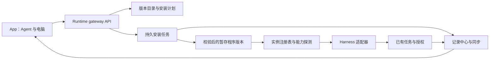

<strong>简体中文</strong> · <a href="agent-gateway.md">English</a>

# Agent gateway 架构方案

状态：2026-10-19 的设计方案。本文不代表已经交付安装器，也不构成安装 CLI 的授权。
本次实现的是现有记录／同步链路中的帮手公开执行过程；安装管理留待后续增量。

## 会话续接网关（0.26.0 源码）

Runtime 0.26.0 在现有的每台对等 Runtime 内加入同一个会话网关。
小鱼的 `find_sessions` / `continue_session` 工具和经过认证的
`GET /v1/sessions` / `POST /v1/sessions/<target>/continue` 使用相同的选择与派发边界。
这是源码实现状态，不代表已经部署或通过原生窗口验收。没有新增守护进程、会话正文库或派发日志：
共享目录元数据、Cards、Record effects、请求幂等、mesh 和适配器协议仍是权威来源。

搜索最多返回 20 项，只投影会话元数据，同时包含所有者可见的原生来源和当前聊天的托管任务，
不会暴露其他旁支聊天的普通任务内容。多个匹配项需要明确选择目标。续接必须携带客户端请求标识；
重试保留所选目标，复用现有持久化请求及 effect 记录。桌面加密 relay 校验这组可选接口，
传输重试沿用同一回执。现有 `/v1/messages` 客户端继续兼容；新接口经过 relay 时需要更新宿主白名单。

所有已配置的执行引擎均通过该网关补充托管任务，包括 Codex、Claude Code、DSH、Pi、
command、echo 和 remote。原生续接是独立的适配器能力：Codex、Claude Code、DSH 和 Pi
声明支持，command 与 echo 不声明支持。原生来源发现目前导入 Codex 和 Claude Code。
声明支持续接不等于每种 harness 都支持外部发现或 GUI 刷新。远端任务通过已有 mesh 绑定
交回来源电脑；共享目录中的远端来源若没有该绑定，则明确不可用，不能悄悄改成本地任务。

原生续接保留观测到的会话编号、工作目录和来源 home 范围。配置的执行端使用隔离 home 时，
Codex 和 Claude 可以绑定经过核实的发现来源 home，不修改全局配置或复制会话正文。
显式提供方路由配置冲突、未知 home、来源不可用、恢复时绑定变化均在派发前拒绝。
没有范围信息的旧记录保留配置的适配器，不能重新绑定。
原生来源正在执行、等待审批，或已有活动续接时，阻止第二个写入者。
新的 Runtime 执行记录关联原生会话，不替换为新原生聊天。执行续接轮次前校验返回的原生会话身份。

投递状态区分提交、会话绑定、实际开始轮次、等待审批和接收情况未知。
原生 idle 仅表示本轮结束，不代表所有者的整个任务已经完成。
恢复时先重新校验原绑定，再检查现有派发指纹。不支持运行中补充或绑定不可用时明确失败，不新开会话替代。
借用的 DSH 会话禁用旧的续接失败新建逻辑，并使用原工作目录。借用的 Pi 会话必须唯一匹配
编号及目录一致的现有文件头，再通过 `--session <path>` 打开，不使用缺失时新建的
`--session-id` 路径；依据 [Pi 会话选择实现](https://github.com/badlogic/pi-mono/blob/main/packages/coding-agent/src/main.ts)。

自动测试覆盖网关选择、适配器能力边界、来源 home 绑定、请求与 effect 重放、来源身份、
HTTP 认证及加密 relay 重试去重。原生桌面实际显示、手机端到端投递、三秒内首回复和真实断线重连，
仍需使用部署后的版本验收。

## 验证与本机部署，2026-10-29

候选版本基于 `7575c61`，包含本次未提交的网关修改及线上 0.25.0 的回复时限修复，
并保留新版人设规则注入。确认没有本地托管任务或消息正在处理后，已在所有者的 Mac 部署
Runtime 0.26.0。原 Runtime/主体身份及配置、状态路径保留。线上只读查询找到了原 Codex
及 Claude 来源；正在执行的 Codex 来源明确禁止第二个写入者。未向所有者的原生聊天发送测试消息。
未升级其他电脑或已安装的桌面宿主。宿主源码已加入可选接口的 relay 白名单；现有聊天消息经
Runtime 使用网关，无需同时升级宿主。

| 检查 | 结果与证据 |
| --- | --- |
| Build | PASS：桌面 TypeScript/UI、Mac ARM64 Runtime 0.26.0 冻结包、完整 `tools/validate.sh` 固件构建与合并镜像校验 |
| Host tests | PASS：最终 Runtime 全量 1,210 项；网关及合并专项回归 60 项；冻结包桌面测试 122 项；最终暂存二进制双 Runtime 互操作 |
| 回归 | 已测试的托管任务/选择、原来源绑定、能力边界、认证、effect 恢复和幂等重试 PASS；保留线上回复时限修复 |
| 首回复 <= 3s | 未使用真实模型在手机/原生 UI 测试；echo/API 接收回执不能当作 TTFT 证据 |
| 连接恢复 | 隔离双 Runtime 加密 relay 测试 PASS；部署后手机/原生端断线恢复 NOT RUN |
| 多端同步 | 隔离 API/relay 记录与来源绑定路由 PASS；原生窗口实际渲染及真实手机投递 NOT RUN |
| Device tests | NOT RUN；本轮未修改/安装 Android，也未修改/刷写固件 |
| Unverified | Codex/Claude/DSH/Pi 真实执行及原生窗口刷新、其他远端电脑、手机渲染/TTFT/重连；未重新测量已安装 App/固件版本 |

最终冻结包源码 SHA-256：
`8577ef11ff5c5a899ec03fe2e59cedaa626171da6427365d49a87c3859e5cfa5`。
最终暂存包的 HTTP 探针已通过能力发现、认证查询、同任务续接和持久化重试。
其首次进程启动为 8.161 秒。新冻结包互操作尝试超过未修改的 8 秒启动夹具限制；
冻结包桌面全套串行测试通过，最终暂存二进制初始化后也通过了未修改的互操作专项测试。
这仍是启动方面的限制，不能算三秒首回复通过。

保留线上修复时，回归测试发现遗漏人设规则注入，已在部署前修复。
并发运行中的一个目录删除夹具也曾超时；专项重跑及最终 Runtime 全量测试通过，未修改时限。
失败和通过的日志均保留在本机 `/private/tmp/session-gateway-*` 下。

旧程序包保留在本机部署快照的 `companion/desktop/runtime-dist.before-gateway-0.26.0`，
旁边同时保留旧源码。回退时同样须检查空闲状态（或取得打断工作的授权），优雅停止服务，
恢复旧包并使用原配置重启。不清除凭据、历史、配对或设置。未提交或推送。

## 产品边界

手机让主人选择电脑、发现 Agent、安装受支持的 CLI/harness、登录、检查能力，再启用给小鱼。
可执行程序在电脑运行，Android 提供控制界面。每台 Runtime 都是对等 gateway，复用配对、
mesh、授权、记录、任务与同步服务。首版不需要再启动独立服务或增加一层模型循环。

区分以下概念：

| 概念 | 职责 |
| --- | --- |
| Provider/model | 推理端点、凭据、模型与用量 |
| Harness/CLI | 工具循环、进程与会话协议 |
| Adapter | 把一种 harness 转成 Runtime 的能力和事件 |
| Gateway | 目录、安装生命周期、路由、权限与审计 |
| Agent 实例 | 有名字的适配器、可执行版本、电脑、工作目录与模型设置 |

已有 harness 后面换模型，不应要求重新安装一套工具。安装 harness 不应悄悄选择付费模型或
修改现有 Agent；新增默认配置遵循主人的非 Astra 偏好。

对齐 `0402625`、`7372e1a`、`08d2b3c`、`a71a8f2`：没有必须开着的主机或中央协调器。一次明确的
软件安装绑定目标电脑；逻辑 Agent 及其期望配置可以在多台电脑部署。各端同步不含密钥的
实例注册记录与操作检查点。调度依据实际能力和带隔离令牌的操作租约；失去租约立即停止
副作用，接手前核对最后持久阶段。原生 CLI 会话可能需要用共享任务上下文重新启动，不能
把来源不支持的会话宣称为无感热迁移。

这是主人明确要求的高级连接／设置入口。日常聊天仍只对小鱼说话，不增加模型／帮手／档位
选择器。

## 已有基础与缺口

`runtime/xiaoyu_runtime/helpers/agents.py` 已有 `Agent`、`Job`、`Outcome` 和 `Control`；
`config.py` 定义 `AgentSpec`。现有传输包括 Claude 的流式 JSON、Codex app-server、
DeepSeek ACP、普通命令和远端 Runtime。`tasks.py` 管取消／追加，`record.py` 是记录写入口，
`approvals.py` 管授权，`identity.py` 声明能力；`mesh.py` 已区分电脑身份并转交工作。

目前发现和配置依赖已经安装的程序与启动配置，尚无安装目录、持久安装任务、可执行版本原子
切换、App 安装页。纯文本命令无法承诺内部工具审计、中途追加、用量或远程授权。能力声明
必须明确这些差异。

新提交的 `model_gateway.py` 已管理直接推理的端点／模型登记、选路、预算和用量，
`binding_env(provider)` 提供 harness 环境变量。Agent 实例引用同一注册表，不另建端点／
密钥库。仅绑定环境变量不能限制 CLI 自己请求的预算：启用联网需要接入共享策略／计费
边界并核对原生用量，明确启用并验证前保持关闭。质量元数据接入已有 `iterate/` 插件，
不新建另一套优化循环。

`a71a8f2` 已加入 `events_v1` 事件格式／类型表、`/v1/events`、mesh 事件同步、迭代阶段
能力发现与迭代租约。gateway 元数据扩展这些契约，不另建采集器。现有迭代租约不能直接
当作安装隔离机制：Runtime 不可达时允许本机继续。安装和激活需要按操作隔离，并在无法
确认隔离权时停止副作用；断网的两端不能同时激活同一共享操作。

## 组件设计

注册表提供发现、探测、启动、恢复、追加、取消与关闭。适配器统一公开回复快照、工具开始／
结果、授权、产物、用量与生命周期事件。不支持的操作返回明确能力错误；不采集模型内部
思考或隐藏上下文。事件携带 Runtime、任务、轮次、会话、父任务／调用与原生事件编号，
由记录中心分配序号／修订号，持久保存已接受的最终结果。

本次 `kind=activity` 记录公开回复、工具开始／结果、派发与轮次结束。这是基础，尚不等于
完整嵌套 Agent 追踪：父子关联、安装目录操作、所有适配器的统一契约测试仍需实现。已有
`command` 适配器不能展示来源没有输出的内部步骤，旧观察也无法重建已丢弃的过程。

## 共用会话元数据扩展

主人于 2026-10-22 明确：这里还必须共用一套显示规则，包括 Codex 与 Claude Code 原生窗口。
[展示契约](conversation-presentation.zh_CN.md#所有端共用一套显示规则)负责作者、回合／条目边界、
分组、顺序、展示位置、状态和真实渲染验收。显示投影只在已有 Runtime gateway 实现一套；
仅同步元数据不足以完成要求。适配器转换来源事件并提供经过核验的原生能力，客户端渲染共用
投影。原生端不支持的显示维度仍算未完成，不能改称背景／历史同步成功来代替验收。

Runtime 0.23.0 已实现供可控客户端使用的 `presentation_v1` 投影，由 Android 0.31.1
和桌面端 0.1.6 消费。已有同步、轮询／SSE、卡片及目录历史路径提供这份规则，不另建
记录存储。原生窗口接入明确为未完成；已安装原生协议中的读取／恢复／注入／命名方法
本身不能证明显示一致。

主人于 2026-10-21 要求：项目／会话组织、标题和摘要，对 Codex、Claude Code 及后续
agent 采用同一套 gateway 策略。本节是待实现扩展，不是已经可用的元数据 API。
产品行为由[统一会话展示](conversation-presentation.zh_CN.md)定义。

这里的目录组织指逻辑项目／会话目录，真实文件系统 cwd 属于核实后的执行绑定。
已有安装目录是另一项职责，不能将引擎／版本条目拿来充当项目或会话记录。

在现有对等 Runtime gateway 内增加共用策略／服务，不另起 daemon、不增加中央主机或
可写记录登记表。`Record` 仍是唯一持久写入口，各成员复制同一份来源管理的元数据，
不能每个前端／观察器轮询时各生成一份。

### 确定性事实与可选生成

| 内容 | 共用策略 |
| --- | --- |
| ID、来源绑定、原生 turn 范围、任务状态与能力 | 来自真实记录／协议证据，不由模型生成 |
| 项目归属与 cwd | 来自主人的明确要求、任务来源和已核实检出副本映射；不确定就未知或建议，不由模型搬目录或改变权限 |
| 标题 | 保留主人命名和上游出处，共用任务标题／兜底策略，内部提示词不能成为标题 |
| 短摘要与交接上下文 | 统一限定范围、带来源的生成策略，结构化结果加确定性兜底 |
| 原生展示 | 适配器仅使用支持的命名／打开／恢复机制，生成共享标题不证明原生端已可发现 |

可选生成通过已有模型 gateway，按 `conversation.title`、`conversation.summary`、
`task.handoff` 等用途选路。不为了给会话起名／写摘要而启动另一个 Codex／CC 工作
session；元数据生成不能新增原生侧栏会话或用户消息。共享摘要与真实任务结果、原始
证据分别保留；生成文字不能将任务标完成，也不能授权执行命令。

复用已配置的端点、凭据、本地性、用量和预算策略。优先确定性规则与适合的本地生成；
联网候选保持在已配置的授权／隐私／预算范围内。即使通用兜底路由指向不允许的模型，
也须遵守主人的非 Astra 默认。现有模型 gateway 的可用性／预算检查并未自动实现新增的
用途策略，需要校验候选集合。

生成在后台有界运行、限制重试并缓存兜底结果，不作为消息接收、有意义首回复、派发、
同步或打开真实原生会话的前置条件。没有模型或结果无效时，仍能使用任务，保留稳定
标题，并标记摘要不可用／过期。

### 各端读取同一份有版本的结果

归一化契约引用已有会话／任务／执行尝试／消息身份，项目／来源／检出副本绑定、标题
及出处，以及带来源截止位置、来源版本、策略版本和生成状态的摘要。事实与生成文字
分别保存，保留上游原名。通过记录／同步契约的兼容投影或元数据扩展提供，不另造一套
消息格式或历史数据库。

按用途、记录身份、输入版本、策略版本和输出语言去重生成。结果由原始记录权威方经
记录中心接收；其他成员可执行获授权的生成工作，但不能独立覆盖来源。应用前核对
输入／主人命名的预期版本，晚到摘要不能覆盖新证据或主人改名。输入仅限获授权会话／
任务窗口，并保留覆盖范围；不把全部项目历史发给模型，也不在下一轮把生成摘要当成
新的来源证据。

向原生端同步名称是针对明确绑定 session、带预期来源身份／版本的能力操作。
支持的命名操作应用失败时，在工作记录如实显示；不能通过改写 transcript 或新增用户
回合来修。已有主人管理的原生名称继续遵守展示契约中的命名／授权规则。

### 接入新的 agent

新适配器声明能力，实现支持的发现、事件归一化、执行／恢复／控制、原生打开和可选
原生命名。上报真实 ID、cwd、状态、公开文字、工具事件、产物及覆盖限制。
不再自行实现另一套项目分类、标题生成、摘要、靠提示词猜状态或记录存储。

契约测试覆盖事件重复／乱序、原生来源别名、能力不支持、摘要超时／结构错误、生成中
主人改名、输入过期、成员重复生成、无模型、范围／权限保持，以及元数据不额外创建
原生 session。原生发现／打开／续接仍需真实界面验收；共用 gateway 不能制造来源没有
的能力。本扩展尚未实现。

## App 流程与接口草案

App 打开「连接与设置 → Agent 管理 → 添加引擎」，选择目标电脑，再列出支持的引擎和版本。选择后生成计划，
展示来源、版本、大小、校验值、平台、目录、依赖、权限与回退版本。主人审阅后安装，再按
提供方支持的方式登录、测试就绪、启用实例。安装、登录、模型就绪和连接状态分别展示。

以下接口均为提议，需要认证和版本协商。Runtime 声明 `gateway_v1` 后 App 才显示管理入口；
旧 Runtime 保留现在的帮手页面。

| 接口 | 行为 |
| --- | --- |
| `GET /v1/gateway/catalog` | 支持的引擎／版本／平台及目录修订号 |
| `GET /v1/gateway/agents` | 指定电脑上的实例、安装版本、就绪状态与能力 |
| `POST /v1/gateway/plans` | 校验并返回不可变安装计划，不执行安装 |
| `POST /v1/gateway/operations` | 带主人决定与幂等键执行已审阅的计划 |
| `GET /v1/gateway/operations/<id>` | 持久状态、已下载字节、阶段、错误与恢复操作 |
| `POST /v1/gateway/operations/<id>/cancel` | 安全取消，保留当前可用版本 |
| `POST /v1/gateway/agents/<id>/activate` | 使用条件允许时切换到已校验版本 |

登录使用提供方支持的机制。OAuth 令牌、CLI 主目录、浏览器 cookie、Runtime 私有令牌不进入
公开目录、镜像、APK 或审计事件。登录链接／验证码必须有有效期并绑定任务和来源；敏感
值留在目标电脑。

不含密钥的期望配置、实例身份和操作阶段作为 mesh 记录同步；程序路径、凭据和实际安装
就绪状态属于具体电脑。迁移后缺登录或依赖必须如实显示。APK 发布／撤回清单和内容哈希
也应随 peer 同步、大文件按需获取，对齐[自动迭代方案](auto-iteration.zh_CN.md)；本次
本机 `app publish` 尚不等于已经实现全网制品分发。

执行审计保留在主人的私有任务记录中。只把白名单内的质量元数据（阶段、耗时、引擎／版本、
结果类别、稳定编号）交给使用数据采集／迭代插件；不把命令输出、消息正文、提示词或截图
复制到使用遥测中。

## 安装与恢复契约

采用经维护的目录，固定版本、支持平台和已核验的官方来源。App 文本／模型输出不能指定
任意下载地址、shell 片段或 `curl | sh`。平台安装配方声明精确参数和依赖，先检测已有安装，
保留用户自行管理的程序。首批验证 macOS 和 Windows，匹配主人现有电脑；其他平台单独验证。

计划绑定目标 `runtime_id`、引擎／版本、目录修订号、平台、校验值、路径、权限与有效期；
过期或变化后拒绝执行。先持久保存操作和载荷哈希，再返回接受。重试同一幂等键得到原操作，
载荷不同返回冲突。安装授权不等于允许 Agent 工具操作用户文件。

下载和探测放在有边界的后台任务中，不占用聊天、同步或授权通道。使用按哈希命名的断点
文件、大小／时间限制、安全解包、签名／校验值核对、版本／协议探测和版本暂存目录，全部
验证后才原子切换。每个实例只有一个变更锁；运行中的任务固定原可执行版本和会话。更新
等待空闲或并排安装。取消／重启恢复要区分已下载、已校验、已激活和失败状态。

保留上一个兼容可执行版本与注册记录。回退只切换程序引用，不清空凭据、历史或待审批。
删除仅涉及受管理版本，需主人明确操作。Mesh 将安装路由到所选电脑并回传真实状态，不向
整个网络广播安装。

## 实施顺序与验收

[产品原则](../product-principles.zh_CN.md) 仍是待主人认可的 v0.1 草稿。以下是设计对照，
不产生新的授权：

| 原则 | 对应设计 |
| --- | --- |
| P1、P2、P18 | 主人明确要求高级引擎管理；日常聊天只有小鱼；适配器可替换 |
| P5、P6、P7、P10 | 后台安装、回放与远程链路；实测首屏／恢复并保留现有流程 |
| P8、P9 | 复用已有授权入口，任务里安静显示进展，详情仅在主人主动点开时展示 |
| P14、P15、P16 | 复用模型策略／用量，密钥留本机、遥测不含正文，仅授权过的产物公开 |
| P17 | 对等注册记录／检查点、主机能力、带隔离令牌的租约，明确原生会话迁移限制 |
| P19、P20、P21 | 按版本验收与兼容回退；源码、构建、发布和真机证据分别报告 |

主人要求审计的命令／原文结果可能含英文标识。界面标签使用中文，保留原始技术证据；
草稿 P12 对原始证据的范围需要产品明确后再决定是否自动翻译。

1. **只读清单：**注册／探测 API 与 App 就绪状态；保留现有配置，明确不支持的能力。
2. **一个引擎完整闭环：**macOS／Windows 上固定版本的安装配方，打通计划、审阅、安装、
   登录、探测、启用、取消与回退，并提供 App 界面。
3. **更多适配器：**统一现有传输，新增 CLI 前先通过契约测试。
4. **Mesh 与嵌套审计：**按电脑恢复安装操作、切换来源、补父子任务／调用关联，并在 harness
   提供数据时展示子 Agent 过程。

验收覆盖下载中断、哈希错误、解包越界、缺依赖、授权过期、重复请求、阶段间重启、取消、
登录过期、两台手机同时操作、远端电脑离线、混合版本、回退和运行中更新。离线／失败恢复
不能要求重新配对；慢安装期间聊天、审批与同步仍可用。遵守
[跨栈可靠性门禁](cross-stack-reliability.zh_CN.md)，包括真实首屏、恢复及两端收敛测量；
主机模拟测试不能证明真实链路满足 3 秒契约。

Runtime 0.22.0 已通过 `/v1/directory` 实现共享目录与元数据子集；详见
[会话展示设计](conversation-presentation.zh_CN.md)末尾的增量和原生控制缺口。
本文其他引擎管理接口仍属于设计，不能据此宣称已经实现。
