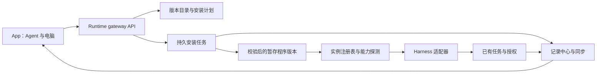

<strong>简体中文</strong> · <a href="agent-gateway.md">English</a>

# Agent gateway 架构方案

状态：2026-10-19 的设计方案。本文不代表已经交付安装器，也不构成安装 CLI 的授权。
本次实现的是现有记录／同步链路中的帮手公开执行过程；安装管理留待后续增量。

## 产品边界

手机让主人选择电脑、发现 Agent、安装受支持的 CLI/harness、登录、检查能力，再启用给小幽。
可执行程序在电脑运行，Android 提供控制界面。每台 Runtime 都是对等 gateway，复用配对、
mesh、授权、记录、任务与同步服务。首版不需要再启动独立服务或增加一层模型循环。

区分以下概念：

| 概念 | 职责 |
| --- | --- |
| Provider/model | 推理端点、凭据、模型与用量 |
| Harness/CLI | 工具循环、进程与会话协议 |
| Adapter | 把一种 harness 转成 Runtime 的能力和事件 |
| Gateway | 目录、安装生命周期、路由、权限与审计 |
| Agent 实例 | 有名字的适配器、可执行版本、电脑、工作目录与模型设置 |

已有 harness 后面换模型，不应要求重新安装一套工具。安装 harness 不应悄悄选择付费模型或
修改现有 Agent；新增默认配置遵循主人的非 Astra 偏好。

对齐 `0402625`、`7372e1a`、`08d2b3c`、`a71a8f2`：没有必须开着的主机或中央协调器。一次明确的
软件安装绑定目标电脑；逻辑 Agent 及其期望配置可以在多台电脑部署。各端同步不含密钥的
实例注册记录与操作检查点。调度依据实际能力和带隔离令牌的操作租约；失去租约立即停止
副作用，接手前核对最后持久阶段。原生 CLI 会话可能需要用共享任务上下文重新启动，不能
把来源不支持的会话宣称为无感热迁移。

这是主人明确要求的高级连接／设置入口。日常聊天仍只对小幽说话，不增加模型／帮手／档位
选择器。

## 已有基础与缺口

`runtime/xiaoyou_runtime/agents.py` 已有 `Agent`、`Job`、`Outcome` 和 `Control`；
`config.py` 定义 `AgentSpec`。现有传输包括 Claude 的流式 JSON、Codex app-server、
DeepSeek ACP、普通命令和远端 Runtime。`tasks.py` 管取消／追加，`record.py` 是记录写入口，
`approvals.py` 管授权，`identity.py` 声明能力；`mesh.py` 已区分电脑身份并转交工作。

目前发现和配置依赖已经安装的程序与启动配置，尚无安装目录、持久安装任务、可执行版本原子
切换、App 安装页。纯文本命令无法承诺内部工具审计、中途追加、用量或远程授权。能力声明
必须明确这些差异。

新提交的 `model_gateway.py` 已管理直接推理的端点／模型登记、选路、预算和用量，
`binding_env(provider)` 提供 harness 环境变量。Agent 实例引用同一注册表，不另建端点／
密钥库。仅绑定环境变量不能限制 CLI 自己请求的预算：启用联网需要接入共享策略／计费
边界并核对原生用量，明确启用并验证前保持关闭。质量元数据接入已有 `iterate/` 插件，
不新建另一套优化循环。

`a71a8f2` 已加入 `events_v1` 事件格式／类型表、`/v1/events`、mesh 事件同步、迭代阶段
能力发现与迭代租约。gateway 元数据扩展这些契约，不另建采集器。现有迭代租约不能直接
当作安装隔离机制：Runtime 不可达时允许本机继续。安装和激活需要按操作隔离，并在无法
确认隔离权时停止副作用；断网的两端不能同时激活同一共享操作。

## 组件设计

注册表提供发现、探测、启动、恢复、追加、取消与关闭。适配器统一公开回复快照、工具开始／
结果、授权、产物、用量与生命周期事件。不支持的操作返回明确能力错误；不采集模型内部
思考或隐藏上下文。事件携带 Runtime、任务、轮次、会话、父任务／调用与原生事件编号，
由记录中心分配序号／修订号，持久保存已接受的最终结果。

本次 `kind=activity` 记录公开回复、工具开始／结果、派发与轮次结束。这是基础，尚不等于
完整嵌套 Agent 追踪：父子关联、安装目录操作、所有适配器的统一契约测试仍需实现。已有
`command` 适配器不能展示来源没有输出的内部步骤，旧观察也无法重建已丢弃的过程。

## App 流程与接口草案

App 打开「连接与设置 → Agent 管理 → 添加引擎」，选择目标电脑，再列出支持的引擎和版本。选择后生成计划，
展示来源、版本、大小、校验值、平台、目录、依赖、权限与回退版本。主人审阅后安装，再按
提供方支持的方式登录、测试就绪、启用实例。安装、登录、模型就绪和连接状态分别展示。

以下接口均为提议，需要认证和版本协商。Runtime 声明 `gateway_v1` 后 App 才显示管理入口；
旧 Runtime 保留现在的帮手页面。

| 接口 | 行为 |
| --- | --- |
| `GET /v1/gateway/catalog` | 支持的引擎／版本／平台及目录修订号 |
| `GET /v1/gateway/agents` | 指定电脑上的实例、安装版本、就绪状态与能力 |
| `POST /v1/gateway/plans` | 校验并返回不可变安装计划，不执行安装 |
| `POST /v1/gateway/operations` | 带主人决定与幂等键执行已审阅的计划 |
| `GET /v1/gateway/operations/<id>` | 持久状态、已下载字节、阶段、错误与恢复操作 |
| `POST /v1/gateway/operations/<id>/cancel` | 安全取消，保留当前可用版本 |
| `POST /v1/gateway/agents/<id>/activate` | 使用条件允许时切换到已校验版本 |

登录使用提供方支持的机制。OAuth 令牌、CLI 主目录、浏览器 cookie、Runtime 私有令牌不进入
公开目录、镜像、APK 或审计事件。登录链接／验证码必须有有效期并绑定任务和来源；敏感
值留在目标电脑。

不含密钥的期望配置、实例身份和操作阶段作为 mesh 记录同步；程序路径、凭据和实际安装
就绪状态属于具体电脑。迁移后缺登录或依赖必须如实显示。APK 发布／撤回清单和内容哈希
也应随 peer 同步、大文件按需获取，对齐[自动迭代方案](auto-iteration.zh_CN.md)；本次
本机 `app publish` 尚不等于已经实现全网制品分发。

执行审计保留在主人的私有任务记录中。只把白名单内的质量元数据（阶段、耗时、引擎／版本、
结果类别、稳定编号）交给使用数据采集／迭代插件；不把命令输出、消息正文、提示词或截图
复制到使用遥测中。

## 安装与恢复契约

采用经维护的目录，固定版本、支持平台和已核验的官方来源。App 文本／模型输出不能指定
任意下载地址、shell 片段或 `curl | sh`。平台安装配方声明精确参数和依赖，先检测已有安装，
保留用户自行管理的程序。首批验证 macOS 和 Windows，匹配主人现有电脑；其他平台单独验证。

计划绑定目标 `runtime_id`、引擎／版本、目录修订号、平台、校验值、路径、权限与有效期；
过期或变化后拒绝执行。先持久保存操作和载荷哈希，再返回接受。重试同一幂等键得到原操作，
载荷不同返回冲突。安装授权不等于允许 Agent 工具操作用户文件。

下载和探测放在有边界的后台任务中，不占用聊天、同步或授权通道。使用按哈希命名的断点
文件、大小／时间限制、安全解包、签名／校验值核对、版本／协议探测和版本暂存目录，全部
验证后才原子切换。每个实例只有一个变更锁；运行中的任务固定原可执行版本和会话。更新
等待空闲或并排安装。取消／重启恢复要区分已下载、已校验、已激活和失败状态。

保留上一个兼容可执行版本与注册记录。回退只切换程序引用，不清空凭据、历史或待审批。
删除仅涉及受管理版本，需主人明确操作。Mesh 将安装路由到所选电脑并回传真实状态，不向
整个网络广播安装。

## 实施顺序与验收

[产品原则](../product-principles.zh_CN.md) 仍是待主人认可的 v0.1 草稿。以下是设计对照，
不产生新的授权：

| 原则 | 对应设计 |
| --- | --- |
| P1、P2、P18 | 主人明确要求高级引擎管理；日常聊天只有小幽；适配器可替换 |
| P5、P6、P7、P10 | 后台安装、回放与远程链路；实测首屏／恢复并保留现有流程 |
| P8、P9 | 复用已有授权入口，任务里安静显示进展，详情仅在主人主动点开时展示 |
| P14、P15、P16 | 复用模型策略／用量，密钥留本机、遥测不含正文，仅授权过的产物公开 |
| P17 | 对等注册记录／检查点、主机能力、带隔离令牌的租约，明确原生会话迁移限制 |
| P19、P20、P21 | 按版本验收与兼容回退；源码、构建、发布和真机证据分别报告 |

主人要求审计的命令／原文结果可能含英文标识。界面标签使用中文，保留原始技术证据；
草稿 P12 对原始证据的范围需要产品明确后再决定是否自动翻译。

1. **只读清单：**注册／探测 API 与 App 就绪状态；保留现有配置，明确不支持的能力。
2. **一个引擎完整闭环：**macOS／Windows 上固定版本的安装配方，打通计划、审阅、安装、
   登录、探测、启用、取消与回退，并提供 App 界面。
3. **更多适配器：**统一现有传输，新增 CLI 前先通过契约测试。
4. **Mesh 与嵌套审计：**按电脑恢复安装操作、切换来源、补父子任务／调用关联，并在 harness
   提供数据时展示子 Agent 过程。

验收覆盖下载中断、哈希错误、解包越界、缺依赖、授权过期、重复请求、阶段间重启、取消、
登录过期、两台手机同时操作、远端电脑离线、混合版本、回退和运行中更新。离线／失败恢复
不能要求重新配对；慢安装期间聊天、审批与同步仍可用。遵守
[跨栈可靠性门禁](cross-stack-reliability.zh_CN.md)，包括真实首屏、恢复及两端收敛测量；
主机模拟测试不能证明真实链路满足 3 秒契约。
