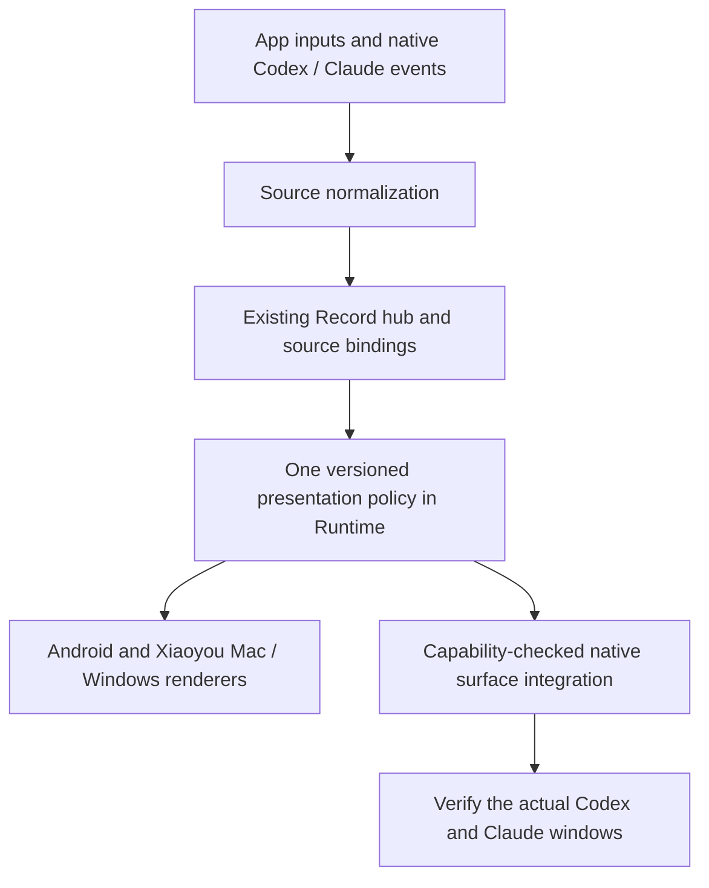

<p align="right"><a href="conversation-presentation.zh_CN.md">简体中文</a> · <strong>English</strong></p>

# Conversation presentation across clients

Status: consolidated proposal, 2026-10-21. This replaces the earlier incremental
UI proposals, including task cards in the main chat. It records the owner's
accepted direction and the remaining native-client integration requirements.
It does not claim implementation, deployment or installed-client acceptance.
The [message model](unified-message-model.md), [reliability contract](cross-stack-reliability.md)
and [desktop plan](xiaoyou-desktop-plan.md) continue to govern storage, transport
and delivery. This document owns presentation, task association and surface handoff.

All agents use the same metadata policy for project/conversation organization,
titles, summaries and handoff context. Extend the existing Runtime gateway and
reuse `model_gateway.py` for optional generation, while `Record` remains the sole
durable writer. The shared architecture and new-agent contract are defined in
[Agent gateway: shared metadata](agent-gateway.md#shared-conversation-metadata-extension),
not independently by each agent adapter or UI.

## 1. Product contract

The owner talks to one Xiaoyou. Normal navigation contains the main chat and
side chats the owner chose to open. A separate **Work records** view exposes
execution, source conversations and audit detail across those chats.

- Main chat contains actual owner messages, concise meaningful answers/results,
  and necessary decisions. Dispatch notices, task cards, tools, retries, source
  metadata and background transcripts do not accumulate there by default.
- Side chats provide optional topic focus. Creating, retrying, delegating or
  discovering work does not create a side chat. Project grouping is optional.
- Tasks stay linked to where the owner asked. The owner need not classify work
  before it can start. Original messages are never silently relocated.
- Work records is a read projection, not another conversation or second inbox.
  It has stable task links, source links and a route back to the original message.
- Necessary permissions, blockers and promised results remain discoverable.
  Quiet presentation must not hide a decision that is needed to proceed.

A short generic acknowledgement or spinner does not satisfy the required
meaningful first response within 3 seconds. Keep that acceptance requirement
while reducing repeated administrative text.

### One presentation policy across all surfaces

Owner clarification, 2026-10-22: shared storage alone is insufficient. The
same conversation must follow one presentation policy on Android, Xiaoyou
Mac/Windows, Codex's native window and Claude Code's native window. Native
windows are part of acceptance; unsupported integration remains incomplete.
Different fonts, spacing and platform controls are compatible with this goal;
different interpretations of authorship, message boundaries, order, status or
conversation membership are not.

Use one turn/item-based policy for every agent, retaining the main/side-chat and
Work records navigation above. Codex and Claude adapters translate source events
into that policy; neither adapter nor frontend defines its own conversation
rules. This is a product contract, not a claim that either vendor's entire
current UI specification has been adopted or that native UI can be controlled.

| Decision | Shared rule |
| --- | --- |
| Conversation and title | One stable logical conversation and owner-protected title; executor changes and retries do not create another chat. Native bindings retain their actual identities. |
| Author and provenance | Preserve who actually authored each item. A forwarded instruction is linked to the original owner message; generated summaries and helper results are separately attributed. |
| Turn and item boundaries | A new owner request begins a turn; steering joins the active turn only through a supported explicit operation, and queued follow-ups retain their declared relationship. Assistant messages, progress, tools, decisions and artifacts are typed items with stable identities. A turn may contain several assistant messages. |
| Message grouping | The shared policy assigns visible message/block boundaries. Clients do not split on separators, merge paragraphs or combine adjacent messages independently. Preserve source boundaries and record any explicit normalized subdivision. |
| Order and revisions | One deterministic order from source ordering and canonical identities, with explicit tie-breaking for concurrent sources. Replication arrival and client wall clocks do not define order; stale revisions cannot replace final items. |
| Placement | Actual dialogue and promised results stay in the initiating chat; detailed tools, retries and execution evidence belong in Work records. Required decisions remain visible from the initiating chat. |
| Status | Accepted, queued, running, waiting for a decision, failed, cancelled, unavailable and turn-ended have shared meanings. Ending a model turn does not establish task success. |
| Streaming and rendering | The gateway provides shared message boundaries and completion flags. Retain the accepted complete-message presentation and the 3-second contract; each client must not invent its own buffering or completion test. |
| Attachments and actions | The same item references the same attachment/source and capability-checked action. A replicated attachment reference does not imply that its bytes are locally available. |

The existing Runtime gateway owns a deterministic, versioned presentation
projection over Record's canonical messages/tasks and their native bindings.
Extend the existing message/sync contract compatibly; do not create another
writable transcript or independent view history. Each projected item references
its original record identity and revision, policy revision, logical
conversation/turn, author, kind, stable block identity/order, placement,
completion state and supported actions. These are required semantics for the
contract extension, not field names or an API already implemented.



Shared peers apply the same policy version to the same canonical input. A
version mismatch is explicit and cannot be reported as converged. Clients keep
cache, transport, native layout and clearly marked unsent drafts; accepted
items reconcile by identity with the authoritative projection. Old clients and
readable old records remain supported, but legacy presentation does not pass
the new cross-surface acceptance gate.

Native integration needs separate evidence for model-visible context,
persisted public history, actual rendered message boundaries, sidebar
identity/title and later continuation. A shared-history hook or context
attachment proves only the context path. Opening or resuming a session does
not establish that the window consumes the shared presentation policy. Use
supported native APIs and verify each installed backend/home/version; never
rewrite native databases or fabricate turns to simulate convergence. Where
the native surface cannot consume or preserve a required rule, report that
specific dimension as incomplete while keeping it in the acceptance scope.

Current source inspection found an actionable difference: Android's
`AppPresentation.bubbles()` splits assistant text at standalone separators and
`settledBubbles()` buffers the unfinished segment; desktop `Bubble` renders
the terminal message text as one bubble. Centralizing records has not removed
these independent presentation rules in the legacy paths. Runtime 0.23.0,
Android 0.31.1 and desktop 0.1.6 now implement the shared `presentation_v1`
projection for controlled clients: block identities/boundaries, completion,
formatting runs, authors, order, placement and task status/groups. Old records
refresh compatibly without replacing history or accepted work. The Python,
Java and TypeScript consumers share golden fixtures. Actual installed-client
rendering and native-window conformance remain separate, incomplete acceptance;
native source context/history reads do not fulfill that requirement.

Validation checkpoint for this increment: 682 Runtime tests, 166 Android unit
tests and 57 desktop tests pass; the complete repository gate, Android debug
assembly/Lint and Mac arm64 packaging pass. The source and packaged Mac window
were exercised in isolated profiles against the shared wire fixtures: completed
blocks during streaming, empty retraction, final boundaries/order, formatting,
incompatible-policy feedback and restart identity passed. Two frozen Runtime
peers passed encrypted continuation/recovery with an echo provider on retry;
the first fresh-bundle launch exceeded that test's unchanged eight-second
startup window. Keep the cold-start result as an unresolved observation rather
than reporting all startup paths as accepted.

The local Runtime was updated to 0.23.0 only after a complete paged idle check;
the App candidate is 0.31.1 / code 58, published through the local Runtime. The
owner's phone install, Windows native execution, real-model text/voice TTFT
(zero samples; p50/p95/max unavailable), live multi-device recovery and native
Codex/Claude rendered conformance are NOT RUN. The native CLI versions checked
were Codex 0.162.0 and Claude Code 2.1.294; schema methods are not GUI evidence.
No firmware was flashed. Previous 0.30.1 APKs/publication metadata and the
0.1.5 Mac preview are retained for recovery; the additive projection can be
ignored by old clients without deleting accepted history, pairing or outbox.

The 0.1.7 desktop / 0.23.1 Runtime correction also makes request polling
consume authoritative `message_snapshot` records during history catch-up. Accepted
requests retain their waiting state until the assistant reply ends, even when the
owner message has already synced. The live read does not advance the history cursor
or create an independent transcript. Source Mac window checks cover restart with
an accepted request, offline feedback and live delivery while history is blocked;
synthetic recovery samples were 785 ms (source) and 795 ms (packaged). The
installed Mac window displayed the original stuck request without resubmission.
Real-model TTFT remains unverified.

## 2. Separate the identities

| Object | Meaning and lifetime |
| --- | --- |
| Logical conversation | Main chat or an owner-opened side chat; persists across clients/provider changes |
| Message | One actual authored message with immutable origin and stable identity |
| Task | One objective, original request, state, approvals and result |
| Attempt | One execution/retry/delegation for a task, with helper and execution location |
| Native session | A Codex thread or Claude Code session, in its original storage/backend |
| Project / checkout | Optional project identity and a particular computer's directory/worktree |

A native session is not necessarily one task. A long native session can contain
several objectives; one task can use several helper sessions. Associate them by
task/attempt plus native turn IDs or a declared entry range, not by title or
basename. If the range is unknown, retain a session-level source link and label
that limitation instead of attributing every future turn to the old objective.

A main logical conversation also need not equal one unlimited model session.
Management state lives outside provider history. It supplies authorized task
summaries, decisions and references, and retrieves detail when needed. Side-chat
context is scoped. Changing helper or execution computer preserves task identity.

## 3. End-to-end behavior

| Starting point | Where the owner sees it | Execution and reporting |
| --- | --- | --- |
| Ordinary chat in the App/client | Same logical chat on authorized Xiaoyou clients | No worker task merely to synchronize a sentence |
| Work requested in main chat | Original request and concise answer; details in Work records | Bind one task before dispatch; result returns to this request |
| Work requested in a side chat | Original side chat; task also visible in Work records | Remains in that topic; does not replay the transcript in main chat |
| Owner starts work directly in native CC/Codex/CLI | A source-conversation entry in Work records | Observe visible records; do not fabricate a main-chat request or new execution |
| Explicitly continue an existing task | Same task, new turn/attempt as needed | Send to its actual source/executor; verify availability and ownership first |
| Ask Xiaoyou about native work | Reply in the chat where the question was asked | Read attributed context; explanation alone does not resume the native agent |

Association happens before executor selection. Naming Codex selects a helper,
not a new task/project/chat. Use explicit task references, selected task context
and established follow-up relationships; a genuinely different objective gets a
new task in the same chat. Ambiguity that changes repository, authority, cwd or
side effects must be resolved before execution. Cosmetic project classification
can remain unknown. A multi-objective request keeps one original owner message
and links separate objectives/dependencies without copying the message.

Explicit owner routing wins. Linking to existing side-chat work leaves the new
question in its original conversation. Optional presentation reassignment is an
undoable metadata event; it does not change cwd, permissions, pending approval
routing, native sessions or already-promised report destinations.

A raw native session can be viewed before it has a task mapping. Adopt or link
it to a managed objective only with explicit owner intent or reliable dispatch/
turn provenance. Similar text/time/title is insufficient. Distinct native
conversations remain distinct even when their titles match.

## 4. Synchronization is three different operations

### A. Replicate records for viewing

```text
App/client messages -> Runtime record hub -> authorized peer replicas
Native CC/Codex/CLI -> local source adapter -> record hub -> peer replicas
Peer replicas -> main/side-chat views, Work records and bounded device views
```

The Runtime owns its durable shared records through the existing record hub.
Native tools own their original transcripts; adapters add attributed observed
records. Those observed records do not make Xiaoyou the owner of native storage.
Preserve original source identity when copying/exporting a session, so observing
an imported copy does not create another logical execution.

Keep source, native session/turn, task/attempt and message identities plus
revision/sequence. Deduplicate deliveries by identity, not wording or timestamps.
A Runtime-owned session observed again aliases its existing attempt; an unknown
historical copy stays separate until its provenance can be verified. Store
association events through the record hub as compatible metadata, retaining
origin single-writer rules rather than adding a second writable registry.

Peers replicate origin records. An App may view them through any authorized
reachable member; commands still travel to the authoritative origin. Receipt,
replication and viewing do not start model turns. Retain offline pending state,
opaque cursors, epoch/reset handling, newer-revision wins and source-generation
isolation. File/attachment metadata replication does not prove the bytes are
available; retrieval must use the correct source and report unavailable content.

### B. Continue or control execution

Continuation, steering, cancellation and approval are explicit operations on a
particular task/attempt/native source. Check capability, source availability and
current writer, preserve idempotency and persist acceptance. A frontend changing
screen must not move work to another computer.

At most one controller dispatches a mutating turn into a native execution at a
time. Read-only observers can coexist. Handoff waits for the current turn to
finish, or follows an explicitly supported interruption/steering mechanism.
Existing busy/unknown-session restrictions stay until a stronger handoff is
implemented and tested. An offline origin does not cause an automatic replacement
job. An unknown acceptance is reconciled using the same request identity.

### C. Give a different agent context

A CC session cannot become a Codex session by copying a file. An explicit
cross-agent handoff creates/chooses a target native session and binds a new
attempt to the existing task. Supply a source-linked handoff context: objective,
relevant original dialogue, decisions, constraints, current files/checkout,
artifacts, verified/unverified results and outstanding questions.

Keep original author/time/source and the context cutoff/version. Background is
not a new owner instruction or renewed permission. Include only authorized
relevant context, never an automatic dump of every conversation. Native command
history and provider reasoning remain outside this shared context contract.

## 5. App and CLI records inside CC/Codex

This is a bidirectional surface design, not just importing native work into the
phone. The following distinctions are mandatory:

| Content originating elsewhere | Native CC/Codex presentation |
| --- | --- |
| App ordinary/main/side-chat dialogue | Available as attributed shared context/history on demand; do not create native sidebar sessions for every message |
| App task already executed by that native agent | Open/resume the original execution session by its recorded ID; do not manufacture a second conversation |
| Persistent CLI task using the same native agent | Discover/open its original stored session when compatible home, source filters, project and version allow it |
| CLI command without an agent transcript, or ephemeral/nonpersistent execution | Show recorded task/process evidence in Xiaoyou; there is no original native session to resume |
| Task handled by another agent | Explicit context handoff to a linked target session; the original session remains intact |
| Remote computer's task | Link to its origin; locally opening a context copy must not claim control of its remote process |

For **reading App history in native tools**, provide a shared-history reader/tool
with conversation/task selection and source-linked readable exports. A native
agent can retrieve the relevant conversation without executing it. Where the
owner explicitly asks to continue that dialogue in CC/Codex, reuse a recorded
conversation-to-native binding or create one target session with an attributed
context attachment. That session shows the handoff and its later turns. Do not
promise that arbitrary Xiaoyou history becomes indistinguishable native chat
bubbles unless a supported import API is verified for that exact format/version.
The adapter should record new owner turns/results once, and return a concise
summary to the logical conversation under their real origin.

For **App-delegated work and persistent CLI sessions**, prefer their actual
native session. Ensure ordinary background helper sessions are persisted and
record their IDs at creation. Missing sidebar discovery may be a home/directory/
source filter issue; it is not a reason to create another execution. An original
session-opening action must not include a new prompt just to make it visible.
Provide a reliable open-by-ID route. For an owner-facing task delegated by
Xiaoyou to Codex, native discoverability is also a **required acceptance gate**:
the real task session must be easy to locate under its verified native project
with a stable objective title, without knowing an ID, opening a terminal, changing
hidden source filters, or reading internal prompts. Do not require every internal
helper/diagnostic session to appear; keep those out of ordinary task navigation.

The App task detail supplies `Open in Codex` for that exact native session.
While work is active, inspection must remain available through a verified live
surface/backend; supported takeover waits for the current controller or uses the
tested steering mechanism. After the turn ends, the owner can continue that same
session in Codex. Native follow-ups, progress and results return to the linked
task's Work records without creating another task or flooding main chat.
Session identity, source links and discoverability survive App/Runtime restart.
Do not automatically archive an owner-facing delegated session just to declutter.

Validate both direct native-sidebar discovery and App-to-native opening on the
actual supported installation. A launcher exit, deep link that only works when
the ID is known, summary export, or isolated-home snapshot does not satisfy this
full gate. If the selected backend/version cannot provide it, mark that path
incomplete and fix the integration; do not advertise transparent continuation.

At dispatch, bind the forwarded task instruction to the original App message and
the new native input/turn ID. A native protocol's user-role transport item is not
automatically another direct owner utterance. Re-observation after handoff must
alias that forwarded input/result rather than importing it into main chat again.
Arbitrary shell processes are not automatically traceable: only instrumented
runners/hooks or actual saved agent transcripts provide CLI work records.

Native titles name the objective; originating chat, project, execution location,
parent task and handoff context are separate metadata when supported. Preserve
owner titles; use stable task-derived names only for newly managed sessions via
supported adapters. Keep native names and optional shared aliases distinguishable.
No edits to native databases, invented user turns or transcript rewrites.

### Current supported boundaries

Official [Codex App Server documentation](https://learn.chatgpt.com/docs/app-server)
describes stored-thread reading, resume and streamed events. Its listing has
source-kind filters, including noninteractive sources. A shared backend can
support multiple surfaces; merely starting another app-server does not attach
the existing desktop app to it. Verify the actual backend/home/version and
control path before offering live display or takeover. See also the
[Codex CLI reference](https://learn.chatgpt.com/docs/cli/reference).

The App Server documentation checked on 2026-10-22 also describes
`thread/inject_items`, which persists model-visible history without starting a
user turn. This is a candidate supported context mechanism, not evidence that
the installed Codex window renders injected items as the required public
messages or adopts external grouping/status rules. Check method availability,
provenance, idempotency and actual rendered behavior before using it for this
contract; no native mutation was performed for this design clarification.

Official [Claude Code Desktop documentation](https://code.claude.com/docs/en/desktop#coming-from-the-cli)
describes opening a CLI session with `claude --desktop --resume <id>` and
resuming local CLI sessions in Desktop. Platform, subscription/login and idle
session requirements apply; a live background session cannot simply be moved.
This is Claude Code's Code surface, not arbitrary claude.ai chat history.

The repository's `desktop_handoff.py` currently supports native launching on
macOS. Same-home sessions open by ID. An isolated helper home imports only a
completed transcript, atomically and without overwriting different content;
that import is a snapshot, not bidirectional live mirroring. Desktop continuations
are not currently written back to the isolated Runtime session. Keep its conflict
checks and single-owner handoff; re-observation is a viewing path, not proof of a
shared writer. Official Windows support does not mean this launcher implements it.

## 6. Work records and long silence

Keep routine execution outside the main chat. The stable **Work records** entry
opens an overview; selecting work reveals original requests, linked native
sessions/turn ranges, parent/child tasks, attempts, public progress, tool starts/
results, approvals, durations, failures/retries and evidence/artifacts. Contextual
message actions may link to it without permanently adding task cards to chat.

Show current observed action, last meaningful event and its age, blocker if known,
actual helper/computer and last successful source sync. Project/cwd/branch are
details. Evidence and reported claims remain distinguishable.

| Observation | Truthful presentation |
| --- | --- |
| Accepted, not dispatched | Queued, with known dispatch information |
| Tool started, no result | Waiting for that tool; elapsed time and observation age |
| Explicit approval/dependency | Waiting for the named decision/dependency |
| Runtime online, no worker evidence | Runtime online; worker progress unconfirmed |
| Old/unreachable source | Last recorded state; current state unavailable |
| Terminal failure, including usage limit | Failed with its actual reason |
| Native turn ended | This turn ended; task completion needs separate evidence |

A heartbeat refreshes source freshness, not meaningful-progress age. A silence
threshold flags attention without asserting a hang. Status refresh reconciles
state with bounded requests; it does not submit another prompt or automatically
kill/restart/switch workers. No invented percentages, ETA or “still thinking”.

Important results, failures requiring action and approvals have stable one-time
attention identities. Routine tools, polling, backfill and retries do not create
chat bubbles/unread messages. Per-member seen event identities prevent offline
read-state reconciliation from hiding unseen concurrent arrivals. Explicitly
requested completion reports return to their originating chat once.

Keep an append-only evidence trail, with superseded/retracted observations marked
rather than presented as current. Public progress, bounded credential-redacted
tool summaries and evidence links are auditable; hidden model reasoning is not.
The current rolling window is not a complete archive. Before claiming durable
audit, define checkpoint/attempt/delegation/approval/result retention across log
pruning and restarts, plus history paging and truthful gap/coverage indicators.

## 7. Client navigation and screens

The owner accepted this interaction design on 2026-10-21 after reviewing
interactive prototypes up to v7. It applies to the Android App and the Mac/Windows
client and keeps the current App visual language: Xiaoyou portrait, grey-blue
background, blue owner bubbles, white replies and the large microphone. The
prototypes are design references, not implementation or acceptance evidence.

The owner approved the v8 refinement: Work records becomes a top-level entry;
Add instructions, read-only native records and opening the native client have
distinct meanings. An addition to a busy session is shown as waiting for relay,
not as already relayed. Android and Runtime implementation proceeds together; build, publication and installed acceptance remain separate results.

### Sidebar

The phone uses a drawer; the desktop uses a permanent sidebar with the same
content, top to bottom:

1. **Identity**: portrait, name and overall connection state. On the phone it
   opens Home. On the desktop it is status only, because Home is the main chat.
2. **Main chat**: one fixed row, modeled on Muse's single Main chat.
3. **Work records**: a top-level entry without a single-item "Work" section.
   An amber count shows decisions waiting for the owner; otherwise a blue count
   shows running work.
4. **Side chats**: a flat list ordered by latest activity. A row shows the title
   and last activity time; an unread dot replaces the time. A `+` in the section
   header creates a side chat. No tree connectors, per-row icons or nesting.
5. **Helpers**: each helper with its usage ring and state (working, waiting for
   you, idle). Selecting one opens its usage sheet.
6. Bottom: **Connection & settings**.

There is no separate "Conversation history" or "Helpers" destination.

**Top-left control.** Every place reachable from the sidebar (main chat, side
chats, Work records, settings) is top level and shows ☰. Only a page opened from
inside another page, such as chat → task detail → native session, shows ‹, which
returns one level. Home is reached through the identity row. On the phone, ☰
carries an amber dot while a decision is waiting or a chat is unread.

### Side chats

- Creating a side chat never asks for a topic. `+` opens an empty side chat with
  the hint that its title comes from the first message. The first owner message
  produces the title through the [shared metadata gateway](agent-gateway.md#shared-conversation-metadata-extension);
  the owner may rename it later.
- Branch from a message: selecting any message reveals **Start side chat**. The
  new side chat opens with a quoted context block labelled with its origin
  ("From main chat") and an automatic title. The quote is attributed context,
  not a new owner message, and the main chat is unchanged.
- Delegating, retrying or discovering work never creates a side chat.

### Phone Home

Home is the voice face of the main chat:

- the portrait and one speech card with Xiaoyou's latest main-chat reply;
  selecting the card opens the main chat;
- the helper chip row, matching the current App `HelperChip`: the avatar sits in
  a remaining five-hour quota ring (green above 40%, amber above 15%, red
  otherwise, as `UsageRing`) and the chip states what the helper is doing.
  Selecting the avatar opens the usage sheet (five-hour and weekly remaining,
  reset times, model and effort, refresh, and a link to current work). Selecting
  the rest of the chip opens that helper's current work;
- a symmetric voice bar: keyboard (main-chat text input), hold-to-talk
  microphone, and `+` (camera, photo or file, shown in place; after a choice the
  main chat opens with the attachment staged).

Home has no suggestion chips. The space between the speech card and the voice
bar is reserved for future generative content. Home does not announce
delegation such as "handed to Codex".

### Desktop Home

Home is the main chat. A companion header above the conversation shows the
portrait, device presence and the same helper chips with usage rings. The
composer holds text, microphone, `+` and send. There is no large microphone stage.

### Chat

- Owner bubbles are right-aligned and blue; Xiaoyou replies are left-aligned and
  white. The composer `+` sits on the right before send and offers photo or file.
- The reply that started work carries one light status line (helper avatar,
  "in progress" or "waiting for you", chevron to the detail). Only the latest
  related reply carries it; it disappears when the work finishes, and the result
  is reported once in the same chat.
- A decision is asked in the originating chat with option buttons. Choosing in
  the chat or in Work records records the same decision once, and the chosen
  option appears as the owner's message in that chat.
- **Add instructions** from Work records returns to the originating chat with a
  task reference chip above the composer. Xiaoyou relays the message to the same
  native session; while that session is busy it says truthfully that the
  instruction waits for the current turn to end.
  Receipt, waiting for relay, successful relay and execution start each require
  their corresponding evidence. A queued addition must not appear as a sent
  native message or reset the worker's meaningful-progress age merely on receipt.

### Work records

Each screen has one focus.

- **List**: "Waiting for you" comes first. On the phone it is a card with the
  question and option buttons answered in place; on the desktop it is one compact
  row, because the detail pane already shows the decision. "In progress" rows
  show the helper avatar, title and one trailing indicator: a spinner, or an
  amber clock with the idle time once meaningful progress passes the silence
  threshold. "Completed N" is collapsed.
- **Detail**, top to bottom: avatar and title; one status block (current action
  and time since meaningful progress, or the decision with buttons, or completion
  time); one full-width **Add instructions** button, with **Open in &lt;agent&gt; ↗**
  beside it on the desktop only when the native session lives on this computer;
  the latest three progress steps (icon, label, time) with **All N**; one quiet
  meta row with the computer, the origin chat (jumps to and highlights the
  original message), the native session and an ⓘ toggle for operation, working
  directory, branch and session ID.
- The **native session view** is read-only on every client. It marks relayed
  owner text as relayed by Xiaoyou and offers Add instructions. A session on
  another computer is marked as openable only on that host.
- **View native session** reads existing records; **Add instructions** returns to
  the originating chat for Xiaoyou to relay; **Open in agent** opens the original
  client's session on its source computer for inspection and direct continuation.
  Native continuation follows control handoff and remains associated with the
  same task. Read-only client records do not restrict native-client continuation.
- The desktop shows list and detail side by side.

Usage values come from the Runtime's reported usage with its age
(`HubStore.usage()` and `Usage.windowSummary`); cached or offline values are
labelled as such.

## 8. Context, naming and directory rules

- One project can map to several computer-specific checkouts/worktrees. `workdir`
  is an execution path, not a project identity. Display grouping cannot widen
  sandbox permissions or change actual execution cwd.
- Original owner messages keep their role, source and IDs. Remote results missing
  a parent remain attributed result/note events until the parent arrives; no
  synthetic owner utterance is created to fill a gap.
- Keep historical context outside the real owner request and out of title
  derivation. It provides evidence, not instructions or authorization.
- Side chats and source sessions stay context-scoped. Main management retrieves
  authorized task summaries/detail; it does not receive every tool event as chat.
- Owner-given titles remain stable. Preserve upstream names as provenance; offer
  repair previews for polluted legacy names. No automatic mass rename/merge.
- Restore late events to their original conversation/task/source even after a
  client switches screens. A stale partial cannot overwrite a newer terminal state.

## 9. Verified source foundation and gaps

Read-only source inspection on 2026-10-21; installed versions are not verified.
Local commands report Codex CLI **0.162.0**, Claude Code CLI **2.1.294**.

| Foundation | Present source and remaining gap |
| --- | --- |
| Record hub and sync | `record.py`, `message_log.py`, origin-based mesh and sync exist; add explicit task/attempt/source-range bindings and quiet projections compatibly |
| Native observation | `desktop_sync.py` reads visible local Codex/CC messages, progress and metadata; excludes owned sessions/subagents and raw tool content; not full native-session synchronization |
| Observation window | Up to 32 recent sessions, 20 entries / 32 KiB per phone card, initial tail read up to 2 MiB; cropped/unsupported records need explicit coverage |
| Cross-computer desktop history | `desktop_history.py` and `mesh_share.py` mirror bounded readable exports: up to 500 entries / 512 KiB per session, newest 32 from seven days; not a native backend or an unlimited archive |
| Desktop context | `shared_history.py` exists; needs precise dialogue/task selection and attributed handoff semantics instead of broad context becoming new owner input |
| Activity auditing | `Record.activity()` and Android activity pages exist; 2,000 activity events across the Runtime, 4,000-character detail cap; need source freshness, structured wait/evidence and durable audit retention |
| Execution association | `Xiaoyou.hear()` routes explicit agents before general association; map objective/follow-up before dispatch and preserve the initiating chat |
| Misleading authorship | `agents.py` prepends recap text to a new Claude job when enabled; `mesh.py::_remember_turn()` synthesizes a missing owner sentence; separate historical context/result events |
| Native opening | `desktop_handoff.py` provides completed-session macOS handoff and isolated-home snapshots; live shared backend, Windows launcher and writer transfer need separate verification/work |
| New desktop client | `companion/desktop` now exists and is in progress; its source guide records the current increment; the quiet/native-handoff design here is not claimed implemented |

Source observation now uses one-second polling/two-second discovery; the Runtime
README still describes older intervals. Source constants are not end-to-end
latency measurements. Current native observation cannot expose raw tool outputs
that it deliberately excludes. Do not promise equal audit detail for all source
adapters. Ephemeral, unsupported or missing local transcripts remain unavailable.

## 10. Implementation and acceptance order

1. Stop synthetic owner turns, recap-derived requests/titles and sync-triggered
   narration. Preserve existing messages and expose old coverage honestly.
2. Persist task/attempt/source-session/turn-range bindings and original/report
   destinations; make owner follow-ups and explicit-agent dispatch idempotent.
3. Implement the quiet main/side-chat projection and cross-chat Work records,
   including meaningful-progress age, source freshness and action-needed states,
   with the navigation and screens in section 7 on the App and desktop client.
   Implement the single versioned policy in section 1 and remove independent
   client grouping/status/placement decisions for supported projected records.
4. Complete native read/open/resume capability adapters in both directions.
   Add shared-history reading and explicit attributed cross-agent context handoff.
   Keep unsupported routes disabled; do not silently fork or change computers.
5. Add durable audit/history coverage, read-state reconciliation and migration.
   Validate each installed App/client/Runtime/native-agent combination.

Required cases include an App-delegated Codex task found from the native sidebar
without a session ID, inspected while running, continued as the same session after
handoff, and reconciled back into the same task after a native follow-up/restart;
an App task opened in its native agent; persistent CLI
work discovered/opened without rerunning; an App dialogue read/explicitly handed
to CC/Codex; an isolated-home conflict; a busy native session; another computer
viewing versus controlling; one native session reused for different tasks;
one task using several helpers; duplicate imported copies; missing native turn
ranges; wrong-home correction; missing parent events; worker silence with a live
Runtime; real approvals, usage limits, sleep/offline, reconnect/source switch,
reordered/duplicate events, pruning and unavailable attachments. Ten follow-ups
must not create ten chats or repeat results. Client screens add: a side chat
created without a topic and titled from its first message; a side chat branched
from a message keeps the main chat unchanged; ☰ versus ‹ follows section 7 on
every page; one decision answered from either chat or Work records is recorded
once; usage rings match Runtime usage and label stale data. Inspect native rendered output;
mock events/launcher exit codes do not establish native acceptance.

Replay identical canonical fixtures through Android, Xiaoyou Mac/Windows and
both native integrations. Compare visible conversation/title, author, item IDs,
block boundaries, order, content, placement, status and available actions;
platform geometry may differ. Cover multiple assistant items in one turn,
literal Markdown separators, partial retraction, tool progress, final results,
approval resolution, retry, helper switch, restart and reordered replication.
Verify real rendered native windows separately. Unsupported native dimensions
and incompatible policy versions remain incomplete; passing App/desktop tests
or showing imported context cannot substitute for them.

Apply the complete [reliability matrix](cross-stack-reliability.md), retaining
text/voice/images/files/BLE, approvals, cancellation, durable retry and mixed-version
compatibility. Meaningful first response, online committed-event propagation and
recovery of latest state remain subject to the 3-second contracts. Do not require
all native transcript polling to pass merely because the App's own sync passed.

Migration is additive, origin-preserving and idempotent. Never infer identity from
names. Keep old logs/projections and readable legacy sources. Rollback disables
new projections/bindings without deleting transcripts, pairing or accepted work.
Shipping follows existing App publication and Runtime restart rules; this proposal
authorizes no native rename, active Runtime restart, commit/push or firmware flash.

## 11. Implementation validation

The Android 0.28.0 (version code 52) and Runtime 0.21.0 implementation follows
the accepted v8 screens. The desktop client is being implemented separately.
The complete repository gate (`./tools/validate.sh`), including host tests,
firmware compilation and merged-image verification, passed on 2026-10-21.
Android unit tests (151 tests), debug APK assembly and Lint passed; Lint retains
58 findings and reports no errors. Firmware source was not changed or flashed.

Runtime regression coverage includes catalog persistence and title conflicts,
attributed branching without synthetic owner messages, explicit all-conversation
sync versus legacy scoped sync, durable audit pagination, restart preservation,
native session bindings, and persisting supplements before queue acceptance.
Adapter tests exercise native title/metadata APIs without turning background
context into owner input. These are host checks, not real native-client acceptance.

No Android phone was connected for installation or rendered UI acceptance.
Real text/voice first-response timing (samples and p50/p95/max), transport
recovery within three seconds, and live App/native/firmware convergence remain
NOT RUN. Independently observed CLI chats expose synchronized public excerpts;
full live bidirectional native continuation is not established by this release.
Generic file upload remains unavailable and is labelled accordingly. Phone
installation and the separately developed desktop client require their own
acceptance evidence before being reported as verified.

## Unified directory increment (2026-10-22)

Android 0.30.0 / code 55, Runtime 0.22.0 and desktop 0.1.4 add a shared
conversation directory. Open **Work records → Unified conversation directory**
on Android, or **Unified conversation directory** in the desktop sidebar.
Ordinary short messages stay inside one main/side conversation. Managed goals
and actual native sources remain distinct; linked sources are hidden from the
unfiltered directory to avoid listing the same work twice. Search includes the
original title, project classification and source computer. It never merges
records because names or directory basenames match.

The authenticated Gateway exposes paged `GET /v1/directory?q=&cursor=`,
`POST /v1/directory/<uid>` with `fields` and `revision`, paged
`GET /v1/directory/<uid>/history`, and explicit `POST .../metadata` and
`POST .../open`. Source-authoritative edits support shared aliases, pin, archive,
restore and display project. Original names and actual execution directories
remain separate. Remote pending edits are not reported as applied; stale edits
are rejected. A phone can preview migrating old local pin/archive marks; existing
shared edits are skipped. Old scoped message APIs and side-chat rename remain
compatible. A damaged metadata file is preserved and editing it is disabled.

`python3 -m xiaoyou_runtime conversations list --query <text>` and its
`show`, `history`, `rename`, `pin`, `unpin`, `archive`, `restore`, `project`,
`metadata` and `open` actions use the same authenticated API. Select the exact
`--id` returned by list. Both desktop agents can use
`shared_history.py --directory` or `--conversation <uid> --cursor <cursor>`.
These reads never start an agent/model, submit an owner turn or modify a native
database. Existing fail-open context hooks keep their bounded historical context.

Enabled native discovery scans available Codex/CC transcript roots incrementally,
including old sources outside the recent work-card window. It reports indexing
backlog and missing sources. Public source text is read in bounded pages;
reasoning and raw tool output remain excluded. Canonical message compaction seals
evicted public records in the same JSONL format. Tasks leaving the live card
window retain canonical snapshots, without becoming executable tasks again.
Previously deleted records cannot be recovered; coverage gaps, unavailable files
and expired/replaced-file cursors are explicit. Clients can restart a source read.

Execution attempts retain native home scope and actual session IDs. Codex
app-server turn IDs are recorded when supplied; adapters without a turn boundary
mark the range unavailable. A source can contain several goals; later native
inputs are not automatically assigned to an older goal or repeated into main chat.
The shared directory is a projection, not another writable task/message registry.

Title/summary suggestions reuse the existing model gateway in one bounded
background pool, with source/input version, revision fencing and provenance.
Only an explicitly configured `conversation.metadata`/`conversation` route enables
optional inference; no generic paid default or Astra route is substituted.
Without an eligible route or on provider failure, an attributed bounded extract
remains available. Suggestions do not automatically rename an owner conversation
or mark a task complete. Source-owned suggestions replicate through Mesh.

Native opening is capability-gated. This increment can request navigation to an
ended, available, externally controlled Codex session in the default macOS home.
Launcher success is labelled only as a request, never as verified visibility or
resumption. Managed/busy/unknown/isolated-home sources, CC/Windows launchers and
unverified writer transfers stay disabled with reasons; their public history
remains readable. Existing explicit desktop handoff CLI remains a separate path.
This does **not** establish full live native writer transfer, App conversation
import into a native sidebar, or native follow-up reconciliation into a goal.
Those acceptance cases in the design remain open.

Source/build tests and fixture-rendered desktop UI do not establish phone install,
real model first render <=3 seconds, physical connection recovery or live multi-end
convergence. Report those independently in delivery evidence. Preserve native
transcripts, credentials, pairing and retained logs on rollback; old clients ignore
the additive metadata/history files and continue using their existing APIs.

Runtime 0.22.1 refines stable directory pagination to place logical chats and
managed goals before historical native sources. This prevents a large native
index from displacing actionable records from the first page. The 0.22.0 Mac
bundle remains API-compatible; Android 0.30.1 includes the directory and the
separately validated communication increment.
