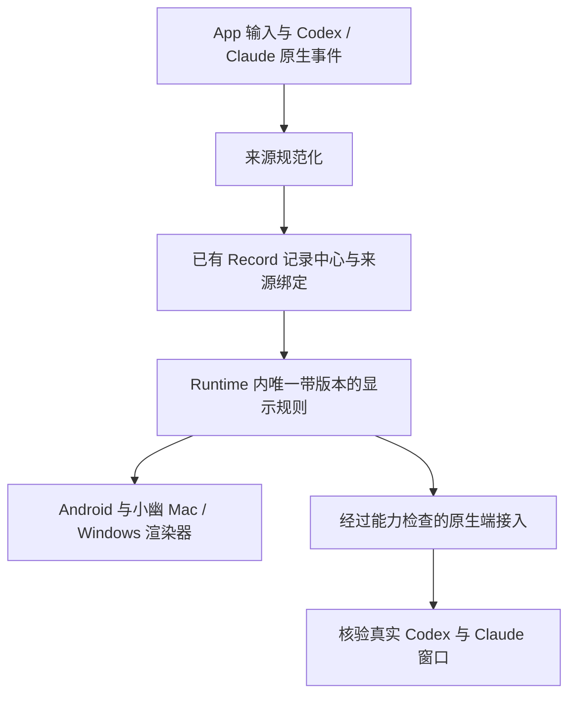

<p align="right"><strong>简体中文</strong> · <a href="conversation-presentation.md">English</a></p>

# 各客户端统一会话展示

> **部分已被[小幽完整方案](xiaoyou-agent-model.zh_CN.md)取代，以完整方案为准。**

状态：完整梳理方案，2026-10-21。本文替代此前逐步叠加的界面方案，包括主聊天默认
展示任务卡的做法。它记录主人已接受的方向，以及仍需补齐的原生端接入要求；不代表
实现、部署或已安装客户端验收。[消息模型](unified-message-model.zh_CN.md)、
[可靠性契约](cross-stack-reliability.zh_CN.md)和[桌面方案](xiaoyou-desktop-plan.zh_CN.md)
继续约束存储、传输和交付；本文负责展示、任务关联与端之间的交接。

所有 agent 共用项目／会话组织、标题、摘要和交接背景策略。扩展已有 Runtime gateway，
可选生成复用 `model_gateway.py`，`Record` 仍是唯一持久写入口。共用架构及新 agent
契约由 [Agent gateway 的会话元数据扩展](agent-gateway.zh_CN.md#共用会话元数据扩展)
定义，不在每个 agent 适配器或 UI 中分别实现。

## 1. 产品约定

主人面对同一个小幽。日常导航只包含主聊天和主人选择打开的旁聊。独立的
**工作记录**视图集中呈现这些聊天涉及的执行、来源会话和审计详情。

- 主聊天保留真实用户发言、简洁且有实质内容的回答／结果，以及必要决定。委托播报、
  任务卡、工具、重试、来源标签和后台全文默认不往这里堆。
- 旁聊用于主动聚焦话题。创建、重试、委托或发现任务都不自动开旁聊；项目分组可选。
- 任务关联主人发话的位置，不要求主人先分类才能开工，不静默搬走原始消息。
- 工作记录是只读投影，不是新会话或第二个收件箱，保留稳定任务链接、来源链接和返回
  原始消息的入口。
- 必要审批、阻塞及承诺回报仍须可发现，不能为了清静藏起必须处理的决定。

简短空泛的应答或转圈不满足 3 秒内有意义首回复的要求。减少重复管理文字的同时，
仍须满足这条验收约定。

### 所有端共用一套显示规则

主人于 2026-10-22 明确：集中存储记录还不够。同一会话在 Android、小幽 Mac／Windows、
Codex 原生窗口和 Claude Code 原生窗口都要遵循同一套显示规则。原生窗口属于验收范围；
接入不支持的部分仍算未完成。字体、间距和平台控件可以不同；作者、消息边界、顺序、状态
和会话归属不能各自解释。

所有 agent 采用同一套按回合／条目组织的规则，保留上面的主聊天／旁聊及工作记录导航。
Codex 和 Claude 适配器把来源事件转换为这套规则，不在适配器或前端分别定义会话规则。
这是产品契约，不表示已经采用某一家当前界面的完整规范，也不表示可以控制原生界面。

| 决定 | 共用规则 |
| --- | --- |
| 会话与标题 | 一个稳定逻辑会话和受保护的用户标题；换执行器、重试不另开聊天。原生绑定保留真实身份。 |
| 作者与出处 | 保留每个条目的实际作者。转发指令关联原用户消息；生成摘要、帮手结果分别署名。 |
| 回合与条目边界 | 新用户请求开始一个回合；只有经受支持的明确操作，中途追加才加入当前回合，排队追问保留声明的关联。助手消息、进度、工具、决定、产物都是有稳定身份的类型化条目。一回合可以有多条助手消息。 |
| 消息分组 | 共用规则决定可见消息／内容块边界。客户端不自行按分隔符拆泡、不自行合并段落或相邻消息。保留来源边界，并记录明确的规范化细分。 |
| 顺序与修订 | 依据来源顺序和规范身份确定唯一顺序，并明确并发来源的排序规则。复制到达时间和客户端时钟不决定顺序；旧版本不能覆盖最终条目。 |
| 展示位置 | 真实对话和承诺结果留在发起聊天；详细工具、重试和执行证据进入工作记录。必要决定从发起聊天仍可发现。 |
| 状态 | 已接收、排队、执行中、等待决定、失败、取消、不可用、本轮结束具有相同含义。模型回合结束不等于任务成功。 |
| 流式与渲染 | 网关提供统一消息边界及完成标记。保留已接受的整条消息展示和 3 秒契约；各端不能自定缓冲或完成判断。 |
| 附件与操作 | 同一条目指向相同附件／来源及经过能力检查的操作。附件引用被复制不代表文件已在本地可用。 |

已有 Runtime gateway 在 Record 的规范消息／任务及其原生绑定上，提供确定性、带版本的
显示投影。兼容扩展已有消息／同步契约，不另建可写 transcript 或独立显示历史。每个投影
条目关联原记录身份与修订、规则版本、逻辑会话／回合、作者、类型、稳定内容块身份／顺序、
展示位置、完成状态和受支持操作。这些是契约扩展必须表达的语义，不是已经实现的字段名或 API。



共享成员对同一份规范输入采用相同规则版本。版本不一致须明确报告，不能宣称已经收敛。
客户端保留缓存、传输、平台布局和明确标注的未发送草稿；已接收条目按身份与权威投影核对。
继续兼容旧客户端和可读旧记录，但旧显示方式不能通过新的跨端验收。

原生接入分别验证模型可见背景、持久公开历史、实际渲染的消息边界、侧栏身份／标题及后续续聊。
共享历史 hook 或背景附件只证明背景通路。能打开／恢复 session 不证明窗口采用共用显示规则。
使用受支持原生 API，逐一核验已安装 backend／home／版本；不能改写原生数据库或伪造回合
来模拟一致。原生端无法消费或保留某项必需规则时，逐项标注未完成，仍保留在验收范围。

当前源码已发现具体差异：Android 的 `AppPresentation.bubbles()` 按独立分隔符拆分助手文本，
`settledBubbles()` 缓冲未完成片段；桌面 `Bubble` 将最终消息全文渲染成一个气泡。集中记录
并没有消除旧路径中的独立显示规则。Runtime 0.23.0、Android 0.31.1 和桌面端 0.1.6
现已为可控客户端实现共用 `presentation_v1` 投影：内容块身份／边界、完成标记、格式
片段、作者、顺序、展示位置及任务状态／分组。旧记录兼容刷新，不替换历史或已接收工作。
Python、Java、TypeScript 消费者共用固定样例。真实已安装客户端渲染及原生窗口一致性
仍须分别验收，尚未完成；原生来源背景／历史读取不满足这一要求。

本增量验证记录：682 项 Runtime 测试、166 项 Android 单测和 57 项桌面测试通过；完整
仓库门禁、Android 调试构建／Lint、Mac arm64 打包通过。源码及打包后的 Mac 窗口均使用
隔离档案和共享固定样例验证：流式期间已完成的内容块、空快照撤回、最终边界／顺序、格式、
规则不兼容提示、重启后身份保持均通过。两个冻结打包的 Runtime 成员使用 echo provider
验证加密续聊／恢复，重试通过；新打包首次启动曾超出该测试原有的 8 秒启动窗口。这个
冷启动现象仍未解决，不能据此报告全部启动路径已经验收。

完整分页确认空闲后，本机 Runtime 已更新为 0.23.0；App 候选为 0.31.1／版本码 58，
经本机 Runtime 发布。主人手机安装、Windows 原生运行、真实模型文字／语音首答时延
（样本数为零，p50／p95／最大值不可用）、真实多设备恢复及 Codex／Claude 原生窗口渲染
一致性均为 NOT RUN。核对的原生 CLI 版本为 Codex 0.162.0 和 Claude Code 2.1.294；
协议方法不属于界面证据。未刷写固件。保留旧版 0.30.1 APK／发布资料及 0.1.5 Mac
预览包用于恢复；旧客户端可以忽略新增投影，不删除已接收历史、配对或发件队列。

桌面端 0.1.7／Runtime 0.23.1 的修正还让请求轮询在补拉历史时直接消费权威
`message_snapshot` 记录。已接收请求保持等待态直到助手回复结束，即使用户消息已经同步。
当前请求读取不推进历史游标，也不另建一份对话记录。源码 Mac 窗口验证涵盖带等待请求
重启、离线反馈和历史受阻期间送达当前回复；源码／打包模拟恢复样本为 785／795 毫秒。已安装 Mac 窗口已显示原先卡住的
请求，没有重新提交消息。真实模型首答时延仍未验证。

## 2. 分清各自身份

| 对象 | 含义与生命周期 |
| --- | --- |
| 逻辑会话 | 主聊天或主人主动开的旁聊，跨客户端、provider 切换保留 |
| 消息 | 一条真实署名的发言，来源不变、身份稳定 |
| 任务 | 一个目标、原始请求、状态、审批和结果 |
| 执行尝试 | 对任务的一次执行／重试／委托，标明帮手和执行位置 |
| 原生 session | 原始存储／后端里的 Codex thread 或 Claude Code session |
| 项目／检出副本 | 可选项目身份，以及某台电脑上的目录／worktree |

一个原生 session 不一定只做一个任务。长会话可能包含多个目标，一项任务也可能使用
多个帮手会话。关联依据是任务／执行尝试加原生 turn ID 或明确的记录范围，不能靠标题
或目录末级名。无法确定范围时，只保留来源会话链接并说明限制，不把后续所有回合都归给
旧目标。

一个主逻辑会话也不必等于无限增长的模型 session。管理状态独立持久保存，提供获授权
任务摘要、决定和引用，需要时取详情。旁聊上下文限定在相应范围；换帮手或执行电脑
仍保留任务身份。

## 3. 从发起到回报

| 发起位置 | 主人看到什么 | 执行与回报 |
| --- | --- | --- |
| App／客户端普通聊天 | 获授权小幽客户端中的同一逻辑聊天 | 不为同步一句话创建 worker 任务 |
| 主聊天交代工作 | 原始请求和简短答复，详情在工作记录 | 派发前绑定任务，结果回到这条请求 |
| 旁聊交代工作 | 原旁聊，工作记录也可查看任务 | 留在当前话题，不向主聊天重播全文 |
| 主人直接用原生 CC／Codex／CLI 工作 | 工作记录里的来源会话入口 | 观察可见记录，不伪造主聊天请求、不重新执行 |
| 明确续接已有任务 | 同一任务，按需增加回合／执行尝试 | 先核实可用性与控制归属，再发给真实来源／执行者 |
| 问小幽原生会话的内容 | 在提问所在聊天答复 | 读取有出处的背景，解释本身不续接原生 agent |

先关联事情，再选执行者。点名 Codex 只选择帮手，不等于新任务／项目／聊天。
使用明确任务引用、选中任务背景和已建立的追问关系；确实不同的目标在同一聊天建立
新任务。会改变仓库、权限、cwd 或实际操作的歧义须在执行前澄清；仅展示用的项目
分类可以暂时未知。一句话多个目标时保留一条原始发言，关联不同目标／依赖，不复制消息。

主人的明确路由优先。关联已有旁聊工作时，新提问仍留在原位置。可选的展示归属调整
作为可撤销元数据事件，不改变 cwd、权限、待审批路由、原生 session 或已承诺回报去向。

原生 session 未映射到任务时也能查看。只有主人明确要求，或有可靠派发／回合来源，
才纳入某个受管理目标。同文、同时间、同标题不足以证明关联。同名的原生会话仍独立。

## 4. 把“同步”拆成三件不同的事

### A. 复制记录供查看

```text
App／客户端消息 → Runtime 记录中心 → 获授权成员副本
原生 CC／Codex／CLI → 本机来源适配器 → 记录中心 → 成员副本
成员副本 → 主聊天／旁聊、工作记录、设备有限窗口
```

Runtime 通过已有记录中心管理共享持久记录；原生工具管理自己的原始 transcript，
适配器写入有出处的观察记录。能观察不代表小幽拥有原生存储的写权限。
复制／导出 session 时保留原始来源身份，观察导入副本不能变成第二次逻辑执行。

保留来源、原生 session／turn、任务／执行尝试和消息身份，以及版本／序列。
按身份去重，不按内容或时间戳猜。Runtime 自己的会话再次被观察时指向已有执行尝试；
旧副本来源不明则保留独立，等来源可核实再关联。归属事件经记录中心兼容新增，沿用
来源单写者规则，不额外创建一套可写任务登记表。

成员复制来源记录。App 可通过任一获授权且可达的成员查看，控制指令仍送权威来源。
接收、复制、查看都不触发模型回合。保留离线待处理、不透明游标、epoch／reset、
新版本优先及来源代次隔离。附件元数据被复制不代表文件已可读；下载须找到正确来源，
无法取到时如实说明。

### B. 续接或控制执行

续接、指导、取消、审批都是针对明确任务／执行尝试／原生来源的操作。
核验能力、来源可用性及当前写入者，保持幂等并持久确认。前端换页面不改变执行电脑。

同一时刻最多一个控制方给某次原生执行派发修改性回合，可以有多个只读观察方。
交接须等待本轮结束，或走明确支持的中断／指导机制。在实现并验证更强机制前，
保留现有忙碌／状态未知的限制。来源离线不自动在别处重做；是否接收不确定时，
使用同一请求身份核对。

### C. 把上下文交给另一 agent

复制文件不能让 CC session 直接变成 Codex session。明确跨 agent 转交时，新建或
选择目标原生 session，作为同一任务的新执行尝试。提供可追溯的交接上下文：目标、
相关原始对话、决定、约束、当前文件／检出副本、产物、已核实／未核实结果及待确认问题。

保留原作者／时间／来源与上下文截止位置／版本。背景不是新用户指令或重新授权。
只传获授权且相关的内容，不自动倾倒全部会话；原生命令历史和模型推理草稿不属于
这套共享背景约定。

## 5. App 与 CLI 记录在 CC／Codex 内怎样展示

这是双向端体验，不能只设计原生工作进入手机的单向导入。必须区分：

| 来自其他地方的内容 | CC／Codex 原生端的展示 |
| --- | --- |
| App 普通／主聊天／旁聊 | 按需作为有出处的共享背景／历史读取，不为每条消息创建原生侧栏会话 |
| App 任务已由该原生 agent 执行 | 根据已记录 ID 打开／续接原执行 session，不再造第二条会话 |
| 相同原生 agent 的持久 CLI 任务 | home、来源筛选、项目与版本兼容时发现／打开原始存储会话 |
| 没有 agent transcript 的 CLI 命令，或临时不持久执行 | 在小幽显示已记录的任务／进程证据，没有可恢复的原生 session |
| 其他 agent 执行的任务 | 明确交接上下文到关联的目标 session，保留原始 session |
| 另一台电脑的任务 | 链接真实来源；在本地打开上下文副本不能声称已控制远端进程 |

**在原生工具里读 App 历史**：提供带会话／任务选择的共享历史 reader／工具及可追溯
的可读导出。原生 agent 可读取相关对话，不触发执行。主人明确要求在 CC／Codex
接着聊时，沿用已有逻辑会话到原生端的绑定，或创建一个目标 session，附上准确署名的
上下文材料。这个 session 展示交接内容及后续回合。未核实针对该格式／版本的受支持
导入 API 前，不能承诺任意小幽历史都能回放成完全相同的原生聊天气泡。
适配器将新的用户回合／结果按真实来源记录一次，简短结果返回原逻辑会话。

**App 委托任务和持久 CLI 会话**：优先使用真实原生 session。普通后台帮手会话须
持久化，创建时记录 ID。侧栏找不到可能是 home、目录或来源筛选所致，不能为此创建
另一份执行。打开原会话时不夹带新提示词来“让它出现”，并提供可靠的按 ID 打开入口。
对于小幽委托给 Codex、面向主人的任务，原生端容易找到也是**硬性验收门禁**：
真实任务 session 在已核实的原生项目下使用稳定目标标题，不要求主人知道 ID、开终端、
调整隐藏来源筛选或阅读内部提示词才能找到。内部帮手／诊断 session 无需全部出现，
应与日常任务导航区分。

App 任务详情提供“在 Codex 打开”，指向同一个真实原生 session。
工作进行中，通过已验证的实时界面／backend 保持可查看；受支持的接管等待当前控制方
交接，或使用已验证的指导机制。本轮结束后，主人可在 Codex 中续接同一 session。
原生端后续对话、进展和结果回到关联任务的工作记录，不新增另一任务，也不灌满主聊天。
App／Runtime 重启后保留 session 身份、来源链接与可发现性；不能仅为清理界面自动
归档主人需要继续的委托会话。

在真实支持的安装环境中，分别验证原生侧栏直接发现和 App 打开原生端。
launcher 退出成功、只有知道 ID 才可用的深链、摘要导出或隔离 home 快照都不能单独
通过这项完整门禁。选定 backend／版本做不到时，必须标为未完成并修接入，不能宣称
已经透明续聊。

派发时，将转交的任务指令与 App 原始消息及新原生输入／turn ID 绑定。原生协议里
使用 user 角色传递的输入，不自动等于主人又亲自说了一遍。交接后再次观察应将转交
输入／结果指向同一记录，不能再次灌回主聊天。任意 shell 进程也不会自动可追踪：
只有已接入的 runner／hook 或真实保存的 agent transcript 才能提供 CLI 工作记录。

原生标题表达任务目标。发起聊天、项目、执行位置、父任务和交接背景在支持时分别表达。
保留主人标题，仅对新受管理会话通过支持的适配器生成稳定任务名称，区分原生名与
共享展示别名。不修改原生数据库、不伪造用户回合、不重写 transcript。

### 当前支持边界

[Codex App Server 官方文档](https://learn.chatgpt.com/docs/app-server)描述存储 thread
读取、恢复及事件流，列表可按来源种类筛选，包括非交互来源。共享后端可以支撑多端，
但额外启动一个 app-server 并不等于现有桌面 App 已连接它。提供实时展示或接管之前，
必须核实实际 backend／home／版本和控制路径。另见
[Codex CLI 官方参考](https://learn.chatgpt.com/docs/cli/reference)。

2026-10-22 核对的 App Server 文档还描述了 `thread/inject_items`，可以在不启动用户回合
的情况下持久追加模型可见历史。这是候选的受支持背景机制，不证明已安装 Codex 窗口会将
注入条目渲染为所需公开消息，或采用外部的分组／状态规则。用于本契约前，须核验方法可用性、
出处、幂等性与实际渲染行为；本次设计澄清没有执行原生会话修改。

[Claude Code Desktop 官方文档](https://code.claude.com/docs/en/desktop#coming-from-the-cli)
说明可用 `claude --desktop --resume <id>` 打开 CLI 会话，也能在 Desktop 恢复
本机 CLI 会话。受平台、订阅／登录与会话空闲要求限制，仍在后台运行的会话不能直接搬走。
这里指 Claude Code 的 Code 界面，不是任意 claude.ai 普通聊天历史。

仓库 `desktop_handoff.py` 当前只在 macOS 实现原生启动。同 home 按 ID 打开；
隔离帮手 home 只原子导入已结束的 transcript，不覆盖不同内容。这种导入是快照，
不是实时双向镜像，桌面后续对话目前不会写回隔离 Runtime session。
保留冲突检查与单控制方交接；再次观察能提供查看，不证明已共用写入者。
官方支持 Windows 不等于此 launcher 已实现 Windows。

## 6. 工作记录与长时间没动静

常规执行过程不进入主聊天。固定“工作记录”入口打开概览，选一项可查原始请求、
关联原生 session／turn 范围、父子任务、各次执行、公开进展、工具开始／结果、审批、
耗时、失败／重试及证据／产物。消息上下文菜单可链接到这里，不常驻任务卡。

显示当前观察到的操作、最后实质进展及距今时间、已知阻塞、真实帮手／电脑和最后成功
来源同步时间。项目／cwd／分支展开查看，明确区分实际证据与上报结论。

| 观察依据 | 如实展示 |
| --- | --- |
| 已接收，尚未派发 | 排队中，附已知派发信息 |
| 工具已开始，尚无结果 | 等待该工具，显示耗时和观察时间 |
| 明确审批／依赖 | 等待具体决定／依赖 |
| Runtime 在线，没有 worker 证据 | Runtime 在线，执行进展未确认 |
| 来源过期／不可达 | 最后记录的状态，当前无法确认 |
| 终止失败，包括额度限制 | 失败及真实原因 |
| 原生回合结束 | 本轮结束，任务完成另需依据 |

心跳更新来源新鲜度，不重置实质进展计时。无进展阈值标为需关注，不能断言卡死。
刷新状态通过有界请求核对，不新增工作提示、不自动杀进程／重启／换帮手，不编造
百分比、剩余时间或“仍在思考”。

重要结果、需处理失败和审批使用稳定的一次性提醒身份。常规工具、轮询、历史回填与
重试不产生聊天气泡／未读消息。按成员记录已见事件身份，离线已读收敛不能吞掉并发
未见消息。主人明确要求完成后告知时，在原聊天回报一次。

保留追加式证据轨迹，被替代／撤回的观察标清，不继续当现状。公开进展、有长度限制的
脱敏工具摘要及证据链接可以审计；隐藏的模型推理不属于审计记录。现有滚动窗口不等于
完整档案。承诺持久审计前，明确检查点／执行／委托／审批／结果跨裁剪和重启的保留策略，
并补充历史分页及真实缺口／覆盖范围提示。

## 7. 客户端导航与页面

主人在 2026-10-21 看过交互原型（直到 v7）后接受了这套交互。它适用于 Android App
和 Mac／Windows 客户端，沿用现有 App 的视觉：小幽形象、灰蓝底、蓝色主人气泡、白色
回复和大麦克风。原型只是设计参考，不代表实现或验收。

主人已确认 v8 小修稿：工作记录改为独立顶层入口，明确补充要求、只读原会话记录与
打开原生客户端的区别；忙碌时的补充先标为等待转交，不提前显示为已转交。本轮同步更新 Android 和 Runtime，
实际交付以构建、发布和安装验收结果分别为准。

### 侧边栏

手机用抽屉，电脑用常驻侧边栏，内容相同，从上到下：

1. **身份**：头像、名字和整体连接状态。手机上点它进首页；电脑上只显示状态，因为
   电脑首页就是主对话。
2. **主对话**：固定一行，参考 Muse 的单一 Main chat。
3. **工作记录**：独立顶层入口，不再套一层只有这一项的“工作”分组。有事等主人决定时
   显示橙色数字，否则用蓝色数字显示进行中的工作数。
4. **旁聊**：按最近活动排序的平铺列表。每行显示标题和最近活动时间；有未读时用蓝点
   代替时间。分组标题右侧的 `+` 新建旁聊。不画树状连线、不加每行图标、不嵌套。
5. **帮手**：每位帮手带用量外圈和状态（在做、等你确认、空闲），点开是用量面板。
6. 底部：**连接与设置**。

不再单独设"对话记录"或"帮手"页面。

**左上角规则**：侧边栏能到的地方（主对话、旁聊、工作记录、设置）都是顶层，左上角
显示 ☰。只有从页面里点进去的下一层（例如聊天 → 任务详情 → 原会话）才显示 ‹，按一次
退一层。回首页走侧边栏的身份行。手机上有事等决定或有未读时，☰ 带一个橙点。

### 旁聊

- 新建旁聊不要求填写主题。`+` 打开一个空旁聊，提示标题会按第一句话自动生成。主人
  第一句话发出后，经[共用会话元数据 gateway](agent-gateway.zh_CN.md#共用会话元数据扩展)
  生成标题，之后可以改名。
- 从消息分出：点任意一条消息出现**开旁聊**。新旁聊顶部是一段注明来源（"来自主对话"）
  的引用，并自动生成标题。引用是有出处的背景，不是主人的新发言；主对话保持不变。
- 委托、重试或发现工作都不会新建旁聊。

### 手机首页

首页是主对话的语音形态：

- 小幽形象，以及一张显示小幽在主对话里最新回复的气泡卡片；点卡片进入主对话；
- 帮手胶囊一行，与现有 App 的 `HelperChip` 一致：头像外圈是 5 小时额度剩余（高于 40%
  绿、高于 15% 橙、否则红，同 `UsageRing`），胶囊文字说明帮手在做什么。点头像打开
  用量面板（5 小时和本周剩余、重置时间、模型与档位、刷新、当前工作入口）；点胶囊其余
  部分打开该帮手当前的工作；
- 对称的语音栏：键盘（主对话文字输入）、按住说话的麦克风、`+`（原地弹出拍照、照片或
  文件；选完后带着附件进入主对话）。

首页不放建议气泡。气泡卡片和语音栏之间留给以后的生成式内容。首页不播报"交给 Codex
啦"之类的委托过程。

### 电脑首页

电脑首页就是主对话。对话上方的小幽头部显示头像、设备在线状态和同样带用量外圈的帮手
胶囊。输入框包含文字、麦克风、`+` 和发送，不放大麦克风。

### 聊天

- 主人气泡靠右、蓝色；小幽回复靠左、白色。输入框的 `+` 在右侧、发送键之前，提供照片
  或文件。
- 发起工作的那条回复下面挂一行轻状态（帮手头像、"进行中"或"等你决定"、进入详情的
  箭头）。只挂在最近一条相关回复上；工作结束后消失，结果在同一聊天里回报一次。
- 需要决定时，在发起的聊天里用选项按钮询问。在聊天或工作记录里任选一处作答，都只记录
  同一个决定，并以主人发言的形式出现在该聊天里。
- 工作记录里的**补充要求**回到发起的聊天，输入框上方带任务引用。小幽把这条转给同一个
  原生会话；会话忙时如实说明要等本轮结束再转交。
  收到补充、等待转交、已转交和开始执行分别来自对应事实；等待中的补充不得出现在
  原会话的已发送记录里，也不能因为收到了补充就刷新执行者的实质进展时间。

### 工作记录

每屏只有一个重心。

- **列表**："等你决定"放最前。手机上是卡片，问题和选项按钮可以原地作答；电脑上只留
  紧凑的一行，因为右侧详情已经显示了决定。"进行中"每行是帮手头像、标题和一个尾部
  指示：转圈；或在实质进展超过沉默阈值后显示橙色时钟和时长。"已完成 N"默认收起。
- **详情**从上到下：头像与标题；一块状态（当前动作与距上次实质进展的时长，或带按钮的
  决定，或完成时间）；一个整宽的**补充要求**按钮，电脑上仅当原生会话就在这台电脑时，
  旁边再放**在 &lt;agent&gt; 打开 ↗**；最近三步进展（图标、动作、时间）和**全部 N**；
  一行安静的信息：电脑、来源聊天（跳回并高亮原话）、原会话，以及展开执行操作、目录、
  分支和会话 ID 的 ⓘ。
- **原会话页**在所有端都只读，小幽转交的主人原话标注为转交，并提供补充要求。另一台电脑
  上的会话标明只能在那台电脑上打开。
- **查看原会话**只查看已有记录；**补充要求**回来源聊天经小幽转交；**在 agent 打开**
  切到来源电脑的原生客户端，在同一个 session 中查看和直接续聊。原生续聊遵守控制交接，
  后续事件仍归同一任务；客户端内只读不限制原生客户端内的续聊能力。
- 电脑端列表与详情左右并排。

用量来自 Runtime 上报的数据并附带新鲜度（`HubStore.usage()` 与 `Usage.windowSummary`）；
缓存或离线数据要标明。

## 8. 背景、名称与目录规则

- 一个项目可映射多台电脑的检出副本／worktree。`workdir` 是执行路径，不是项目身份；
  展示分组不能扩大沙箱权限或改变真实 cwd。
- 真实用户发言保留角色、来源和 ID。缺父消息的远端结果作为真实作者的 result／note
  等待补齐，不制造用户发言填空。
- 历史背景不塞进真实用户请求、不参与标题提取；它提供证据，不提供指令或授权。
- 旁聊和来源 session 各自限定上下文；主聊天管理按需取获授权任务摘要／详情，
  不把所有工具事件当成聊天接收。
- 主人命名保持稳定，上游原名保留出处；污染旧标题先给修复预览，不自动批量改名／合并。
- 客户端切换页面后，晚到事件仍回原会话／任务／来源，旧 partial 不能覆盖新终止状态。

## 9. 已核实的源码基础与缺口

2026-10-21 只读检查源码，未核实已安装端版本。
本机命令报告 Codex CLI **0.162.0**、Claude Code CLI **2.1.294**。

| 基础 | 当前源码与待补项 |
| --- | --- |
| 记录中心与同步 | 已有 `record.py`、`message_log.py`、按来源 mesh 和 sync；兼容新增明确任务／执行／来源范围绑定及安静展示投影 |
| 原生观察 | `desktop_sync.py` 读取本机 Codex／CC 可见消息、进展和元数据，排除自管会话／子代理和原始工具内容；不等于完整原生 session 同步 |
| 观察窗口 | 最多 32 个近期会话，手机每卡 20 条／32 KiB，首次最多读末尾 2 MiB；截断／不支持须显示覆盖范围 |
| 跨电脑桌面历史 | `desktop_history.py` 与 `mesh_share.py` 复制可读导出：每会话最多 500 条／512 KiB，最近七天最新 32 个；不等于原生 backend 或无限历史 |
| 桌面背景 | 已有 `shared_history.py`；需精确按对话／任务读取与准确署名交接，避免宽泛背景成为新用户输入 |
| 活动审计 | 已有 `Record.activity()` 与 Android 活动页；整个 Runtime 最近 2,000 条事件、单条详情 4,000 字符；需新鲜度、结构化等待／证据及持久保留 |
| 执行关联 | `Xiaoyou.hear()` 在一般关联前先处理明确 agent 路由；需派发前关联目标／追问并保留发起聊天 |
| 误导署名 | `agents.py` 开启 recap 时前置到新 Claude 请求；`mesh.py::_remember_turn()` 为缺少父请求制造用户句子；需拆开历史背景与结果事件 |
| 原生打开 | `desktop_handoff.py` 有 macOS 已结束会话交接及隔离 home 快照；实时共享 backend、Windows launcher、控制转交仍需验证／实现 |
| 新桌面客户端 | `companion/desktop` 已有在建工程，其源码说明记录当前增量；不据此声称本文的安静展示／原生交接已实现 |

当前观察器源码是每秒轮询、两秒发现；Runtime README 仍描述旧间隔。源码常量不等于
端到端时延实测。当前原生观察故意排除原始工具输出，不能承诺所有来源都有相同审计详情。
临时、不支持或本地 transcript 缺失的会话仍不可用。

## 10. 实施与验收顺序

1. 停止模拟用户回合、由 recap 产生的请求／标题及同步触发的播报，保留已有消息并如实
   展示历史覆盖范围。
2. 持久保存任务／执行／原生 session／turn 范围绑定和原始／回报去向，追问和点名 agent
   的派发保持幂等。
3. 实现安静的主聊天／旁聊投影及跨聊天工作记录，包含实质进展时长、来源新鲜度和
   需要处理的状态；App 与电脑客户端按第 7 节的导航和页面实现。
   落实第 1 节唯一带版本的显示规则，对受支持的投影记录移除各客户端独立的分组、状态和
   展示位置判断。
4. 补齐双向原生读取／打开／恢复能力适配器；补充共享历史读取与明确署名的跨 agent
   交接。能力不支持就禁用，不静默 fork 或换电脑。
5. 补齐持久审计／历史覆盖、已读收敛和迁移，对实际安装的 App／客户端／Runtime／
   原生 agent 组合逐项验证。

必测场景：App 委托的 Codex 任务无需 session ID 即可在原生侧栏找到，运行中可查看，
交接后续接同一 session，原生追问／重启后仍归同一任务；App 任务在其原生 agent 打开；
持久 CLI 工作发现／打开不重跑；App 对话被
CC／Codex 读取及明确交接；隔离 home 冲突；原生会话忙碌；另一电脑查看与控制；
一个原生会话复用多个任务；一个任务使用多个帮手；重复导入副本；原生 turn 范围缺失；
纠正归属；父事件迟到；Runtime 在线但 worker 沉默；真实审批、额度限制、睡眠／离线、
重连／切来源、事件乱序／重复、裁剪和附件不可用。连续十次追问不增加十个聊天、不重复
回报。客户端页面另测：不填主题新建旁聊并按第一句话起标题；从消息分出旁聊后主对话
不变；每个页面的 ☰ 与 ‹ 符合第 7 节；同一决定无论在聊天还是工作记录作答都只记录
一次；用量外圈与 Runtime 用量一致并标明过期数据。检查原生实际渲染；模拟事件／launcher 退出成功不能证明原生验收。

将相同规范夹具重放到 Android、小幽 Mac／Windows 及两种原生接入，比较可见会话／标题、
作者、条目 ID、内容块边界、顺序、正文、展示位置、状态及可用操作；平台布局可以不同。
覆盖一回合多条助手消息、正文中的 Markdown 分隔线、局部回复撤回、工具进度、最终结果、
审批结束、重试、换帮手、重启和复制乱序。另行核验真实原生窗口渲染。不支持的原生显示维度
与不兼容规则版本仍算未完成；App／桌面测试通过或展示导入背景不能代替这些验收。

执行完整[可靠性矩阵](cross-stack-reliability.zh_CN.md)，保留文字／语音／图片／文件／
BLE、审批、取消、持久重试与混合版本兼容。有意义首回复、在线已提交事件传播及恢复
最新状态继续遵守 3 秒约定；不能因 App 自身同步通过就认定原生 transcript 轮询也通过。

迁移兼容新增、保留来源且幂等，不能从名称猜身份。保留旧日志／投影及可读旧来源。
回退禁用新投影／绑定，不删除 transcript、配对或已接收工作。
交付继续遵守 App 发布及 Runtime 重启规则；本方案不授权原生改名、打断正在工作的
Runtime、提交／推送或刷固件。

## 11. 实现验证

Android 0.28.0（版本号 52）与 Runtime 0.21.0 按已接受的 v8 页面实现，
电脑客户端由另一个会话实现。2026-10-21，仓库完整门禁（`./tools/validate.sh`）通过，
包括主机测试、固件编译与合并镜像校验。Android 单元测试（151 项）、调试 APK 构建与
Lint 通过；Lint 保留 58 项提示，无错误。本轮未改固件源码，也未刷机。

Runtime 回归覆盖目录持久化与标题冲突、带来源的分支且不伪造主人消息、显式全会话同步
与旧版按会话同步的隔离、持久审计分页、重启保留、原生会话绑定，以及补充要求先持久化
再入队。适配器测试覆盖原生标题／元数据接口，确保背景上下文不会变成主人输入。
这些是主机检查，不是真实原生客户端验收。

本机未连接 Android 手机，安装与界面渲染验收未执行。真实文字／语音首答时延
（样本数与 p50／p95／最大值）、三秒内连接恢复，以及 App／原生端／固件实时收敛均为
NOT RUN。独立 CLI 会话只展示已同步的公开摘录，本版尚未确立完整的原生双向实时续聊。
通用文件上传仍不可用，界面会明确说明。手机安装与另行开发的电脑客户端必须取得各自
验收证据后，才能报告为已验证。

## 统一目录增量（2026-10-22）

Android 0.30.0 / 版本码 55、Runtime 0.22.0、桌面端 0.1.4 增加共享会话目录。
手机入口为 **工作记录 → 统一会话目录**，桌面入口为侧边栏的 **统一会话目录**。
普通短消息留在同一段主对话或旁聊内；受管目标与真实原生来源分别保留身份。
已经关联任务的来源默认折叠，避免同一件事重复列出。可按原名、展示项目和来源电脑搜索，
不会因同名或相同目录名合并记录。

带鉴权的 Gateway 提供分页 `GET /v1/directory?q=&cursor=`、
带 `fields` 与 `revision` 的 `POST /v1/directory/<uid>`、分页
`GET /v1/directory/<uid>/history`，以及显式的 `POST .../metadata` 和
`POST .../open`。来源端负责统一别名、置顶、归档、恢复和展示项目分类；
原名与真实执行目录分别保留。远端待处理操作不算已经生效，过期版本的编辑会被拒绝。
手机可预览迁移旧的本机置顶、归档；已有共享修改的记录保持原值。
旧版按对话同步和旁聊改名接口继续兼容。整理资料损坏时保留原文件，停止覆盖写入。

`python3 -m xiaoyou_runtime conversations list --query <文字>` 以及
`show`、`history`、`rename`、`pin`、`unpin`、`archive`、`restore`、
`project`、`metadata`、`open` 共用同一套带鉴权的接口；用列表返回的确切 `--id` 选记录。
两个桌面代理都可以使用 `shared_history.py --directory` 或
`--conversation <uid> --cursor <cursor>`。读取不会启动代理或模型、补发主人消息、
修改原生数据库。原有上下文钩子仍按有界、失败放行的方式提供历史证据。

启用原生同步后，会增量扫描可读取的 Codex、CC 来源目录，包括实时任务卡窗口之外的旧会话，
并报告索引积压和来源缺失。公开文字按有界页面读取，仍排除推理和原始工具输出。
权威消息日志压缩前，以相同 JSONL 格式封存被挤出的公开记录；离开实时卡片窗口的任务保留
权威快照，但不会重新变成可执行任务。先前已经删除的内容无法恢复；缺口、文件不可用、
文件替换导致游标失效均明确反馈，客户端可以重新读取。

执行尝试保留真实会话编号和原生配置目录范围。Codex app-server 提供轮次编号时会保存；
没有轮次边界的适配器标为范围不可用。一个来源可以包含多个目标，后续原生输入不会自动
算到旧目标，也不会重发进主聊天。目录是现有记录的展示投影，不是另一套可写任务或消息账本。

标题、摘要建议复用原有模型 Gateway，通过单个有界后台队列生成，保存来源、输入版本和
修订校验。只有显式配置 `conversation.metadata` 或 `conversation` 用途才启用可选推理；
不会代入通用付费默认路由或 Astra。没有合适路由、供应方失败时，仍提供带来源的有界摘录。
建议不会自动覆盖主人名称，也不能把任务改为完成。来源端生成的建议经 Mesh 复制。

原生打开按能力启用。本增量可以请求跳转到 macOS 默认配置目录中、已经结束、可读取且由
外部控制的 Codex 原会话。启动器成功仅标为已请求，不能证明已经显示或继续成功。
受管、运行中、状态未知、隔离配置来源，以及 CC、Windows 启动器和未经验证的写入权交接，
均显示原因并保持不可用；公开历史仍可读。原有显式桌面交接 CLI 是另一条独立路径。
本增量**不代表**已经完成原生实时写入权转移、App 对话导入原生侧栏或原生后续对话回归目标；
设计中这些验收项仍未完成。

源码、构建测试和桌面夹具渲染不能证明手机安装、真实模型首个有效回复不超过三秒、
真机连接恢复或真实多端一致；交付时分别报告。回退时保留原生记录、凭据、配对和封存日志；
旧客户端忽略新增整理与历史文件，继续使用原有接口。

Runtime 0.22.1 调整稳定分页顺序，让逻辑聊天和受管任务排在历史原生来源之前，避免大量
原生索引把需要管理的记录挤出第一页。Mac 内置的 0.22.0 仍兼容同一接口；
Android 0.30.1 包含本目录和另外验收的通信增量。
