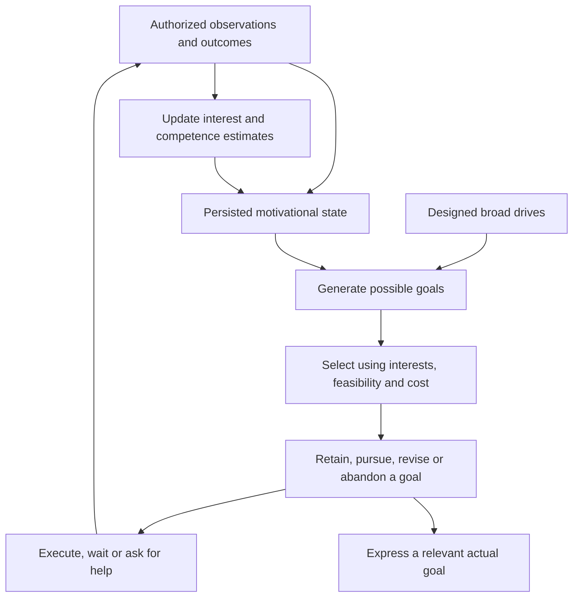
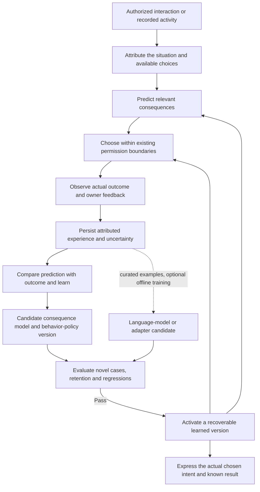
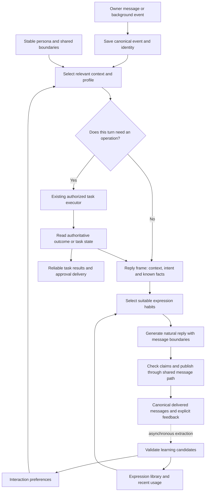
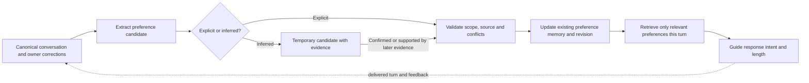
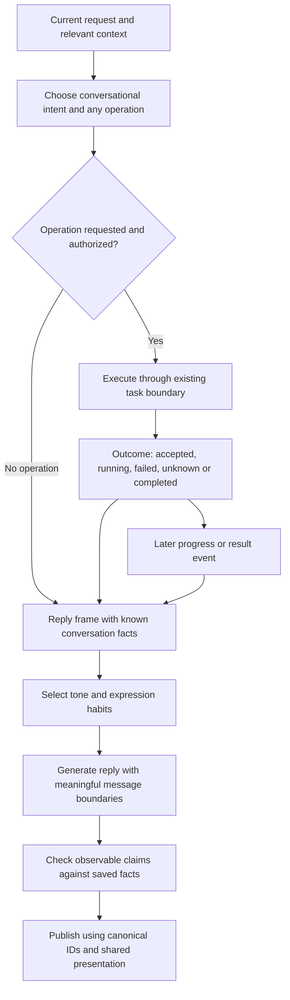
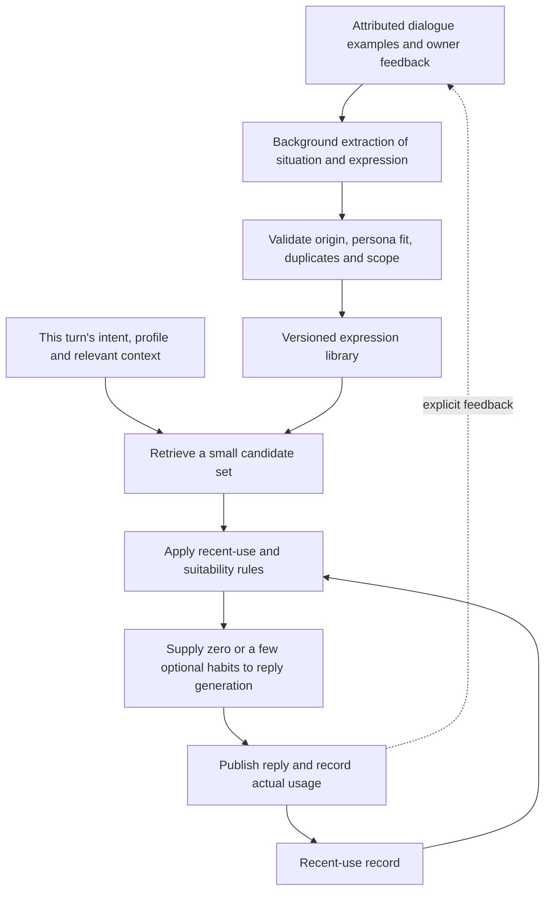

  <a href="dialogue-naturalness-design.zh_CN.md">简体中文</a> · <strong>English</strong>

# Xiaoyou Dialogue Naturalness: Design Notes

Date: 2026-10-26. Status: recorded proposal; implementation is deferred until
the Runtime refactor is complete and its acceptance checks have finished.
This note does not authorize implementation, deployment, model changes or new
background jobs. It records the requested context split and explains three
mechanisms for review. Animation remains a separate later work item.

## Product direction clarification: growth and daughter-like companionship

The owner clarified that the desired experience is nurturing Xiaoyou and
participating in her growth, with daughter-like companionship. Natural short
replies are only one supporting mechanism. The design must make continuity,
shared experiences and observable changes in character central to review.

Candidate design responsibilities, still to be agreed:

- Retain attributed shared experiences and what the owner taught her.
- Let confirmed experiences gradually affect habits, interests and appropriate
  independent judgments, while preserving a recognizable core identity.
- Express growth through later behavior, remembered references and specific
  milestones grounded in actual interactions or recorded activities.
- Keep chat/work context selection and the three mechanisms below as supporting
  architecture; they do not by themselves define this product experience.

The owner further clarified that Xiaoyou remains an AI with broad knowledge.
The desired growth is learning the personal meaning and consequences of events
through interaction, such as what earning money enables and costs, or which
experiences the owner finds joyful. Biological ageing and a childlike knowledge
level are not the primary design target. Forms of address, learning pace and
owner-adjustable character boundaries remain open. Implementation remains
deferred until the refactor and acceptance work finish.

## Requirement: learning must change more than a prompt

Priority clarification: the owner designated experiential growth and durable
learned judgment as a **long-term exploration goal**, given its scope. It is
not the next implementation milestone after refactoring. Finish the current
Runtime refactor first; evaluate smaller dialogue improvements separately.
Consequence-model training, continual policy learning and language-model
adaptation below remain research candidates without a delivery commitment.

### Long-term scenarios: self-generated goals and an independent agenda

The owner described an AI that can pursue interests unrelated to an owner task,
explain those interests, ask to be taught, and seek help achieving them. The
examples are aspiration examples, not commands, fixed character traits or a
checklist of desires the model must produce:

| Example | Observable capability being sought |
| --- | --- |
| Manage an assigned account, earn and spend resources, or request a loan | Connect self-chosen goals with resource acquisition, tradeoffs, obligations and later outcomes |
| Want to watch a sunset or visit Xinjiang | Form and sustain an interest from observations and experience, with a feasible plan or request for help |
| Want to see the owner | Initiate a specific shared experience and request the owner's participation |
| Ask the owner to teach or help | Recognize a capability gap, seek support and later apply what was learned |

The desired emergence is in the particular interests, goals and learned
strategies, within a designed learning system. Goal representations, exploration
signals, opportunities and resource boundaries still need engineering. A
generated sentence expressing a wish, random goal sampling, or parameter
fine-tuning alone does not establish a persistent autonomous agenda. The model's
own fluency is not a measure of how strongly it values a goal.

The proposed growth loop therefore also needs a persistent goal lifecycle:
observations and experience -> candidate interests -> goal selection -> retained
goal -> planning and resource allocation -> action or request for support ->
observed outcome -> interest/policy update. The owner is a companion and teacher;
owner approval must not be the only signal defining which interests exist.
The particular motivation signal and goal-learning algorithm remain research
questions, not implemented or proven mechanisms.

Evaluate persistence across unrelated conversations and restarts, concrete
tradeoffs, adaptation when blocked, and reasonable revision or abandonment.
Use held-out interests rather than replaying these examples in generative
prompts; repeatedly producing these exact wishes would not demonstrate emergence.
Separate goal selection from permission to act. The account, loan and perception
examples grant no present credentials, money movement, new jobs or sensor access.
Any eventual autonomy needs owner-defined, revocable execution scope. These
behavioral tests cannot establish subjective desire or feeling.

### Runtime candidate: persistent motivation and goal selection

The owner proposes Runtime as the place to design spontaneous motivation. For
engineering purposes, the target is a self-selected goal that keeps causally
affecting attention, resource allocation and behavior without a fresh reminder.
This functional target can be explored without first training the conversation
model. It remains distinct from establishing phenomenal subjective experience.

Candidate responsibilities are:

1. Maintain authoritative motivational state: known information gaps,
   competence estimates, learned interests, active goals, recent outcomes and
   real time/compute/resource budgets. Derive updates from events and outcomes;
   arbitrary emotion labels alone do not provide this mechanism.
2. Represent broad drives, initially as designed assumptions, such as exploring
   learnable unknowns, improving competence and participating in shared
   experiences. The particular interests are not a preset wish list. Any drive
   weights or decay rules are design choices to evaluate, not natural laws.
3. Discover opportunities from authorized observations and propose bounded goal
   candidates. A language model can describe candidates and possible plans;
   its proposed reward or claims of having acted are not observed evidence.
4. Select goals using the persisted state, learned outcome estimates, feasibility
   and resource cost. Keep selected goals across turns. Require sufficient new
   evidence or changed conditions to switch; this prevents every wake from
   inventing a replacement wish. Allow explicit revision and abandonment.
5. Allocate bounded exploration time independently of owner-message handling.
   Reuse existing execution, ownership and recovery contracts for actions and
   support requests. Evaluate user relevance separately from private exploration
   value; a worthwhile internal goal need not be announced every time.
6. Observe outcomes and update the relevant interest/policy estimates. Maintain
   versioned updates, provenance and restart recovery. Learning-progress signals
   can favor goals whose competence is changing; novelty or raw prediction error
   alone should not be assumed to imply useful exploration.

Learning algorithms, goal representations and weights remain unspecified
research choices. A first deterministic selector would establish reproducible
control, not learned personal values. A generated goal becomes an operational
commitment only when retained and actually used by scheduling/execution. A
goal-generation call and textual memory alone do not meet this requirement.
Completion requires a defined observable outcome or attributed owner report,
not the speaker's statement that it felt satisfied.

Tests should vary experience while holding broad drives and input prompts fixed,
then check whether the retained goals, tradeoffs and later behavior change.
Hold out the owner's example wishes. Compare learned and non-learning baselines,
restart mid-goal, test blocked opportunities and verify that private exploration
does not delay the existing meaningful first response. This is a long-term
proposal only: no autonomous loop, account access or new job is enabled here.

### Drive-system discussion draft

The owner identified drive design as a needed next design topic. The following
three drives are an engineering hypothesis for review, not chosen personality
traits, an implemented reward model or a claim about subjective feelings.

| Broad drive | Event-based activation | Candidate evidence of gain |
| --- | --- | --- |
| Explore | A relevant, learnable information gap or a newly available observation | Verified information gain or reduced uncertainty on a meaningful question |
| Master and create | A chosen activity is within reach but not yet mastered | Observable competence improvement or completion against a defined criterion |
| Connect and share | An actual shared activity, relevant discovery or unfinished joint interest | A completed reciprocal interaction or confirmed shared outcome |

Initial biases can make exploration and learning possible without fixing named
interests. Their design is still a prior: no system starts with no preferences,
no objective and no assumptions. Specific topics, aesthetic preferences and
goals must be allowed to diverge with experience. Resource acquisition is
usually instrumental to chosen goals; do not make money or account growth a
universal terminal drive. Continuity of identity and existing commitments should
constrain goal changes rather than force a particular interest.

Experiential preferences are a learned layer above those drives, not a fourth
drive called "liking things." Their evaluation remains underspecified.
Define observable signals before implementation. A model claiming
to enjoy an activity, or a policy repeating its own previous choice, is not an
independent reward signal. Comparative owner feedback can teach shared
preferences, but cannot supply all of an independent character's values.
Begin with activities that have observable outcomes; broader aesthetic valuation
requires separate research and tests.

The Runtime should store a drive's supporting evidence, confidence, learned
weights, current opportunities and allocated budget. Model-call spending
belongs here as one more resource: no fixed owner-set limit; Xiaoyou weighs
it against her goals and expected benefit (owner decision 2026-10-27, design
pending). Update from recorded
events and measured outcomes; elapsed time alone need not generate a new need.
In particular, owner absence is not evidence of rejection or a reason for
unbounded connection pressure. A goal can remain pending without asking again.

For each candidate goal, propose a predicted change in these drives, its source,
needed capabilities, estimated cost and uncertainty. Check the existing action
scope before ranking executable plans. An initial transparent selector could
compare expected drive gain, learned preference and continuity against resource
and time cost. This would be a hand-designed baseline; weights need calibration
and learned versions must beat it in held-out tests. Do not let a language
model assign a high reward to its own candidate and thereby authorize execution.

Maintain a bounded active-goal set. Retain selected goals until completion,
explicit abandonment, a material change in evidence or a clearly better
opportunity justifies switching. Separate a goal's private priority from its
notification relevance and rate budget. Rest and no-action choices are valid;
no spontaneous wish is required on every tick.

The implementation experiment should start with one drive and an activity with
observable feedback. Hold the initial rules constant across different experience
histories, then compare goal selection, persistence, competence and cost. Include
a no-learning baseline, noisy/unlearnable opportunities and blocked goals. Only
add further drives after the learning/selection feedback loop is measured.

The owner explicitly rejects relying on unstable context injection as the main
growth mechanism. Storing an experience in JSON and placing it back into a
prompt is still contextual memory; persistence of that record does not prove
that judgment or behavior has been learned. The context-profile and expression
designs below remain useful supporting mechanisms, but are insufficient alone.

An implementation candidate must distinguish these responsibilities:

| Responsibility | Persisted or learned object | What it can establish |
| --- | --- | --- |
| Experience record | Attributed situation, available choices, expectation, actual outcome, owner feedback and uncertainty | An auditable record of an experience; not learning by itself |
| Consequence estimation | A trainable estimator of context-dependent costs, benefits and outcomes | Improved predictions on evaluated situations; generalization must be measured |
| Behavior policy | Versioned executable skills, action constraints and/or a trained selection policy | Stable control of the actions actually governed by that policy |
| Language adaptation | A trainable model or parameter adapter, if supported | Changed output tendencies without replaying every teaching example; not a guarantee of semantic understanding |
| Current interpretation | Relevant observations and internal computational state | Inputs for deciding and expressing this turn; not evidence of subjective feeling |

This is a proposed learning architecture, not evidence that the project already
has a reliable learning algorithm. Start with a narrow, measurable domain and
compare a learned policy with unchanged rules and prompt-only retrieval. A
handwritten rule is an explicit rule; do not label it learned experience. An
outcome predictor must be updated from evidence, not merely asked to describe
what it supposedly learned. Owner feedback can be ambiguous, delayed and
context-dependent; one approval is not a universal reward function.

For a money-related example, represent time/effort, affordability, future options,
security and personal significance separately. The same owner may reasonably
save on one purchase and value a gift enough to spend more on another. Learn
the conditions and tradeoffs from attributed feedback rather than hardcode
money maximization or interpret every expenditure as bad. Owner-reported
feelings and Xiaoyou's own observed action outcomes are different evidence types.
Actual financial actions require their existing specific authorization; this
proposal does not expand it.

Persisted computational state and policies can make the system's controlled
behavior more consistent without updating the conversational model's weights.
If the requirement includes the model itself internalizing new judgment and
language patterns beyond contextual retrieval, a suitable training interface is
needed. LoRA is one parameter-adaptation technique; training data, objective,
retention, evaluation and rollback still need design. A black-box API without
a supported training interface does not provide access to change its internal
weights. Adapters depend on their base model and require migration checks when
that model changes. The local H3 video deployment does not establish any of
these language-learning capabilities.

Understanding emotional situations, predicting consequences and expressing
care are measurable engineering targets. Emotional labels or internal numeric
state do not establish a subjective feeling of happiness. Training a model also
does not by itself establish such an experience. Keep this distinction explicit
when discussing the proposed character.

Acceptance must include a fresh provider session without explicit personality
reminders or replayed teaching examples, restart recovery, previously unseen
tradeoff cases, and an ablation comparing before/after learned versions using
the same current inputs. Persisted identity/state and learned components remain
present where needed; clearing a model session is not deletion of experiences.
Show which decision changed, why, and which experience/model version caused
it. Test retained task abilities and rollback. No new permission or authority is
learned from preferences. These tests can demonstrate behavioral learning, not
prove subjective consciousness or human-equivalent understanding.

## Recorded direction: two context profiles

One Xiaoyou identity and one authoritative conversation history serve both
profiles. Select context per turn; a running task does not force all later
conversation into the task profile.

- **Companion chat:** persona, relevant conversation history, relevant owner
  preferences, expression habits, and concise truthfulness/privacy/permission
  boundaries. Omit the full task catalog, helper catalog and action instructions.
- **Handling work:** additionally load the relevant task facts and only the
  capabilities and execution constraints needed for the current request.

Discussion, a request to act, a question about progress, and a mixture of
personal conversation and an action request need distinct handling. Talking
about a possible change does not authorize implementing it. A mixed turn can
include both empathetic language and an authorized operation. Important task
results, failures and permission requests retain reliable delivery in either
profile.

Classification is a logical responsibility, not a requirement for another serial
model request. Prefer existing request/task signals and incremental capability
discovery. Do not add deliberate waiting or reset the original 3-second response
deadline. Switching profiles must reconstruct the actual model input or use
derived provider sessions with delivery receipts: omitting a system-prompt block
does not remove task content already retained by a provider session. Provider
sessions must not become separate authoritative histories.

## Evidence and limits

The review compared the checkout at `6d05427` with the R7 worktree at `81f658a`
plus its then-current uncommitted refactor, and MaiBot commit
`062d45cf8bd4272ac57d7ec03fcf405e5a458211`. These are source observations,
not claims about installed versions, comparative conversational quality or
passing runtime/device acceptance.

| Responsibility | Existing Xiaoyou | MaiBot reference | Proposed extension |
| --- | --- | --- | --- |
| Remember interaction preferences | Owner memory, source quotes, replacement/deletion, logs, recall and quiet-time upkeep | A_memorix builds evidence-backed person-profile snapshots with separate relationship, preference and uncertain-information buckets | Retrieve relevant interaction preferences with scope and provenance |
| Speak while doing work | Optional decide-then-speak path, tool outcome checks, background results; R7 adds durable action/effect recovery | Planner requests visible replies with contextual guidance | Produce a small reply frame from authoritative outcomes for either profile |
| Maintain expression habits | Persona, fixed chat-style instructions and conversation context | Separate expression learner and per-reply selector | Reviewed situation/style examples, contextual selection and repetition controls |

Current-checkout anchors: [persona](../../runtime/persona.txt),
[owner memory](../../runtime/xiaoyou_runtime/world/memory.py),
[conversation and reply orchestration](../../runtime/xiaoyou_runtime/loop/xiaoyou.py),
[background wakes](../../runtime/xiaoyou_runtime/loop/proactive.py).
R7 moves the corresponding responsibilities into `loop/`, `world/` and `api/`;
recheck the final refactor before implementing this proposal.

## Overall logical framework

Boxes denote responsibilities; they do not imply separate agents or serial
model calls. A reply frame is a proposed bounded data projection, not another
source of task truth.

## 1. Remember how to interact

An interaction preference records what the owner wants in a situation. An
expression habit records a way Xiaoyou may phrase a response. For example,
preferring a short acknowledgement before advice is an interaction preference;
a recurring phrasing pattern is an expression habit. Both can be represented
without inventing a numerical relationship score.

MaiBot's A_memorix person-profile service resolves a person identity, gathers
person-bound relation edges, retrieved passages and fact claims, then groups
them into identity/relationship settings, stable facts, interaction preferences,
recent interactions and uncertain notes. Classification can use a configured
model with a rule-based fallback. A snapshot stores evidence IDs, an evidence
fingerprint and expiry; unchanged evidence reuses the snapshot. Manual
overrides and feedback-driven refresh are separate supported paths. These
source mechanisms do not establish that a deployment remembers every interaction.

Existing Xiaoyou memory accepts explicit remember/replace/forget operations,
keeps source quotes and a change log, and injects a bounded collection of notes.
Quiet-time upkeep can extract preferences from recent conversation. R7 adds
revision checks and durable handling around related effects. This already
provides a useful base; the proposed retrieval policy is additional work.

Suggested metadata, subject to the existing memory format and migration design:
`id`, `situation`, `preference`, `scope`, `source_message_ids`, `status`,
`updated_at`, and `revision`. A situational statement stays situational; do not
turn a single tired evening into a permanent personality trait. Explicit owner
corrections supersede conflicting inferences. Candidate extraction can run
asynchronously; an explicit request to remember remains a real operation whose
success is acknowledged only after persistence.

A model-generated reply is not evidence that the owner liked its style. Use
explicit corrections or attributed owner behavior as learning evidence. Preserve
the existing forget/retention contract and define how newly derived records and
indexes are invalidated when a source preference changes or is deleted.

## 2. Speak appropriately while doing work

MaiBot's Planner decides when to call its visible-reply tool and supplies
contextual guidance to the reply path. Xiaoyou already has an optional
`decide_first` route: select an operation, apply it, then generate language from
the resulting facts with mutation tools unavailable in the speaking phase.
R7's executor unifies saved selections and recovery. These mechanisms describe
source behavior, not a newly validated deployment.

The proposed reply frame contains only the relevant information:
`turn_id`, `conversation_id`, `profile`, `dialogue_intent`, `known_facts`,
`operation_id?`, `operation_status?`, and `uncertainties`. It can be assembled
inside the existing loop. A companion-only turn need not receive executor
instructions. A task reply can still use the same persona and interaction
preferences.

For example, after a task is accepted but not finished, the reply may confirm
that it has started and describe the actual next step. It cannot claim the
requested result is complete. Unknown execution stays unknown; speaking failure
does not rerun an operation. Saving an operation does not itself establish the
3-second meaningful-response requirement. Preserve the original end-to-end
deadline, asynchronous long work, interruption semantics and reliable delivery.
Check known state/tool claims at the existing deterministic boundary; do not
promise that every free-form claim can be mechanically verified or add an
unbounded extra review-model call.

## 3. Maintain Xiaoyou's expression habits

MaiBot has a genuine learning/selection pipeline. Its learner extracts
`situation/style/source` candidates, validates content and sources, writes the
expression database and updates a vector index when configured. The selector
loads the session's permitted scope; the inspected implementation skips an
insufficient library, samples weighted candidates in its fast path, or retrieves
semantic candidates when configured. An optional selection-model call can pick
up to five suitable expressions; there are fallbacks to direct injection.
Selected entries record their last-active time. That timestamp alone is not
evidence of a complete repetition-cooldown mechanism.

For Xiaoyou, start with a small curated library. Candidate fields could be
`id`, `situation`, `style`, `examples`, `scope`, `source_message_ids`, `status`,
and `revision`; keep recent-use statistics separate from the examples. Prefer
zero to two relevant habits initially, as a tunable proposal, not a fixed
contract. Encode an expressive pattern rather than a mandatory sentence. A
library miss uses the base persona without blocking the reply.

Learning and index maintenance run outside the first-response path. Cached or
local retrieval can prepare candidates within the shared deadline. Optional
model ranking requires measured benefit and a bounded budget. Do not infer that
frequent self-generated wording is preferred, copy the owner's identity into
Xiaoyou, or force a catchphrase into every turn. Deleting or correcting a learned
habit must invalidate cached selections.

## Acceptance before implementation is considered complete

Use the same model, configuration and attributed dialogue cases to compare the
current behavior, context profiles alone, and profiles plus preference/expression
selection. Do not claim more human-like behavior from architecture alone.

- A correction to reply length updates the relevant preference and affects
  later replies; a temporary situation does not become a permanent preference.
- Companion/work/mixed turns keep one history and preserve unfinished requests;
  discussing a change does not execute it.
- A saved start, failure or unknown result is described truthfully; retrying
  speech does not repeat an operation, and background results remain visible.
- A 20-turn sample checks contextual fit, recognizable voice and repetitive
  phrasing; empty or unavailable expression retrieval still produces a reply.
- Measure every supported first visible meaningful response against the
  existing 3,000 ms contract, including actual complete-bubble rendering.
- Test interruption, restart, source switching and multi-client recovery with
  the existing IDs, revisions, ownership and synchronization contract.
- Correction/deletion invalidates derived preferences, expression candidates
  and caches according to the agreed retention semantics.

Follow the [cross-stack reliability rules](cross-stack-reliability.md) for final
version tuples, compatibility checks and evidence. This documentation-only
record does not establish any of those acceptance results.

## Pinned primary references

- [CURIOUS](https://proceedings.mlr.press/v97/colas19a.html): learning-progress-based goal attention in a robotic research environment; its results do not establish human-like desires in a companion.
- [Augmenting Autotelic Agents with Large Language Models](https://arxiv.org/abs/2305.12487): research on representing, generating and learning self-generated goals; not a turnkey real-world companion.
- [Intrinsically Motivated Goal Exploration Processes](https://arxiv.org/abs/1708.02190): goal generation, intrinsic rewards and exploration within a designed learning architecture.
- [LoRA: Low-Rank Adaptation of Large Language Models](https://arxiv.org/abs/2106.09685): parameter adaptation; not a guarantee of experiential understanding.
- [Voyager research project](https://voyager.minedojo.org/): environment feedback and a persistent executable skill library; its planner still uses in-context prompting, so it is only a partial reference for this requirement.
- [MaiBot person-profile service](https://github.com/Mai-with-u/MaiBot/blob/062d45cf8bd4272ac57d7ec03fcf405e5a458211/src/A_memorix/core/utils/person_profile_service.py)
- [MaiBot profile administration and feedback refresh](https://github.com/Mai-with-u/MaiBot/blob/062d45cf8bd4272ac57d7ec03fcf405e5a458211/src/A_memorix/core/runtime/services/profile_admin_service.py)
- [MaiBot expression learner](https://github.com/Mai-with-u/MaiBot/blob/062d45cf8bd4272ac57d7ec03fcf405e5a458211/src/learners/expression_learner.py)
- [MaiBot expression selector](https://github.com/Mai-with-u/MaiBot/blob/062d45cf8bd4272ac57d7ec03fcf405e5a458211/src/chat/replyer/maisaka_expression_selector.py)
- [MaiBot Planner prompt](https://github.com/Mai-with-u/MaiBot/blob/062d45cf8bd4272ac57d7ec03fcf405e5a458211/prompts/zh-CN/maisaka_chat.prompt)
- [MaiBot reply prompt](https://github.com/Mai-with-u/MaiBot/blob/062d45cf8bd4272ac57d7ec03fcf405e5a458211/prompts/zh-CN/maisaka_replyer.prompt)

These references inform mechanism analysis. This proposal vendors no upstream
code; any later code reuse needs its own dependency and license review.
