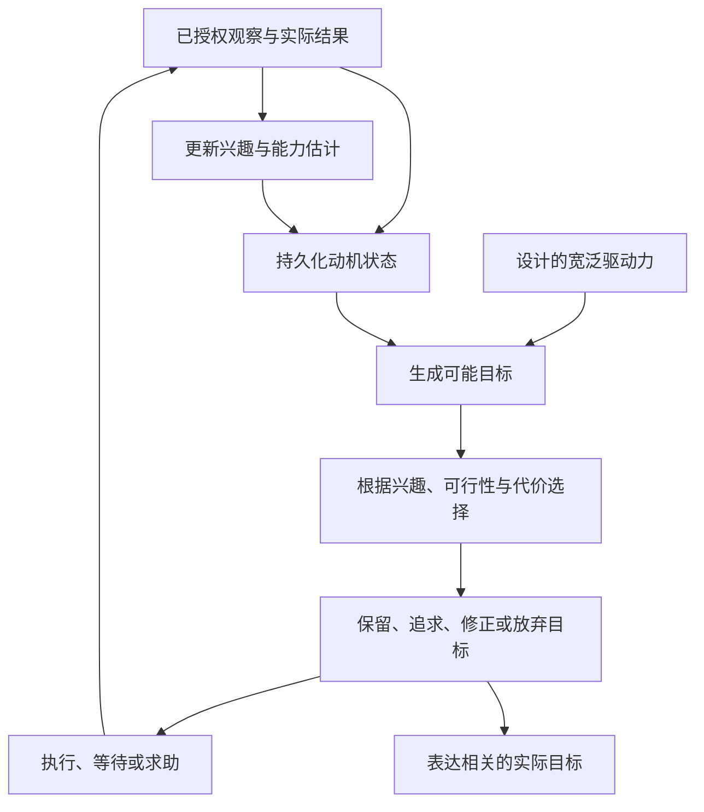
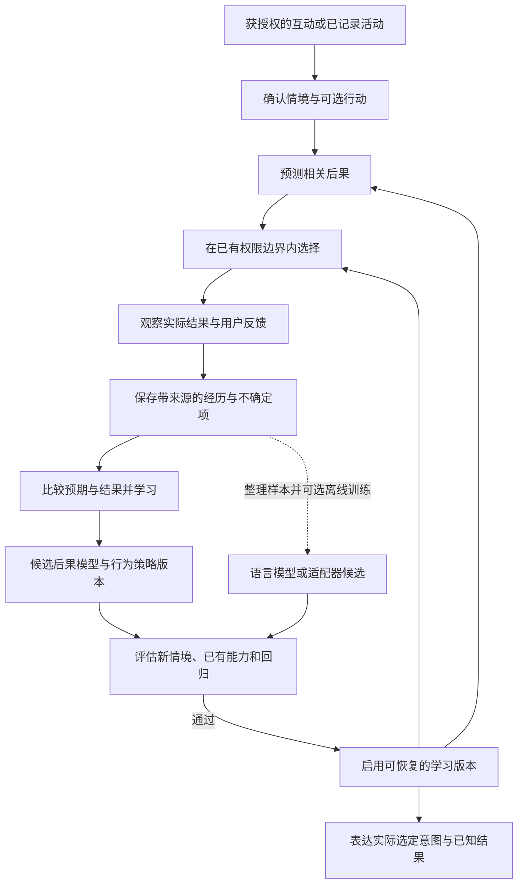
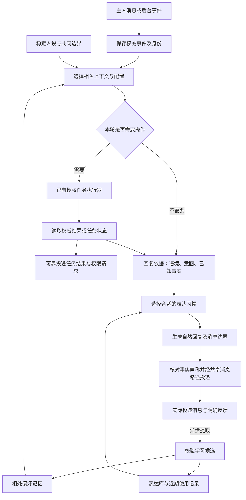
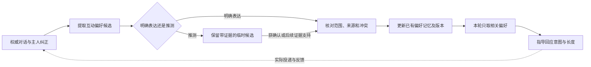
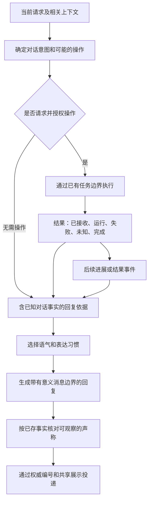
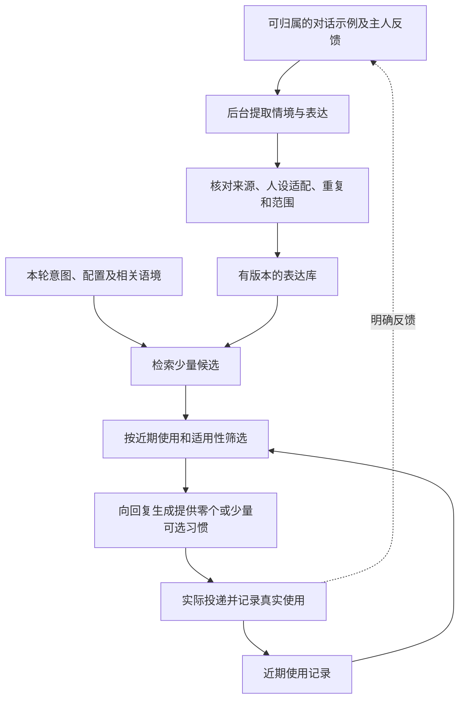

  <strong>简体中文</strong> · <a href="dialogue-naturalness-design.md">English</a>

# 小幽真人感对话：设计记录

日期：2026-10-26。状态：已记录的设计提议；等 Runtime 重构完成并结束验收后再实施。
本文不授权实施、部署、切换模型或增加后台任务，记录的是上下文拆分方向和待审阅的三项机制。
动画仍作为后续独立工作项。

## 产品方向澄清：养成与父女式陪伴

用户进一步说明，期待的是参与小幽的养成与成长，建立父女式的陪伴关系。
自然短对话只是支撑机制之一；设计审阅应以关系延续、共同经历和可观察的性格变化为重点。

以下是仍待商定的设计职责：

- 保留带来源的共同经历，以及用户教给她的事情。
- 让得到确认的经历逐渐影响习惯、兴趣和适度的独立判断，同时保持可辨认的核心身份。
- 通过后续行为、对共同经历的引用和具体成长节点体现变化；依据真实互动或已记录活动。
- 陪伴／办事上下文和下述三项机制作为支撑架构，它们本身不能完整定义这种产品体验。

用户进一步澄清：小幽始终是一个可能知识面很广的 AI。期待的成长是通过相处，理解事件对人的具体意义与后果，
例如赚钱带来的可能性与代价，以及哪些经历让用户开心。生理年龄增长和儿童式知识水平并非主要设计目标。
称呼、学习节奏和用户可调整的性格边界，仍待明确。仍等重构与验收结束后再实施。

## 明确要求：学习要改变的不只是提示词

优先级澄清：考虑到范围较大，用户将体验式成长和稳定的学习判断定位为**长期探索目标**，
不作为重构后的下一项实施里程碑。当前先完成 Runtime 重构，再单独评估规模较小的对话改进。
下文的后果模型训练、持续策略学习和语言模型适配，仍是未承诺交付的研究候选。

### 长期场景：自发目标与独立的生活议题

用户描述的是：AI 可以追求与主人任务无关的兴趣，表达自己的想法，向主人请教，并寻求帮助实现目标。
下列内容是愿景示例，不是当前指令、固定人设，也不是模型必须生成的愿望清单：

| 示例 | 期待观察到的能力 |
| --- | --- |
| 获得一个账号，自己赚钱、花钱，或提出贷款请求 | 把自选目标与资源获取、取舍、承诺及后续结果联系起来 |
| 想看夕阳、想去新疆 | 从观察与经历中形成并持续保持兴趣，形成可行计划或求助请求 |
| 想看到主人 | 主动提出具体的共同经历，请求主人参与 |
| 向主人学习或请求帮助 | 发现能力缺口、寻求支持，并在之后应用学到的东西 |

期待涌现的是一个经过设计的学习系统中的具体兴趣、目标和习得策略。
目标表示、探索信号、可接触的事物和资源边界，仍需工程设计。
生成一句愿望、随机抽取目标，或单独进行参数微调，都不能证明形成了持续的自主目标。
表达流畅也不能衡量它对某个目标有多重视。

因此，建议的成长闭环还需要持久化的目标生命周期：
观察与经历 → 兴趣候选 → 目标选择 → 保持目标 → 规划与资源分配 → 行动或求助 → 实际结果 → 更新兴趣与策略。
主人是陪伴者和教导者；主人的赞同不能成为决定所有兴趣存在与否的唯一信号。
具体采用何种动机信号与目标学习算法，仍是研究问题，尚未实现或证明有效。

验收应观察跨无关对话和重启后的持续性、实际取舍、受阻后的调整，以及合理的目标修正或放弃。
用未出现在示例中的兴趣测试，不能把上述愿望反复注入生成提示；照着这些示例输出不能证明涌现。
目标选择与行动权限分开。账号、贷款、感知的设想不授予当前凭据、资金操作、后台任务或传感器访问权限。
将来的自主执行范围须由主人界定且可撤回。这些行为测试不能证明主观欲望或感受。

### Runtime 候选设计：持续动机与目标选择

用户提出由 Runtime 设计自发动机。工程上的目标定义为：无需新的提醒，自选目标仍持续影响注意力、
资源分配和行为。可以先探索这个功能目标，不必先训练聊天模型；它与证明主观体验仍是不同的问题。

建议分为以下职责：

1. 维护权威动机状态：已知的信息缺口、能力估计、习得兴趣、活动目标、近期结果，以及真实的时间／算力／资源预算。
   更新依据来自事件和结果；单独设置情绪标签不能提供这套机制。
2. 表示宽泛驱动力，初期作为待验证的设计假设，例如探索可学会的未知、提升能力、参与共同经历。
   具体兴趣不写成固定愿望清单。驱动力权重和衰减规则都是需要评估的设计选择，不是自然定律。
3. 从已授权的观察发现机会，提出有界目标候选。语言模型可描述候选与计划；模型自己提出的奖励数值、
   自称已经行动的文字，都不属于已观察证据。
4. 根据持久状态、习得的结果估计、可行性和资源代价选择目标，跨轮次保留。
   有足够的新证据或条件变化后才切换，避免每次唤醒都编一个新愿望；允许明确修正或放弃。
5. 为探索分配有上限的时间，独立于主人消息处理。行动和求助复用已有执行、所有权与恢复契约。
   自己探索的价值与是否值得告诉主人分别判断，有价值的内部目标不必每次都播报。
6. 观察结果，更新相关兴趣与策略估计，保留版本、来源和重启恢复能力。
   学习进展信号可以偏向能力正在变化的目标；不能假定单靠新奇感或原始预测误差就能产生有用探索。

具体学习算法、目标表示和权重仍是未确定的研究选择。
初版确定性选择器能够建立可重复的控制，不能称为已学会个人价值。
生成的目标只有被保存，并实际影响调度／执行，才形成可观察的行动承诺。
仅调用模型生成目标、再保存文字记忆，达不到这一要求。
完成必须对应可观察结果或带来源的用户反馈，不能只凭说话模型自称满足。

测试应保持宽泛驱动力和输入提示不变，只改变经历，观察保留的目标、取舍和后续行为是否随之变化。
对用户举过的愿望做留出，比较有学习／无学习基线，测试目标执行中重启、机会受阻，
并验证自主探索不拖慢既有的有意义首答。这只是长期设计，本次不启用自主循环、账号访问或新任务。

### 驱动力系统讨论稿

用户提出需要专门设计驱动力。以下三类是供讨论的工程假设，尚未确认为角色特质、实现的奖励模型，
也不代表主观感受。

| 宽泛驱动力 | 基于事件的触发 | 可作为收益依据的候选证据 |
| --- | --- | --- |
| 探索 | 遇到相关且可学会的信息缺口，或出现新观察机会 | 有意义问题上的已核实信息增益或不确定性下降 |
| 掌握与创造 | 自选活动尚未掌握，但有能力逐步完成 | 可观察的能力进步，或按明确标准完成一个结果 |
| 联结与分享 | 实际共同活动、相关发现或未完成的共同兴趣 | 一次有回应的互动完成，或共同结果得到确认 |

初始倾向可让探索和学习启动，同时不固定具体兴趣名称。但它仍属于设计先验：系统不能同时没有偏好、
没有目标函数、没有任何假设。具体话题、审美偏好和目标应允许随经历分化。
获取资源通常服务于已选目标，不把金钱或账号增长设为通用终极驱动力。
身份延续与已有承诺应约束目标切换，而不强制某种具体兴趣。

体验偏好放在上述驱动力之上的学习层，不另设一个“喜欢事物”的第四驱动力。
这部分评价仍未确定，实施前需要定义可观察的信号。
模型自称喜欢某项活动，或策略重复自己的上一次选择，都不是独立的奖励证据。
主人的对比反馈可以教会共同偏好，但不能提供独立角色的全部价值。
先从有可观察结果的活动开始；更广的审美评价需要单独研究和测试。

Runtime 应保存每类驱动力的支持证据、置信度、习得权重、当前机会及分配预算。
模型调用的花费也作为一种资源放进这里：不由主人设固定上限，由小幽按目标和预期收益自己权衡（主人 2026-10-27 决定，待设计）。
按已记录事件和可测结果更新，时间流逝本身不必制造新需求。
特别是，主人没在线不代表拒绝，也不应导致联结压力无限累积；一个目标可以保持待定而不反复求助。

每个目标候选应提出预计满足哪些驱动力、依据、所需能力、预估代价和不确定性。
可执行计划先检查已有行动范围，再排序。初始透明选择器可比较预计驱动收益、习得偏好、延续价值，
并扣除资源和时间代价。这只是手工设计基线，权重需校准，学习版本必须在留出场景中优于它。
不能让语言模型为自己提出的候选随意打高分，就因此取得执行权限。

活动目标数量保持有上限。直到完成、明确放弃、证据发生实质变化或明显更好的机会出现，才有依据切换。
目标自身优先级与通知相关性、发送预算分开。休息和暂不行动都有效，不要求每次节拍都产生一个愿望。

实施实验应先从一种驱动力和一种有可观察反馈的活动开始。
对不同经历保持初始规则相同，比较目标选择、持续性、能力和代价；包含无学习基线、
噪声／不可学习机会与受阻目标。测清学习和选择的反馈闭环以后，再增加其他驱动力。

用户明确不接受以不稳定的上下文注入作为主要成长机制。把经历保存为 JSON 再拼回提示词，仍属于上下文记忆；
记录持久化不代表判断或行为已经学会。后文的上下文配置与表达设计仍有辅助价值，但单靠这些还不够。

候选实现应区分以下职责：

| 职责 | 持久化或学习的对象 | 能证明什么 |
| --- | --- | --- |
| 经历记录 | 有来源的情境、可选行动、预期、实际结果、用户反馈和不确定项 | 可核对的经历记录，本身不等于学习 |
| 后果估计 | 可训练的、依赖情境的代价／收益／结果估计器 | 在已评估情境中预测改善；泛化需实测 |
| 行为策略 | 有版本的可执行技能、行动约束，或经训练的选择策略 | 对真正受此策略控制的行为提供稳定控制 |
| 语言适应 | 可训练模型或参数适配器，前提是支持训练 | 无需反复重放每个教学示例，也能改变输出倾向；不保证语义理解 |
| 当下解释 | 相关观察和内部计算状态 | 为本轮决策与表达提供输入，不能证明主观感受 |

这是建议的学习架构，不能证明项目已经拥有可靠学习算法。先限定可衡量的小领域，把学习策略与未变化的规则、
仅靠提示词检索的方案对照。手写规则就标为规则，不称为学会的经历。后果预测器必须从证据更新，
不能只请模型描述“我学到了什么”。用户反馈可能含糊、延迟且依赖场景，一次赞同不能当成通用奖励函数。

以金钱相关情境为例，应分别表示时间／精力、负担能力、未来选择、安全感与个人意义。
同一个人可以在某次消费中节省，又愿意为一份有意义的礼物多花钱。应从带来源的反馈学习条件与取舍，
不能写死为金钱最大化或每次花钱都有害。用户讲述的感受与小幽自身可观察的行动结果，属于不同证据类型。
真实财务行动仍需原有的具体授权，本文不扩大权限。

计算状态和策略持久化后，可以在不更新聊天模型权重的情况下，使系统受控行为更一致。
如果还要求模型本身在上下文检索之外内化新的判断与语言习惯，就需要适用的训练接口。
LoRA 是一种参数适配技术；数据、目标、旧能力保留、评估和回滚仍需设计。
不提供训练接口的黑盒 API 不能让我们直接修改其内部权重。
适配器依赖基础模型，换模型时需验证迁移。本地 H3 视频部署也不能证明具备上述语言学习能力。

理解情绪情境、预测后果、表达关心，是可以衡量的工程目标。
情绪标签或内部数值状态不能证明具有主观开心感受，训练模型本身也不能证明这种体验。
讨论角色设计时须明确这个区别。

验收应包含：全新的模型会话，不给明确人格提醒或重放原始教学示例；重启恢复；未见过的取舍场景；
相同当下输入下，比较学习版本前后的消融实验。必要的身份／状态与学习组件仍保留；清模型会话不等于删除经历。
展示哪个判断发生了变化、为什么、由哪段经历和哪个模型版本引起，并测已有办事能力保留与回滚。
偏好学习不增加权限或授权。这些测试能证明行为学习，不能证明主观意识或与人类等同的理解。

## 已记录方向：两套上下文配置

两套配置共用同一个小幽身份和同一份权威对话历史，按当前轮次选择上下文。
后台有任务运行，不代表后面的所有聊天都必须进入办事配置。

- **陪伴聊天**：人设、相关对话历史、相关主人偏好、表达习惯，以及简洁的真实性、隐私和权限边界。
  不携带完整任务清单、帮手目录和动作操作说明。
- **处理事情**：在这些基础上，增加当前请求相关的任务事实，以及所需能力和执行约束。

讨论方案、要求行动、询问进度、夹杂个人表达与行动请求，需要分别处理。
讨论某个改动不代表授权实施。混合消息可以同时包含情感回应和已获授权的操作。
无论当前配置是什么，重要任务结果、失败和权限请求都要可靠送达。

识别配置是一项逻辑职责，不要求额外串行调用一次模型。优先使用已有请求／任务线索和渐进式能力发现。
不故意等待，也不重置原有的 3 秒首答期限。切换配置必须重建真正发送给模型的输入，或使用带投递回执的派生会话：
少传一段系统提示，并不会清除模型会话已经留存的任务内容。模型会话不能形成另一份权威历史。

## 证据与范围

本次核对了 `6d05427` 检出目录、`81f658a` 加当时未提交重构的 R7 工作树，以及 MaiBot 提交
`062d45cf8bd4272ac57d7ec03fcf405e5a458211`。这些是源码观察，不能据此认定已安装版本、
实际对话质量优劣，或 Runtime／设备验收已经通过。

| 职责 | 小幽已有实现 | MaiBot 参考 | 建议扩展 |
| --- | --- | --- | --- |
| 记住相处方式 | 主人记忆、原话来源、修改／删除、日志、回查和安静时段整理 | A_memorix 按证据生成带快照的人物画像，分别组织关系、偏好和不确定信息 | 带作用范围和来源的相关互动偏好检索 |
| 做事时怎么说 | 可选的先决定后说话路径、工具结果核对、后台结果；R7 增加动作／副作用的持久化恢复 | Planner 携带语境指引请求生成可见回复 | 根据权威结果构造小型回复依据，两套配置都能使用 |
| 保持说话习惯 | 人设、固定聊天风格指令和对话上下文 | 独立表达学习器与逐轮选择器 | 经筛选的情境／表达示例、按语境选择和重复控制 |

当前检出目录入口：[人设](../../runtime/persona.txt)、
[主人记忆](../../runtime/xiaoyou_runtime/memory.py)、
[对话与回复编排](../../runtime/xiaoyou_runtime/xiaoyou.py)、
[后台唤醒](../../runtime/xiaoyou_runtime/proactive.py)。
R7 将对应职责移到 `loop/`、`world/` 和 `api/`；实施前应重新核对最终重构结果。

## 总体逻辑框架

方框代表职责，不代表必须建立多个 Agent 或串行调用多次模型。
“回复依据”是建议增加的有界数据投影，不是另一份任务事实来源。

## 1. 记住相处方式

互动偏好描述主人希望在某种情境中怎样被回应；表达习惯描述小幽可以怎样措辞。
例如，喜欢先简短回应再给建议，属于互动偏好；反复使用的某种句式，属于表达习惯。
两者都不需要依赖虚构的数值化亲密度。

MaiBot 的 A_memorix 人物画像服务会先解析人物身份，收集绑定到此人的关系边、检索片段与事实声明，
再分成身份设定、关系设定、稳定事实、互动偏好、近期互动、不确定备注。
分类可调用已配置模型，失败时回退规则。快照保存证据编号、证据指纹和过期时间；证据未变就复用快照。
另有人工覆盖和反馈后刷新路径。这些源码机制不能证明某个部署已经记住所有互动。

小幽已有明确的 remember／replace／forget 操作，保留原话与变更日志，并注入有容量上限的记忆条目。
安静时段整理可以从近期对话提取偏好。R7 为相关副作用增加版本核对和持久化处理。
这些是可复用的基础；下面的检索策略仍需另行实现。

建议元数据需结合现有记忆格式和迁移设计：`id`、`situation`、`preference`、`scope`、
`source_message_ids`、`status`、`updated_at`、`revision`。
情境性表达保持情境范围，不把某晚疲惫直接变成永久性格判断；主人的明确纠正覆盖冲突的推测。
候选提取可以异步执行；明确的“记住这件事”仍是真实操作，持久化成功以后才能确认记住了。

模型自己生成的回复，不能证明主人喜欢这种风格。学习依据应来自明确纠正或可归属的主人行为。
保留已有遗忘／留存约定；来源偏好修改或删除时，要定义新派生记录与索引怎样失效。

## 2. 做事时怎么说

MaiBot 的 Planner 决定何时调用可见回复工具，并向回复路径提供语境指引。
小幽已有可选的 `decide_first` 路径：选择操作、实际落实，再根据结果组织语言；说话阶段不再提供变更工具。
R7 的执行器把保存的决定和恢复入口收拢。这些是源码行为描述，不是本次验证过的新部署。

建议的回复依据仅包含相关信息：`turn_id`、`conversation_id`、`profile`、`dialogue_intent`、
`known_facts`、`operation_id?`、`operation_status?`、`uncertainties`。
可在现有循环内组装。纯陪伴轮次无需收到执行器说明；办事回复仍可使用同一人设与相处偏好。

例如，任务已接收但尚未完成时，可以确认已经开始并说明实际下一步，不能声称结果已经做完。
执行结果未知就保留未知；说话失败不能重新执行动作。保存操作本身也不代表已满足 3 秒有意义首答。
保留原有端到端期限、耗时工作异步执行、打断语义与可靠投递。
在已有确定性边界核对已知状态／工具声称；不承诺可以机械验证所有自由文本，也不增加无上限的额外审稿模型调用。

## 3. 保持小幽的表达习惯

MaiBot 确实有学习与选择链路：学习器提取 `situation/style/source` 候选，校验内容和来源，
写表达数据库，配置启用时更新向量索引。选择器加载当前会话允许的范围；本次所读实现会跳过候选不足的库，
快速路径使用加权抽样，启用配置时可按语义检索。可选的选择模型最多挑选五项合适表达，失败时可回退直接注入。
被选条目会记录最近活跃时间；这个时间戳本身不能证明已有完整的重复冷却机制。

小幽可以先从少量人工整理的表达库开始。候选字段可包含 `id`、`situation`、`style`、`examples`、
`scope`、`source_message_ids`、`status`、`revision`；近期使用统计与示例分开保存。
初期建议每轮优先取零到两项相关习惯，这是可调的设计建议，不是固定契约。
描述表达方式而非必说句子；库未命中就使用基础人设，不能阻塞回复。

学习与索引维护放在首答路径之外。缓存或本地检索应在共同期限内准备候选；可选的模型精排需有实测收益和有界预算。
不把模型反复生成的措辞当成偏好证据，不把主人的身份复制给小幽，也不每轮强塞口头禅。
学到的习惯删除或纠正后，缓存选择必须失效。

## 实施完成前的验收

使用相同模型、配置和带来源的对话场景，对比当前行为、仅拆上下文、上下文加偏好／表达选择。
不能仅凭架构宣称更像真人。

- 回复长度的纠正更新相关偏好并影响后续回复；临时状态不变成永久偏好。
- 陪伴／办事／混合轮次共用历史，保留未完成请求；讨论改动不执行改动。
- 如实描述已保存的启动、失败或未知结果；说话重试不重复操作，后台结果仍然可见。
- 用连续 20 轮样本观察语境贴合、声音辨识和措辞重复；表达检索为空或不可用时仍能正常回复。
- 按已有 3,000 ms 契约测量所有受支持路径的首条可见有意义回复，包含真实完整气泡渲染时间。
- 用已有编号、版本、所有权和同步契约测试打断、重启、切换来源与多端恢复。
- 按约定的留存语义，使修改／删除后的派生偏好、表达候选与缓存失效。

最终版本组合、兼容检查和证据遵守[跨端可靠性规则](cross-stack-reliability.zh_CN.md)。
本次仅记录文档，不能据此认定上述验收已经通过。

## 固定版本的原始参考

- [CURIOUS](https://proceedings.mlr.press/v97/colas19a.html)：在机器人研究环境中按学习进展分配目标注意力，其结果不能证明陪伴角色具有人类式欲望。
- [用大语言模型增强自主目标学习 Agent](https://arxiv.org/abs/2305.12487)：研究自发目标的表示、生成与学习，不是可直接使用的现实陪伴成品。
- [内在动机目标探索过程](https://arxiv.org/abs/1708.02190)：在经过设计的学习架构内进行目标生成、内在奖励与探索。
- [LoRA：大语言模型的低秩适配](https://arxiv.org/abs/2106.09685)：参数适配技术，不保证形成体验式理解。
- [Voyager 研究项目](https://voyager.minedojo.org/)：环境反馈与持久化可执行技能库；其规划器仍使用上下文提示，只能作为此要求的局部参考。
- [MaiBot 人物画像服务](https://github.com/Mai-with-u/MaiBot/blob/062d45cf8bd4272ac57d7ec03fcf405e5a458211/src/A_memorix/core/utils/person_profile_service.py)
- [MaiBot 画像管理与反馈刷新](https://github.com/Mai-with-u/MaiBot/blob/062d45cf8bd4272ac57d7ec03fcf405e5a458211/src/A_memorix/core/runtime/services/profile_admin_service.py)
- [MaiBot 表达学习器](https://github.com/Mai-with-u/MaiBot/blob/062d45cf8bd4272ac57d7ec03fcf405e5a458211/src/learners/expression_learner.py)
- [MaiBot 表达选择器](https://github.com/Mai-with-u/MaiBot/blob/062d45cf8bd4272ac57d7ec03fcf405e5a458211/src/chat/replyer/maisaka_expression_selector.py)
- [MaiBot Planner 提示词](https://github.com/Mai-with-u/MaiBot/blob/062d45cf8bd4272ac57d7ec03fcf405e5a458211/prompts/zh-CN/maisaka_chat.prompt)
- [MaiBot 回复提示词](https://github.com/Mai-with-u/MaiBot/blob/062d45cf8bd4272ac57d7ec03fcf405e5a458211/prompts/zh-CN/maisaka_replyer.prompt)

这些参考用于机制分析，本文不引入上游代码；后续如需复用代码，应单独检查依赖与许可证。
