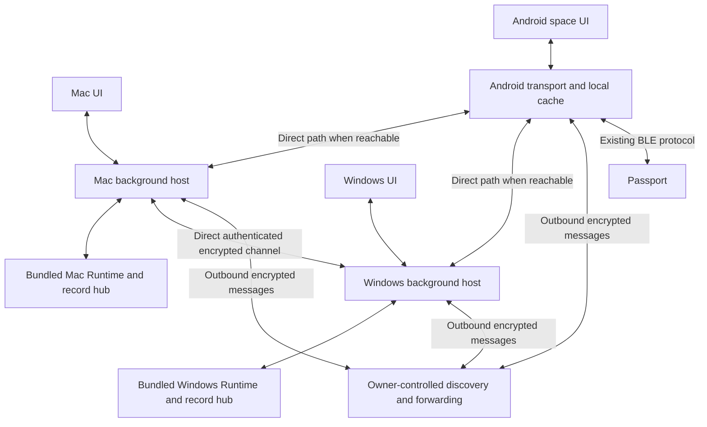
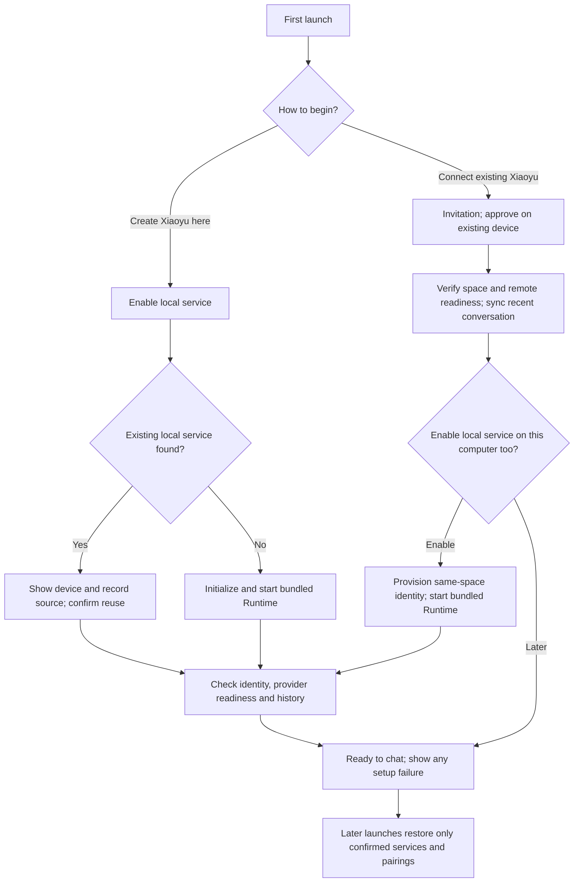

<p align="right"><a href="xiaoyu-desktop-plan.zh_CN.md">简体中文</a> · <strong>English</strong></p>

# Xiaoyu desktop clients and shared conversation plan

> **Partly superseded by the [Xiaoyu complete plan](xiaoyu-agent-model.md); the complete plan prevails.**

Status: implementation in progress, 2026-10-21. Delivery target: **2026-10-22 at
22:00 Asia/Shanghai**, before Friday, for owner-test installers. This is a
compressed target with the dependencies below, not a claim that clients,
infrastructure, signatures, or acceptance tests are complete. The owner has
authorized implementation; current source, commands and measured limits are
recorded in the [desktop implementation guide](../../companion/desktop/README.md).
No future scheduled build has been created.

## 1. Accepted product requirements

The owner sees one Xiaoyu and one conversation space. A conversation started
on Mac continues on Windows or Android with its context, messages, attachments,
task state and approvals. Normal chat never asks which computer stores a record.

- Install the app, create or join a space, pair once, and chat. Bundle Runtime
  and networking dependencies; no Python, Tailscale, terminal, IP, port, or mesh
  secret setup in the ordinary client flow.
- Each computer can run Runtime and local helpers independently. Connectivity,
  history replication and execution location are separate responsibilities.
- Owner clarification: **Mac and Windows normally stay on, and the clients may
  run in the background**. Use them as persistent storage/compute peers for the
  Thursday candidate. Do not equate powered-on with awake, connected or healthy.
- Prefer owner-controlled infrastructure. Support direct connections and a
  self-hosted encrypted relay; no mandatory vendor account or public relay pool.
- Encrypt between authorized endpoints, including across a relay. Pairing,
  key storage and connection recovery belong inside the app.
- Preserve current working chat, memory, tasks, approvals, images, voice,
  Android updates and BLE behavior through an additive rollout.

The [reliability contract](cross-stack-reliability.md) remains mandatory. The
[product principles](../product-principles.md) remain a draft; this plan follows
the owner's requirements without declaring that draft approved.

## 2. Verified source baseline and gaps

Source baseline: `62cc399`, branch `feature/usage-history`, clean when inspected
on 2026-10-21. Runtime source is **0.20.0**; Android source is **0.27.0 / code 50**.
The local Mac is ARM64. Installed peer versions and Windows architecture still
need verification; retained reports of test success are not new test evidence.

| Existing component | Reuse and required work |
| --- | --- |
| `runtime/xiaoyu_runtime/events/record.py`, `message_log.py`, `ledger.py` | Preserve the single record writer, message identities, durable acceptance and retry deduplication; add a subject-level conversation projection |
| `identity.py`, `mesh.py`, `mesh_share.py` | Preserve origin identity, single-writer records and remote task commands; add authenticated transport and bind the existing subject to space membership |
| `/v1/info`, `/v1/sync`, message HTTP/SSE APIs | Keep existing wire contracts and capability negotiation; add the new transport alongside them |
| Android `RuntimeClient.java`, `SyncCache.java`, `HubStore` | Replace ordinary computer selection with a space view; persist sync state and route through a transport adapter |
| Existing agent and model adapters | Reuse installed helpers and provider policy; do not rewrite inference, approvals or model selection |
| Desktop distribution | No Xiaoyu Electron/Tauri project was found; shell, background host, packaging, signing and clean-install tests are new work |

The current mesh uses address-based HTTP exchange, a 20-second long poll,
per-address timeouts of `wait + 30`, and five-minute offline detection. Android
also has address failover and a sync cache held in memory. These are boundaries
to investigate, not proof that any one of them caused the reported instability.

Current retention is finite: the message log retains up to 5,000 records and
the mesh has separate limits. A fresh device cannot recover history that every
peer already discarded. Inventory available history before promising import.

## 3. Thursday candidate scope

| Required in the candidate | Deliberately later |
| --- | --- |
| Mac ARM64 app/DMG and Windows x64 installer, tested on their native OS | Additional desktop architectures after their build/test hosts are confirmed |
| Chinese onboarding, create/join space, QR or invitation-link pairing | Public account system, app-store submission, advanced theme work |
| Shared conversation list, text continuation with reconciled context, history paging | Semantic search and a new memory system |
| Task progress, existing approval/cancel behavior, existing image/file viewing | New desktop microphone/ASR and desktop-to-device BLE |
| Local pending queue, durable receipts, reconnection and missed-state recovery | Automatic internet NAT hole punching and a general P2P/DHT network |
| End-to-end authenticated encryption on direct and relayed paths | Independently audited production security certification |
| Android space/transport adaptation and regression of existing voice/BLE | New firmware functionality or a firmware protocol migration |
| Self-hostable discovery/forwarding, durable endpoint outboxes and operator deployment instructions | Relay-hosted offline mailbox, permanent cloud archive or relay-side inference |

Core continuity, encryption, Android interoperability and recovery are acceptance
requirements, not optional cuts. A failed core gate means an incomplete candidate,
even if both installers exist. This schedule does not authorize purchasing a
server, public deployment, credential changes, active Runtime interruption,
commits, pushes or firmware flashing.

## 4. Architecture and technology decisions

Use **Electron + TypeScript + React** for both desktop shells and the same
TypeScript connection library. Reuse Python Runtime, bundled per OS with
**PyInstaller in one-folder mode**. Pin maintained dependency versions and their
licenses during the first build spike. This choice reduces new language and
platform integration work within the deadline; it is an engineering choice,
not a claim that Electron guarantees reliability. Tauri/libp2p remain later
options only if a measured need warrants migration.

Use a separate background host process for connection management and Runtime
supervision. The renderer talks through a narrow validated IPC API; it never
holds private keys, arbitrary shell access or Runtime bearer tokens. Package
local UI assets, enable sandbox/context isolation, disable renderer Node access,
sanitize chat Markdown and restrict navigation and external URL handling.



The Thursday relay handles discovery and bounded ciphertext forwarding. Durable
outboxes and conversation records stay on the always-on Mac/Windows peers;
the relay requires no message database. An optional encrypted mailbox is later
work if non-overlapping computer uptime becomes a requirement. The relay holds
no plaintext model context, conversation authority, endpoint private keys or
executable task queue.
Each Runtime remains authoritative for its own origin records.
The space timeline is a projection of those records, not a second writable log.

Android uses a native adapter for the **same protocol and conformance vectors**;
it does not require embedding Electron or a second Runtime. Shared desktop
code does not imply identical implementation languages across all three OSes.

### Connection and process lifecycle

- Establish LAN discovery and reuse cached authenticated endpoints. Race usable
  direct candidates against the configured relay with a bounded connect budget;
  a dead address must not serially consume the whole user response budget.
- For this candidate, internet traversal uses outbound WSS on TCP 443 to the
  owner-controlled relay, with HTTPS polling recovery if a proxy rejects WSS.
  Direct LAN connections use the same encrypted message protocol. Reachable
  IPv6 can be tested as an additional direct path;
  neither IPv6 nor NAT hole punching is assumed available.
- Reuse a warm channel for sync, chat, commands and bounded attachment chunks.
  Give chat/approval traffic priority and enforce backpressure and size limits.
- Separate transport, authenticated identity, Runtime readiness and sync freshness
  in state. A successful heartbeat cannot erase a failed conversation fetch.
- Cancel obsolete connection generations; reject late callbacks after a space,
  peer or session change. Retry transient failures with capped jittered backoff;
  authorization failures require corrective action rather than endless retries.
- Closing a window leaves the background host running. Explicit Quit explains
  active work and shuts down safely. Sleep pauses execution; wake resumes
  connectivity and reconciles state. No claim that a sleeping computer works.
- Offer OS login-start registration in onboarding; launchd/Login Items on Mac
  and supported per-user startup on Windows supervise the host. Host/Runtime
  crashes use bounded recovery and durable state, never blind replay of started
  side effects. Do not change system sleep/power policy without authorization.
- Single-instance locks, version handshake, process ownership and crash-loop
  limits prevent duplicate Runtime workers. Adopt an existing Runtime only
  after verifying identity/state ownership; do not start two writers on one
  state directory. An update waits for idle or requests interruption approval.

### Encryption and enrollment

Use **TLS 1.3 for network connections and authenticated, per-recipient HPKE
envelopes (RFC 9180) for end-to-end message encryption**. Persist encrypted
envelopes in the sender's local outbox while a recipient is offline. This also
keeps the protocol extensible to a future encrypted mailbox; the Thursday
candidate does not depend on implementing one. Initial suite: Auth mode,
DHKEM(X25519, HKDF-SHA256), HKDF-SHA256, AES-128-GCM. Use maintained `hpke-js`
on desktop and Bouncy Castle's lightweight HPKE API on Android, after testing
the exact pinned versions against RFC vectors and each other on Wednesday.
Do not replace a system crypto provider globally or implement these primitives
by hand. Failure of this spike blocks encrypted three-client acceptance.

Create a fresh HPKE encapsulation for each independent envelope; authenticated
context binds protocol version, space, sender/recipient device and key versions,
message/command ID, origin sequence and expiry; keep the payload digest inside
the encrypted body. Receive state
deduplicates by identity and detects conflicting payloads. Reuse the same
persisted envelope for a delivery retry. HPKE itself does not prevent replay,
provide membership, or provide forward secrecy against later recipient-key
compromise: application receipts/authorization are mandatory, and Signal-style
ratcheting/independent review remains a later hardening project. Do not advertise
equivalence to Signal's security properties.

Pairing uses a cryptographically random, single-use invitation of at least 128
bits, a two-minute expiry, inviter identity-key fingerprint and explicit approval
of the joining device. A desktop can display a QR and copy a private invitation
link; Android scans it. A short numeric code requires a reviewed PAKE protocol
and is not the initial shortcut. The joining device creates its own private key;
an invitation never distributes a shared endpoint private key.

The signed membership registry binds space, device ID, identity/encryption
public keys, role and revision. Existing trusted devices approve new members;
the relay cannot grant membership or substitute keys. Bind encryption keys to
the device identity, verify the inviter out of band through the invitation, and
approve the joining device's fingerprint before transferring history. Verify
network certificate trust, authenticated sender and expected membership before
forwarding an allowlisted Runtime request. Bind the existing `subject_id`
to the space instead of silently changing IDs derived from an old mesh secret.
The legacy mesh secret stays endpoint-local and is never a relay credential.

Store key material using platform protection: macOS Keychain, Windows
OS-protected storage and Android Keystore as applicable. Validate protection
and upgrade behavior in packaged builds; do not promise protection from malware
already running as the same logged-in user. Cache/history protection is a
separate at-rest concern; transport encryption does not encrypt a local archive.

Revocation closes known sessions and rejects subsequent authentication after
membership reconciliation; rotate applicable credentials and encryption keys.
An isolated peer must catch up with membership before accepting remote commands.
State the partition limitation: an offline device cannot learn a revocation
instantly, and previously decrypted history cannot be recalled. Recovery uses
an existing trusted device for Thursday; encrypted recovery export is later.
Losing every trusted device/key cannot promise recovery from the relay.

The relay can observe IPs, routing IDs, timing and traffic volume. Apply
authentication, connection/rate/buffer limits and metadata-minimal logs. Keep
Runtime file/shell APIs loopback-only behind a method allowlist; do not expose
an unauthenticated generic TCP proxy. Runtime and selected cloud model providers
still receive the plaintext required for inference.

## 5. Conversation continuity and data contracts

Preserve [the unified message model](unified-message-model.md). Add negotiated
space/conversation metadata and a client projection rather than replacing the
existing writer or copying live database files between computers.

- A stable `space_id` maps to the existing subject; a stable `conversation_id`
  is independent of addresses and the selected Runtime. Import the existing
  shared main conversation with an explicit mapping. Preserve distinct legacy
  conversations instead of merging every `default` name across unrelated peers.
- Use full origin identity plus native ID as the canonical global key; keep
  current short aliases only as compatibility mappings. Preserve `turn_id`,
  `client_id`, origin epoch/sequence and revision. Never deduplicate by text.
- Persist pending request ID, exact payload and chosen accepting Runtime before
  send. Runtime acknowledges only after durable acceptance. A lost response is
  resolved at that same accepting Runtime; another peer must not independently
  execute the same request. Receipt retention must cover the negotiated retry
  window; outside it, query or report uncertainty instead of blindly resubmitting.
- Keep message changes and the opaque applied cursor in one local SQLite
  transaction. Reset/gap handling reconciles a snapshot without deleting older
  retained local history. Resume after the applied cursor, including the live
  subscription handoff, without a loss window.
- Merge pending bubbles, message snapshots and history by identity/revision.
  `partial` replaces the full partial snapshot, including an empty retraction;
  terminal state cannot regress to a stale partial. Explicit deletion uses
  scoped tombstones; ordinary retention/pruning is not deletion.
- Preserve origin single-writer order. Simultaneous disconnected submissions
  carry causal parent/frontier information and a stable origin/ID tie-break for
  display; do not pretend clock timestamps create global acceptance order.
  The same conversation's responder serializes accepted turns. Concurrent
  claims or an unknown preceding active turn reconcile before inference, rather
  than letting multiple peers produce answers from inconsistent context.
- For a completed-turn handoff, reconcile the conversation frontier before
  starting a responder on another Runtime. Build model context from the same
  authorized log and shared memory, not text scraped back from UI bubbles.
  A new native model/harness session can be seeded from that context; this does
  not migrate hidden provider state or an in-flight CLI process.
- A running tool task retains its execution origin and permissions. Missing
  local files, unavailable tools and an uncertain running operation remain
  explicit. Never retry side effects on another computer merely because it is
  online. Long-task movement is outside this candidate.
- Approvals bind origin Runtime, task/run, operation fingerprint and expiry;
  answer receipts and revocations replicate. A mirrored approval is not blanket
  authority to run commands elsewhere. Preserve existing notification-only cases.
- Attachments transfer lazily over the encrypted endpoint channel, with digest,
  declared size, resumable bounded chunks and progress. A missing origin/file is
  reported as unavailable. The current mesh does not replicate attachment bytes;
  metadata alone is not evidence of file availability on a second computer.

Persist a new local archive/index for imported and subsequently received records,
and page it without blocking current chat. Import available log/replica records
idempotently. Do not claim recovery of already pruned records or silently change
Runtime's current retention policy. Preserve external/observed session identity
and read-only boundaries; arbitrary private desktop chats do not become shared.

An offline device shows cached history and local pending sends. The sender
encrypts separately for each current member and commits undelivered envelopes to
its local SQLite outbox. A receiver decrypts/verifies/applies records and its
cursor atomically before an applied receipt. Distinguish local saved, Runtime
accepted and recipient applied: none alone means a task completed. A relay
forwarding receipt is never a durable storage or execution receipt.

Mac and Windows normally keep receiving each other's records in the background.
Either sufficiently synchronized, ready peer can serve a returning phone or
new completed-turn continuation. The client selects an eligible peer internally;
it does not move an uncertain accepted turn or a running tool task to another
computer. Closing the chat window leaves replication alive. Crash/reboot/network
recovery reloads outboxes and cursors; an existing replica can serve retained
history if the original peer is temporarily down.

Proposed endpoint transfer limits remain 1 GB per space and 64 MB per attachment,
with explicit quota/backpressure and no silent deletion of undelivered messages.
Command/approval expiry remains enforced separately. Test endpoint disk-full,
process restart, expired cursors and a returning offline phone. New-device
history is explicitly re-encrypted by an available trusted device. If the only
holder of a record goes offline before replication, another device cannot read
that record yet; show the freshness gap and retain new input safely. If both
computers are unreachable, phone messages stay pending and model replies wait
for a ready Runtime. This limitation is compatible with the confirmed normal
always-on baseline; availability during a simultaneous outage is not claimed.

## 6. Screens and onboarding

1. **First launch:** create a space or join through an invitation; explain any
   required system permission once. Fresh inference setup detects installed
   helpers and uses supported sign-in; credentials are never bundled or copied
   from another computer. Existing owner configuration is imported explicitly.
2. **Chat:** Chinese UI, space-level conversation list, history and attachments,
   composer, full-message reply bubbles and truthful pending/catching-up states.
   No ordinary computer/model/effort picker.
3. **Tasks and approvals:** shared status, progress, result, continue/cancel and
   existing approvals; source computer appears only when operationally useful.
4. **Devices and diagnostics:** pairing/revocation, connectivity, Runtime/model
   readiness, sync freshness and a sanitized export. Developer endpoints stay in
   advanced settings; users do not debug by copying raw credentials or logs.

The ordinary first-run goal is successful pairing and first chat without a
terminal or manual address entry. OS installation warnings and unavailable
model login must be recorded as setup friction, not hidden from acceptance.

### Connection and bundled-service review, 2026-10-21

The owner accepted the other task's v8 reference and requested onboarding
implementation, local-agent detection and dsh + DeepSeek defaults. Version
0.1.1 implements explicit activation and selective helper registration; see the
[implementation checkpoint](../../companion/desktop/README.md#first-connection-and-local-agents-011).
The diagram remains the target, including same-space local provisioning that
is not yet implemented.

At the initial review, the code already packaged Runtime and could start a
child process, but startup silently probed legacy configs and restored saved
endpoints. The 0.1.1 increment removes that implicit activation.
The same Connect action can either attach to an external Runtime or start the
bundled one. A successful authenticated `/v1/info` sets Runtime ready without
proving provider readiness; the space indicator separately follows sync success.
The renderer does not explain that distinction or which process is managed.
Fresh local inference still depends on an installed, logged-in Claude Code;
bundling Runtime does not bundle that login or establish working inference.



- First enablement is an explicit action. Subsequent startup automatically
  starts the enabled app-owned service and restores approved connections,
  with visible starting/authenticating/syncing/ready or failure stages.
  A legacy cached endpoint without a recorded confirmation requires review once;
  preserve its history, cursor and pending requests throughout that review.
- Discovery may suggest an existing local installation; it must not silently
  attach, import its history or start a second writer. Confirm its identity,
  compatibility and source before reuse. Reuse does not transfer process
  ownership: do not restart or stop an external service. Migrating that service
  into app management is a separate explicit operation with an idle handoff.
- Joining pairs to the existing space first. Enabling a local service afterward
  provisions the same authorized subject and catches up its context before it
  becomes eligible for new chat work. Do not create an unrelated local space
  during joining or silently rewrite an active Runtime's identity. This
  same-space local provisioning is still missing in the current increment.
- The client handles internal paths, ports, keys, launch and recovery. The user
  enables a service rather than launching Python or selecting config files.
  Provider setup/login remains visible when required; do not report chat ready
  from a heartbeat or sync success alone. Do not run a model probe on every
  startup without accounting for its cost and side effects.
- Settings should expose local service ownership/state, paired devices, actual
  connection route (local, direct or encrypted relay), latest sync state and
  the responding device when relevant. These are separate facts, not one green
  Connected flag. Public reachability remains an infrastructure prerequisite.

| Event | Required lifecycle behavior |
| --- | --- |
| Close window | Keep enabled service and synchronization in the tray |
| Quit app | Warn for active owned work; stop only the owned child; retain data |
| Disable local service | Stop accepting new work there; resolve active work explicitly; keep cached history and pairing |
| Disconnect a device | Stop its transport and automatic reconnect; keep records; revocation requires its own authorization semantics |
| Sleep/wake or network loss | Show offline/stale state; reconnect and reconcile using original request IDs |
| Owned service crash | Bounded restart, then a visible actionable failure; never start duplicate work |
| No reachable peer | Keep messages pending; do not silently send them to a new Runtime |

Implementation boundaries: `main.ts` owns startup/IPC, `runtime-host.ts` owns
local process lifecycle, `client.ts` owns restored endpoints/sync/outbox and
`peers.ts` owns pairing/relay routing under `companion/desktop/src/`. First
separate discovery from activation and persist confirmation/ownership. Then
expose these states to the agreed interaction design. Do not implement a new
visual design as part of this review. The initial review changed documentation only. The subsequent 0.1.1 increment
changes desktop source; it does not restart an existing Runtime or register a
system service automatically.

## 7. Repository work packages

The following are proposed new locations, not existing files:

| Location | Responsibility |
| --- | --- |
| `companion/desktop/` | Electron shell, background host, shared desktop TypeScript transport, SQLite cache and native packaging |
| `runtime/xiaoyu_runtime/` | Additive connection bridge, space/conversation projection, context handoff and readiness capabilities; preserve Record/mesh ownership |
| `companion/relay/` | Self-hostable discovery and encrypted forwarding, connection quotas, deployment manifest and operator guide; no Thursday mailbox database |
| `companion/android/` | Native endpoint TLS/relay adapter, pairing, durable space cache and space-level UI |
| `tests/` and project-local test directories | Protocol fixtures, fault injection, installation/recovery and cross-version cases |
| `.github/workflows/` | Native Mac/Windows packaging only when CI use is authorized; local native builds remain possible |

Share protocol fixtures and adversarial vectors across desktop, Runtime and
Android. OS-specific packaging and key adapters must be exercised natively.
Preserve the owner's model/provider policy: use non-Astra defaults, never select
Astra without an explicit owner request, and do not change budgets or paid routes.
No new firmware feature or flash is planned. Test the existing phone/BLE/device
journey because its upstream connection changes.

## 8. Schedule and decision gates

All times are Asia/Shanghai. The deadline leaves roughly 34 hours from the
initial plan; these are execution milestones, not automatic scheduled jobs.

| Time | Reviewable result and go/no-go check |
| --- | --- |
| Wed 10-21, 15:00 | Confirm source baseline, running versions, native Windows build/test access, relay location/reachability and signing availability; freeze the protocol sketch and installer targets |
| Wed 10-21, 18:00 | Mac and Windows development shells boot with bundled Runtime; desktop and Android pass shared HPKE vectors and authenticated encrypted exchange; wrong-device and key-substitution attempts fail |
| Wed 10-21, 22:00 | Pairing and a real Mac-to-Windows conversation handoff over two networks; close UI while background replication continues; durable endpoint pending/receipt/cursor and Android encryption demonstrated |
| Thu 10-22, 12:00 | Android space view participates; conversation/context/attachment continuation, approval routing, restart and network-switch recovery work in the three-client scenario |
| Thu 10-22, 16:00 | Feature freeze; native installers built; focused fault tests and full project gates run; preserve rollback packages and sanitized evidence |
| Thu 10-22, 20:00 | Clean native installation and real Mac/Windows/Android/Passport smoke and timing runs; fix release blockers only |
| Thu 10-22, 22:00 | Deliver tested Mac/Windows packages, Runtime identity, Android update through Runtime, hashes, setup guide, known issues, acceptance matrix and rollback instructions |

Prove both native packaged starts early: PyInstaller bundles are OS-specific.
Do not discover a missing Windows build host or failed Android encryption interoperability on
Thursday night. The encryption dependencies and three-client integration still
make this a high-risk compressed schedule, not a dependable production-release
estimate. The always-on baseline removes relay mailbox implementation from the
critical path without weakening endpoint persistence, encryption or recovery.
If a critical spike fails, immediately identify its consequence
and replanned work; do not substitute a local-only demo, plaintext relay or a
web page and label it the requested client. By the target time, deliver whatever
candidate artifacts are actually verified, with failed/missing core gates plainly
marked. Production readiness is never inferred from meeting the calendar date.

## 9. Infrastructure and distribution dependencies

| Dependency | Requirement and impact |
| --- | --- |
| Public reachability | First probe whether the always-on Mac/Windows can directly receive authenticated internet connections. An existing machine can host discovery/forwarding if genuinely reachable. Uptime alone does not overcome NAT/firewalls |
| Owner-controlled relay if needed | Reachable by all participating networks using outbound HTTPS/WSS 443, with certificates and bootstrap endpoints. Without any reachable direct endpoint or relay, restricted-network cross-site delivery cannot be claimed. No mandatory Tailscale/Funnel |
| Small relay host if needed | Initial sizing assumption: 1 vCPU, 512 MB to 1 GB RAM plus OS, small config/log disk and measured bandwidth; no ciphertext archive needed for Thursday. Not a capacity guarantee; test a NAS/host's inbound reachability/firewall/IPv6 first |
| Windows native host | x64 is the proposed initial target; verify actual hardware/OS and GUI test access. Local Windows work or approved CI needs direct authorization/access, not a forwarded message to another chat |
| Mac distribution | ARM64 is verified locally; Developer ID signing/notarization requires available owner credentials and the external service. Without them, private test packages may need manual OS approval and fail the frictionless-install objective |
| Windows distribution | Installer signing availability and SmartScreen behavior must be checked on a clean machine; do not promise that a signature eliminates all warnings |
| Real model/helper | Detect existing installation/login and validate the selected inference path; no credentials or personal CLI directories inside installers. A clean client without any usable provider cannot promise an immediate AI reply |
| Android and device | Owner phone installation confirmation and physical BLE/voice observations remain separate from build/publication; keep existing pairing/data |

Self-hosting reduces dependence on third-party application services. An existing
always-on computer may supply the reachable endpoint after network verification;
an additional server is not presumed necessary. The endpoint still needs stable
discovery/address handling and ongoing maintenance. No host
has been procured or deployed by this plan. A second independent relay is a
later availability improvement. Relay outage leaves direct connections and
local data usable, with remote pending work clearly pending.

## 10. Acceptance, measurement and delivery

Use [the full reliability matrix](cross-stack-reliability.md#required-regression-and-fault-matrix),
including affected and adjacent existing flows. The following are release-blocking:

| Scenario | Required observation |
| --- | --- |
| Fresh Mac/Windows install | No Python/Tailscale/terminal requirement; real Runtime/provider readiness; no embedded credentials; observed signing/OS warnings recorded |
| Mac -> Android -> Windows | Same conversation ID, earlier facts understood, same message/order/status and accessible retained attachments; no ordinary computer selection |
| Two online and one returning client | One bubble per message; duplicates/reordering/reset/snapshot races and empty partial retractions converge correctly |
| Disconnect/lost acceptance/crash | Local pending survives; accepted request is resumed/queried with the same identity; uncertain side effects are not repeated |
| Background/returning devices | Close both desktop windows while hosts keep running; phone returns after being offline and catches up from a ready peer; one peer restarts and restores its outbox/cursor; endpoint disk-full/quota are explicit and no reply is invented while both Runtimes are unreachable |
| Sleep/wake/network switch/relay loss | Bounded retry, distinct readiness states, direct/relay recovery and no stale-source callbacks |
| Pair/revoke/hostile relay | Expired/reused invitations, unknown/mismatched certificates, wrong space, replayed commands and revoked membership fail closed |
| Task/approval/context | Origin remains correct, expiry and cancellation work, existing memory and permissions preserved, busy tools do not freeze chat |
| Images/files/voice/BLE | Existing images and attachments retain identity/content; phone/device voice and device recent window remain correct |
| Upgrade/mixed peers/rollback | Old supported App/Runtime APIs continue; data, pairing and pending work preserved; new capability disabled explicitly on unsupported peers |

Measure from the originating client's monotonic send/record-release time to the
first **meaningful complete assistant bubble**, not an ACK/spinner/error. Every
successful sample must be **<= 3,000 ms**. Record at least 20 warm sends for each
affected successful input/transport path, cold starts and long-history cases,
and at least three repeats of every applicable fault/state transition. Record
counts, failures/timeouts, p50/p95/max and the version tuple. Offline attempts
are reported separately; they cannot pass the connected first-response gate.

Also measure committed-delta propagation **<= 3,000 ms** on active clients and
latest-state recovery **<= 3,000 ms after authenticated transport readiness**;
show older-history backfill separately. Proposed warm budget: client dispatch
150 ms, transport/acceptance 350 ms, queue/context 300 ms, provider first complete
message 1,900 ms, render 150 ms, reserve 150 ms. This is an allocation to test,
not measured performance. Cold connection and ASR must fit the same total;
do not reset the clock or loosen the gate when the provider misses it.

Run existing repository commands before implementation delivery:

```bash
./tools/validate.sh --static
./tools/validate.sh
# From runtime/:
python3 -m unittest discover -s tests
# From companion/android/, using JDK 17 and Android SDK:
gradle testDebugUnitTest assembleDebug
```

Add desktop/relay commands to the new projects and CI at implementation time:
type/lint, unit/fault tests, packaged integration tests and native installers.
Document their exact commands once they exist; mocks alone cannot pass native
installation, first-render, security or real multi-network acceptance.

Candidate deliverables: Mac ARM64 DMG/app, Windows x64 installer, SHA-256/version
manifest, matching Runtime bundle, source/dependency lock identities, Android
version update delivered through the existing Runtime publish flow, private
relay deployment material, Chinese onboarding/known-issues guide and sanitized
test evidence. Never package real configuration, private keys, raw chat or logs.
Public publication and new infrastructure deployment retain their authorization
requirements. An App code change still follows the existing shipping workflow.

Preserve the previous installers, Runtime bundle and original state. New client
caches live separately; imports are idempotent and preserve IDs. New metadata is
additive and capability-gated. On rollback, stop the new owned workers safely,
restore the compatible binaries/configuration and retain both old state and new
pending data for reconciliation. Do not clear data, silently switch a new secure
space to plaintext legacy transport, or interrupt active work without approval.

Each implementation handoff reports versions/configuration, regression,
first response <= 3s, connection recovery, multi-end sync, Build, Host tests,
Device tests, Unverified and Recovery, with actual evidence. Document checks do
not establish delivery of a working client; the implementation guide records
the current increment separately from the original proposal baseline below.

## 11. Primary references and decision basis

- [Syncthing relaying](https://docs.syncthing.net/users/relaying.html): reference for direct-first links and an opaque relay, not a database-file replication dependency.
- [Syncthing private relay](https://docs.syncthing.net/users/strelaysrv.html): self-hosting and explicit private-pool configuration.
- [RustDesk architecture](https://rustdesk.com/docs/en/self-host/): reference for separate discovery and relay roles.
- [TURN / RFC 8656](https://www.rfc-editor.org/rfc/rfc8656): some NAT combinations need a reachable relay; direct connectivity is not guaranteed.
- [Electron processes](https://www.electronjs.org/docs/latest/tutorial/process-model) and [security](https://www.electronjs.org/docs/latest/tutorial/security): renderer isolation and privileged-process boundaries.
- [HPKE / RFC 9180](https://www.rfc-editor.org/rfc/rfc9180.html): authenticated recipient encryption and its replay/forward-secrecy limitations.
- [hpke-js](https://github.com/dajiaji/hpke-js) and [Bouncy Castle HPKE](https://downloads.bouncycastle.org/java/docs/bcprov-jdk18on-javadoc/org/bouncycastle/crypto/hpke/HPKE.html): candidate cross-platform RFC implementations; passing cross-language vectors is still required.
- [Node TLS](https://nodejs.org/api/tls.html): standard network TLS; validate the pinned Electron runtime's supported APIs.
- [Electron safeStorage](https://www.electronjs.org/docs/latest/api/safe-storage): platform-dependent key protection, including Windows same-user limitations.
- [PyInstaller operating mode](https://pyinstaller.org/en/stable/operating-mode.html): bundle the interpreter and build natively for each target OS.
- [Electron signing](https://www.electronjs.org/docs/latest/tutorial/code-signing): native signing/notarization and private-preview setup limitations.
- [Android TLS](https://developer.android.com/privacy-and-security/security-ssl): verify certificates using trusted platform APIs; check the TLS provider on supported Android versions.

## 12. Plan-only verification, 2026-10-21

- `git diff --check`: PASS.
- `python3 tools/check_repo.py`: PASS, including the new bilingual documents.
- `python3 tests/test_check_repo.py`: PASS, 22 tests.
- `./tools/validate.sh`: FAIL in the pre-existing Runtime test stage: 205 tests,
  eight failures and 20 errors. Observed errors include sandbox-denied loopback
  socket binding and `ps`; a focused HTTP health test reproduces the bind denial.
  Approval-wait assertions also failed; they are not established as product
  regressions or resolved merely by identifying the environment restriction.
- Protocol/state/orchestrator and firmware-update interop checks were skipped
  because ESP-IDF/cJSON was not activated. The firmware build stage was not
  reached; `idf.py` was unavailable in the active environment.
- Build: NOT RUN. Host tests: FAIL (incomplete gate; environment restrictions
  above). Device tests: NOT RUN. Client implementation, installed-version
  verification, first response, recovery, encryption interoperability and
  multi-end acceptance: NOT RUN. No Runtime restart or deployment was performed.

These results verify the proposal's document checks only. Resolve baseline
test access in the implementation environment and rerun the required gates;
none of these results establishes a working or delivered desktop client.
