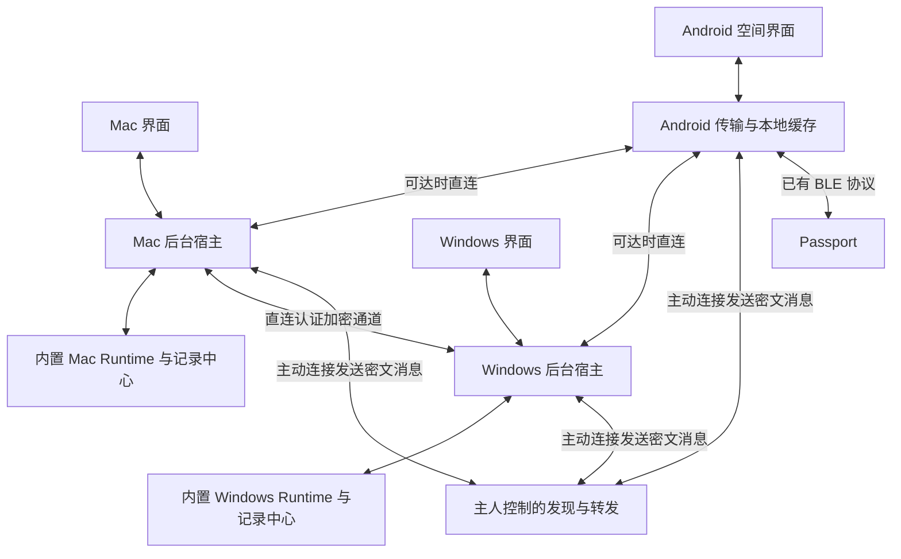
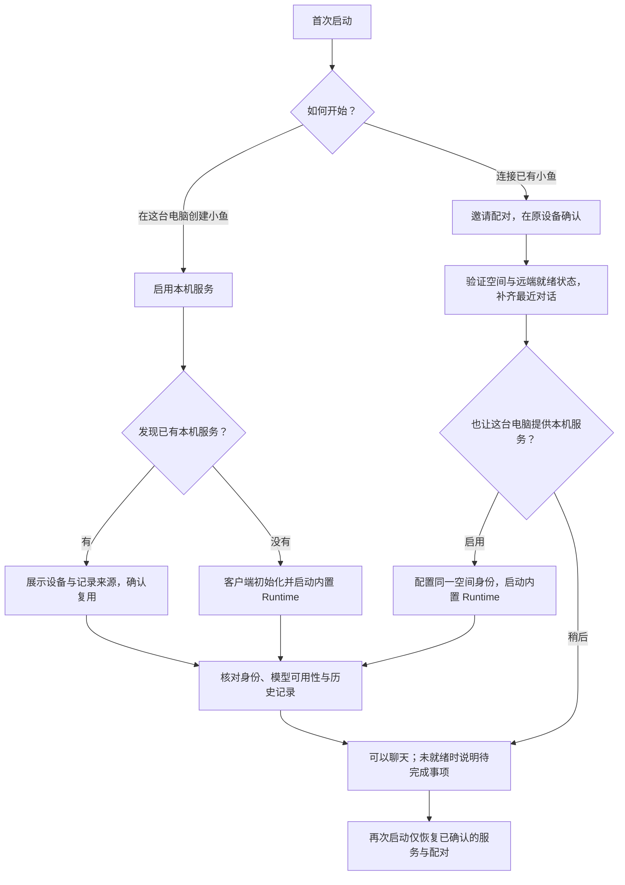

<p align="right"><strong>简体中文</strong> · <a href="xiaoyu-desktop-plan.md">English</a></p>

# 小鱼桌面客户端与统一会话开发方案

> **部分已被[小鱼完整方案](xiaoyu-agent-model.zh_CN.md)取代，以完整方案为准。**

状态：实现进行中，2026-10-21。交付目标：**北京时间 2026 年 10 月 22 日
22:00，周五之前**，提供给主人测试的安装包。这是有明确依赖的压缩目标，
不代表客户端、基础设施、签名或验收已经完成。主人已授权开始实现；当前源码、
命令与已测限制见[桌面实现指南](../../companion/desktop/README.zh_CN.md)。
尚未创建未来定时构建。

## 1. 已确认的产品要求

主人面对同一个小鱼、同一个会话空间。在 Mac 开始的聊天，可以在 Windows
或 Android 接着聊，延续上下文、消息、附件、任务状态和审批。正常聊天不需要
知道记录存在哪台电脑。

- 安装、创建或加入空间、配对一次，即可聊天。内置 Runtime 与通信依赖；
  普通流程不需要安装 Python、Tailscale、开终端、填写 IP、端口或 Mesh Key。
- 各台电脑均可独立运行 Runtime 和本机帮手；连接、记录复制、任务执行位置
  是不同职责。
- 主人补充确认：**Mac、Windows 平常都常开，允许客户端后台运行**。
  周四版以它们作为持久存储与计算节点；开机不等于未睡眠、网络可达或服务健康。
- 优先使用主人控制的基础设施。支持直连与自建加密中继，不强制厂商账号或
  公共中继池。
- 授权端点之间加密，包括经中继转发时。配对、密钥保存和连接恢复封装在 App 内。
- 通过兼容扩展保留现有聊天、记忆、任务、审批、图片、语音、Android 更新和
  BLE 功能。

[跨栈可靠性契约](cross-stack-reliability.zh_CN.md)继续强制生效。
[产品原则](../product-principles.zh_CN.md)仍为草稿；本方案依据主人的要求，
不把草稿整体视为已获批准。

## 2. 已核实的源码基线与缺口

源码基线：`62cc399`，分支 `feature/usage-history`，2026-10-21 检查时工作区干净。
Runtime 源码为 **0.20.0**；Android 源码为 **0.27.0 / code 50**。
本机 Mac 为 ARM64。已安装端的版本与 Windows 架构仍需核实；历史中报告的
测试通过不能作为本轮的新测试证据。

| 现有组件 | 复用方式与所需工作 |
| --- | --- |
| `runtime/xiaoyu_runtime/events/record.py`、`message_log.py`、`ledger.py` | 保留唯一记录写入口、消息身份、落盘确认和重试去重；增加主体级会话投影 |
| `identity.py`、`mesh.py`、`mesh_share.py` | 保留来源身份、记录单写者和远程任务指令；增加认证传输，把已有主体绑定到空间成员关系 |
| `/v1/info`、`/v1/sync`、消息 HTTP/SSE 接口 | 保持现有协议与能力协商，旁路增加新传输 |
| Android `RuntimeClient.java`、`SyncCache.java`、`HubStore` | 普通入口从电脑切换改为空间视图；同步状态持久化，经传输适配器访问 |
| 现有 agent 和模型适配器 | 复用已安装帮手与 provider 策略，不重写推理、审批或模型选择 |
| 桌面分发 | 未发现小鱼 Electron/Tauri 工程；桌面壳、后台宿主、打包、签名和干净安装测试都需新增 |

现有 mesh 使用按地址交换的 HTTP、20 秒长轮询、每地址 `wait + 30` 超时和
五分钟离线判定。Android 也有地址切换和内存同步缓存。这些是待调查的边界，
不代表已经证明其中某一项就是本次不稳定的原因。

现有保留范围有限：消息日志最多保留 5,000 条，mesh 另有上限。所有端都已丢弃的
历史，新设备无法恢复。承诺导入前，先盘点实际可用记录。

## 3. 周四候选版范围

| 候选版必须包含 | 明确后排 |
| --- | --- |
| Mac ARM64 app/DMG 与 Windows x64 安装包，在对应系统实测 | 其他桌面架构，确认构建与测试机器后补齐 |
| 中文引导、创建/加入空间、二维码或邀请链接配对 | 公共账号体系、应用商店上架、复杂主题 |
| 统一会话列表、补齐上下文后接续文字聊天、历史分页 | 语义搜索和新的记忆系统 |
| 任务进度、已有审批/取消、已有图片/文件查看 | 新增桌面麦克风/ASR、桌面直连设备 BLE |
| 本地待发送队列、持久回执、重连和补齐缺失状态 | 自动跨公网 NAT 打洞、通用 P2P/DHT 网络 |
| 直连和中继路径的端到端认证加密 | 独立审计后的生产安全认证 |
| Android 空间/传输适配，回归已有语音/BLE | 新固件功能或固件协议迁移 |
| 可自建发现/转发、本地持久待发送队列与部署者说明 | 中继离线信箱、永久云档案或中继执行推理 |

续聊、加密、Android 互通和恢复是核心验收要求，不是可随意删减项。
核心门禁失败时，即使两种安装包已生成，也仍是未完成候选版。本排期不授权
购买服务器、公网部署、更改凭据、中断正在工作的 Runtime、提交、推送或刷机。

## 4. 架构与技术选择

两种桌面端采用 **Electron + TypeScript + React**，共用 TypeScript 通信库。
复用 Python Runtime，以 **PyInstaller 单目录模式**分别打包。首次构建验证时
锁定维护中的依赖版本与许可证。选择依据是在截止前减少新语言和平台集成工作，
并不意味着 Electron 本身能保证稳定。Tauri/libp2p 留作以后确有测量依据时的选项。

通信管理和 Runtime 监督放在独立后台宿主进程。界面通过范围明确、校验输入的
IPC 调用，不持有私钥、任意 shell 能力或 Runtime bearer token。
使用随包本地界面，开启 sandbox/context isolation，关闭界面 Node 权限，
净化聊天 Markdown，并约束页面跳转和外部链接处理。



周四版中继只做发现与有界密文转发。持久待发送队列和会话记录留在常开的
Mac/Windows 节点，中继无需消息数据库。以后若要求电脑完全错时上线，再增加
可选加密信箱。中继不保存明文模型上下文、会话权威记录、端点私钥或可执行任务队列。
各 Runtime 仍对自己来源的记录负责。空间时间线是这些记录的
投影，不增加第二份可写权威日志。

Android 使用原生适配器，遵循**相同协议与一致性测试向量**，不嵌入 Electron 或
第二套 Runtime。桌面代码共享不意味着三种操作系统必须使用相同实现语言。

### 连接与进程生命周期

- 支持局域网发现与复用缓存的认证地址。可用直连候选和已配置中继在有界连接
  预算内竞争，坏地址不能逐个耗尽整段用户响应时间。
- 候选版跨网使用主动连到自建中继的 TCP 443/WSS；代理不支持 WSS 时以 HTTPS
  轮询恢复。局域网直连使用同一加密消息协议；可达 IPv6 可作为额外直连路径
  验证，不假定 IPv6 或 NAT 打洞可用。
- 同步、聊天、指令和有界附件块复用预热通道。聊天/审批优先，落实背压和大小限制。
- 分别维护传输、身份认证、Runtime 就绪和同步新鲜度。一次心跳成功不能覆盖
  某个会话拉取失败。
- 连接代次过期即取消；切空间、端点或会话后的旧回调不能污染新状态。
  临时故障采用有上限的随机退避；认证失败进入明确修复流程，不无限重试。
- 关闭窗口保留后台宿主；明确“退出”时说明进行中的任务并安全收尾。
  睡眠暂停执行，唤醒恢复连接和补齐状态，不宣称休眠电脑仍在工作。
- 首次引导提供系统登录启动选项；Mac 使用 launchd/Login Items，Windows 使用
  支持的用户级启动机制监督宿主。宿主/Runtime 崩溃通过有界恢复与持久状态接续，
  不盲目重做已开始的副作用。不未经授权修改系统睡眠/电源策略。
- 用单实例锁、版本握手、进程归属和崩溃循环上限防止重复 Runtime。
  接管已有 Runtime 前核实身份与状态目录归属，不让两个写者同时写一份状态。
  更新等待空闲，或取得中断工作的授权。

### 加密与加入空间

采用**网络连接 TLS 1.3，加上按接收设备分别加密、带发送方认证的 HPKE 消息封套
（RFC 9180）**。接收方离线期间，密文封套留在发送方本地持久队列，也为未来
可选加密信箱保留协议扩展能力；周四版不依赖实现中继信箱。
初始套件：Auth 模式、DHKEM(X25519, HKDF-SHA256)、HKDF-SHA256、
AES-128-GCM。桌面采用维护中的 `hpke-js`，Android 采用 Bouncy Castle 轻量 HPKE
API；周三先用锁定的准确版本跑 RFC 测试向量和跨语言互通。
不全局替换系统密码 provider，不手写这些密码原语。该验证失败就不能通过三端加密验收。

每个独立封套使用新的 HPKE 封装；认证上下文绑定协议版本、空间、发送/接收设备和
密钥版本、消息/指令 ID、来源序号和有效期，载荷摘要放在加密正文内。
接收状态按身份去重并检测同 ID 不同载荷，传输重试复用已持久保存的原封套。
HPKE 本身不防重放、不管理成员，也不提供接收方私钥日后泄露时的历史前向保密；
应用回执/鉴权不可省略，Signal 式棘轮与独立审查是后续加固项目，不能宣传
本方案具备与 Signal 等同的安全性质。

配对使用至少 128 位密码学随机、一次性、两分钟过期的邀请，绑定邀请方身份公钥指纹，
并由已有设备明确确认新设备。电脑显示二维码并可复制私密邀请链接，Android 扫码。
短数字码需要经过审查的 PAKE 协议，不作为首版捷径。新设备自己生成私钥，
邀请不分发所有设备共用的端点私钥。

签名成员表绑定空间、设备 ID、身份/加密公钥、角色和版本。已有可信设备批准加入，
中继无权授予成员身份或替换公钥。加密公钥绑定设备身份，通过邀请在带外确认邀请方，
明确批准加入设备的指纹后才传历史。网络证书信任、认证发送方与预期成员身份都验证后，才能转发允许列表中的
Runtime 请求。把现有 `subject_id` 绑定到空间，不悄悄修改旧 mesh secret 派生的
主体 ID。旧 Mesh Key 仅在端点本地保留，不作为中继凭据。

密钥使用平台保护：macOS Keychain、Windows 系统保护存储、适用的 Android
Keystore。验证打包后应用的保护与升级行为，不宣称能防住以同一登录用户运行的
恶意软件。缓存/历史的磁盘保护另行处理，传输加密不等于本地档案已加密。

撤销设备后关闭已知会话；成员状态补齐后拒绝后续认证，更新相应凭据和加密密钥。
隔离端点接受远程指令前必须补齐成员状态。明确网络分区边界：离线设备无法即时知道
撤销，已经解密的历史也无法收回。周四版通过仍可信的设备恢复加入，
加密恢复导出后排；所有可信设备/密钥都丢失时，不能承诺从中继恢复。

中继仍可观察 IP、路由标识、时间和流量。需要认证、连接/速率/缓冲上限和最小化
元数据日志。Runtime 文件/shell 接口留在 loopback，经方法允许列表调用，
不开放无认证通用 TCP 代理。Runtime 与选用的云模型仍会接触推理所需明文。

## 5. 会话接续与数据契约

保持[统一消息模型](unified-message-model.zh_CN.md)。通过协商增加空间/会话元数据
与客户端投影，不替换已有写入口，也不在电脑之间复制正在使用的数据库文件。

- 稳定的 `space_id` 映射到现有主体；稳定的 `conversation_id` 独立于地址与
  当前 Runtime。明确映射导入现有共享主会话，保留原本不同的历史会话，
  不把无关端所有同名 `default` 合并。
- 使用完整来源身份加原生 ID 作为全局键，现有短别名仅做兼容映射。
  保留 `turn_id`、`client_id`、来源 epoch/seq 和 revision，不按文字去重。
- 发送前持久保存请求 ID、原始载荷和选定接收 Runtime；Runtime 落盘后才确认。
  回执丢失时仍向同一接收 Runtime 查询，另一端不得独立执行同一个请求。
  回执保留期覆盖协商的重试窗口；超过窗口先查询或报告不确定，不能盲目重发。
- 消息变化与不透明游标在同一本地 SQLite 事务提交。reset/缺口通过快照修复，
  不删更旧的本地历史。从已应用游标恢复，并保证快照到实时订阅之间无丢失窗口。
- 待发送气泡、消息快照和历史按身份/版本归并。`partial` 是整段替换，空快照也
  必须撤回；终态不能被旧 partial 覆盖。明确删除使用有范围的墓碑，
  普通保留上限/裁剪不表示删除。
- 保留每来源的单写者顺序。离线同时发送携带因果父节点/前沿，显示使用稳定的
  来源/ID 规则解决并列；不能把机器时钟当全局接收顺序。同一会话的响应者
  串行处理已接收回合；发现并发争用或上一回合仍在未知状态时，先协调再推理，
  避免多端以不一致上下文各答一遍。
- 已完成回合换端接续时，先补齐会话前沿，再在另一 Runtime 启动响应者。
  模型上下文来自相同授权日志和共享记忆，不从界面气泡反向抓取文字。
  可用这些上下文创建新的原生模型/harness 会话，不代表搬走隐藏 provider 状态
  或正在运行的 CLI 进程。
- 正在执行的工具任务保留执行来源和权限。本地文件缺失、工具不可用、执行中状态
  不确定都如实呈现，不能因另一电脑在线就重试有副作用的操作。长任务迁移后排。
- 审批绑定来源 Runtime、task/run、操作指纹和有效期，答案回执与撤销都同步。
  镜像审批不赋予在其他电脑执行任意命令的权限，保留已有“仅提醒”情况。
- 附件通过端到端加密通道按需传输，核对摘要、声明大小，支持有界分块续传和进度。
  来源/文件不可用就明确说明。当前 mesh 不复制附件字节，有元数据不等于另一电脑
  已经可以读取文件。

新增本地持久档案/索引，保存导入和后续收到的记录，分页不阻塞当前聊天。
按 ID 幂等导入现有日志/副本，不宣称恢复已经裁掉的记录，也不悄改 Runtime
保留策略。保留外部/观察会话来源与只读边界，不自动共享任意私密桌面聊天。

离线设备显示缓存和待发送消息。发送方为当前每个成员分别加密，将未送达封套提交到
本地 SQLite 待发送队列。接收方解密、验证并将记录和游标原子应用后才确认“已应用”。
区分本地保存、Runtime 接收和目标端应用，它们都不能单独表示任务完成。
中继转发回执不能冒充持久保存或任务执行回执。

Mac、Windows 平常在后台持续互收记录；任一已充分同步且就绪的节点都可以为返回的
手机提供历史，或接续已完成的聊天回合。客户端内部选择合格节点，不把未知的已接收
回合或正在执行的工具任务擅自挪到另一电脑。关闭聊天窗口仍继续复制；崩溃、重启、
切网后从本地队列与游标恢复。原节点暂时离线时，已有副本可提供保留历史。

本地传输空间初始拟定每空间 1 GB、每附件 64 MB，配额/背压明确可见，不静默删除
未送达消息；指令/审批期限独立执行。测试端点磁盘满、进程重启、游标过期与离线手机
返回。新设备历史由可用可信设备明确重新加密给它。如果记录还只在唯一来源上，
该来源就离线，其他端仍无法读取，必须显示新鲜度缺口并安全保留新输入。
两台电脑都不可达时，手机消息保持待发送，模型回复等待可用 Runtime。
这符合已确认的日常常开基线，不宣称能在两台同时故障时继续提供在线服务。

## 6. 页面与首次使用

1. **首次启动**：创建空间或通过邀请加入，必要系统权限一次说明。
   全新推理环境检测已安装帮手并使用官方支持的登录，安装包不带个人凭据，
   不从另一电脑复制登录目录。现有主人配置通过明确流程导入。
2. **聊天**：中文界面、空间级会话列表、历史/附件、输入框、完整消息气泡，
   待发送/补齐状态真实可见，无普通电脑/模型/档位选择器。
3. **任务与审批**：共享状态、进度、结果、继续/取消与已有审批；仅在操作确有
   需要时呈现执行电脑。
4. **设备与诊断**：配对/撤销、连接、Runtime/模型就绪、同步新鲜度和脱敏导出。
   技术端点放高级设置，不让用户复制原始凭据或日志排障。

普通首次使用目标是无需终端和手填地址就完成配对与首次聊天。
系统安装警告、模型登录未就绪都记入使用门槛，不在验收中隐藏。

### 连接与内置服务逻辑复核，2026-10-21

主人已确认另一个任务的 v8 参考稿，要求补齐 onboarding、本机帮手检测，并以
dsh + DeepSeek 作为默认主服务。0.1.1 已实现明确启用及选择接入帮手，见
[实施检查点](../../companion/desktop/README.zh_CN.md#首次连接与本机帮手011)。
下图仍为目标流程，其中加入后配置同空间本机服务尚未实现。

初次复核时，代码已经打包 Runtime，也能将它作为子进程启动；但启动时会静默探测旧配置，
并恢复保存的端点。0.1.1 增量已移除这种隐式启用。同一个“连接”操作可能复用外部 Runtime，也可能启动内置服务。
认证后的 `/v1/info` 成功就把 Runtime 标为就绪，没有验证模型可用；空间的连接标识
则另行依赖同步成功。界面未解释两者的区别，也未说明服务由谁管理。
全新环境的本机推理仍依赖已安装并登录的 Claude Code；内置 Runtime 不等于已经
封装模型登录，也不代表能正常推理。



- 首次启用需要明确操作。之后启动客户端，自动启动已启用且归客户端管理的服务，
  恢复已确认的连接；启动、认证、同步、就绪或失败过程可见。
  旧版已缓存但未记录确认的端点，需要补一次确认；保留原历史、游标和待发送请求。
- 发现旧服务可以提示，但不能静默接入、导入记录或启动第二个写者。
  复用前确认身份、兼容性与来源。复用不等于接管进程，不重启或停止外部服务。
  将旧服务迁入客户端管理属于单独的明确操作，需要等待空闲后交接。
- 加入已有小鱼时先配对到原空间。之后启用本机服务，要配置同一授权主体，
  补齐上下文后才能接收新的聊天工作。加入过程中不能另建无关空间，也不能静默
  改写正在运行的 Runtime 身份。当前增量仍缺少这段同空间本机服务配置流程。
- 路径、端口、密钥、启动与恢复由客户端处理。用户启用服务，无需启动 Python
  或选择配置文件。需要模型配置、登录时明确呈现；不能仅凭心跳或同步成功
  宣称可以聊天。启动时不能忽略成本和副作用而反复调用模型探测。
- 设置中分别呈现本机服务状态及归属、已配对设备、实际连接路径（本机、直连或
  加密中继）、最近同步状态，以及必要时的响应设备。它们是不同事实，不能只用
  一个绿色“已连接”概括。公网可达仍是基础设施条件。

| 事件 | 目标生命周期行为 |
| --- | --- |
| 关闭窗口 | 服务与同步继续在托盘后台运行 |
| 退出客户端 | 自有工作未结束时提示；仅停止自己启动的子进程，保留数据 |
| 关闭本机服务 | 不再在此接受新工作；明确处理进行中工作，保留历史缓存和配对 |
| 断开设备 | 停止其传输及自动重连，保留记录；撤销授权另有明确语义 |
| 睡眠唤醒或断网 | 显示离线、记录未更新状态；用原请求 ID 重连并核实结果 |
| 自有服务崩溃 | 有上限地重启，超过上限明确提示修复；不重复启动工作 |
| 没有可达设备 | 消息保持待发送，不悄悄转交新的 Runtime |

实施边界：`companion/desktop/src/` 下，`main.ts` 负责启动和 IPC，
`runtime-host.ts` 负责本机进程生命周期，`client.ts` 负责端点恢复、同步与发件箱，
`peers.ts` 负责配对及中继路由。先拆开发现与启用，持久记录确认及服务归属，
再向定稿的交互方案暴露这些状态。初次复核仅修改文档。之后的 0.1.1 增量修改桌面源码，不重启已有 Runtime，
不自动注册系统服务。

## 7. 仓库工作包

以下是拟新增位置，不表示这些文件已经存在：

| 位置 | 职责 |
| --- | --- |
| `companion/desktop/` | Electron 界面、后台宿主、桌面共享 TypeScript 传输、SQLite 缓存和原生打包 |
| `runtime/xiaoyu_runtime/` | 兼容增加连接桥、空间/会话投影、上下文接续和就绪能力，保持 Record/mesh 归属 |
| `companion/relay/` | 可自建发现与密文转发、连接配额、部署清单和部署者指南；周四版不做信箱数据库 |
| `companion/android/` | 原生端点 TLS/中继适配、配对、持久空间缓存与空间界面 |
| `tests/` 与各工程测试目录 | 协议样例、故障注入、安装/恢复与跨版本测试 |
| `.github/workflows/` | 获准使用 CI 后增加原生 Mac/Windows 打包；仍可本地原生构建 |

桌面、Runtime 和 Android 共享协议样例与攻击测试向量；平台打包、密钥适配必须
在对应系统验证。保留主人模型/provider 策略：默认使用非 Astra，未经主人明确指定
不选 Astra，不改变预算或付费路由。不新增固件功能、不计划刷机。由于上游连接有变化，仍需回归
现有手机/BLE/设备链路。

## 8. 排期与决策门禁

全部为北京时间。从方案编排时到截止约 34 小时，以下是执行里程碑，
不表示已创建自动定时任务。

| 时间 | 可审查结果与继续条件 |
| --- | --- |
| 10 月 21 日周三 15:00 | 核实源码基线、运行版本、Windows 原生构建/测试入口、中继位置/可达性与签名条件；冻结协议草图和安装目标 |
| 周三 18:00 | Mac/Windows 开发壳能启动内置 Runtime；桌面和 Android 通过共享 HPKE 向量及认证加密收发；错误设备/公钥替换被拒绝 |
| 周三 22:00 | 配对后在两个网络完成真实 Mac→Windows 续聊；关闭界面仍后台复制；验证本地待发送/回执/游标持久化和 Android 加密 |
| 10 月 22 日周四 12:00 | Android 空间视图加入；三端会话/上下文/附件接续、审批路由、重启和切网恢复可用 |
| 周四 16:00 | 功能冻结、原生安装包生成，执行专项故障测试与完整项目门禁，保留回退包和脱敏证据 |
| 周四 20:00 | 干净原生安装与 Mac/Windows/Android/Passport 实机冒烟和计时，只修交付阻塞问题 |
| 周四 22:00 | 交付实测 Mac/Windows 包、Runtime 身份、经 Runtime 发布的 Android 更新、校验值、入门说明、已知问题、验收表与回退说明 |

尽早证明两种原生打包启动：PyInstaller 产物与目标 OS 绑定。不能等到周四晚
才发现没有 Windows 构建机或 Android 加密不互通。加密依赖与三端集成仍使本排期
具有较高风险，不能当作可靠的生产版工期估计。常开基线把中继信箱移出关键路径，
不降低本地持久化、加密或恢复要求。关键验证失败就立即说明影响
并调整后续工作，不能以局域网演示、明文中继或网页替代并称为已交付客户端。
目标时间交付实际已验证的候选产物，核心门禁失败/缺失必须明确标注，不能因
赶上日期就推定已经具备生产可用性。

## 9. 基础设施与分发依赖

| 依赖 | 要求与影响 |
| --- | --- |
| 公网可达条件 | 先验证常开 Mac/Windows 是否能接受认证公网连接。现有机器确实可达时，可内置发现/转发服务；常开本身不能解决 NAT/防火墙 |
| 按需自建中继 | 所有参与网络可主动经 HTTPS/WSS 443 访问，配置证书与引导地址。没有任何可达直连端点或中继时，受限网络的异地互通无法成立；不强制 Tailscale/Funnel |
| 按需小型中继机器 | 初始估算 1 vCPU、除 OS 外 512 MB～1 GB 内存、少量配置/日志磁盘与实测带宽；周四版无需密文档案，不是容量保证；先验证 NAS/主机入站可达、防火墙与 IPv6 条件 |
| Windows 原生机器 | 首版拟定 x64，需核实实际硬件/系统与 GUI 测试入口。Windows 本地工作或获准 CI 要有直接授权/访问，不能凭其他聊天转述就调度 |
| Mac 分发 | 已核实本机 ARM64；Developer ID 签名/公证依赖可用的主人凭据与外部服务。缺少时，私测包可能要手动系统许可，达不到无额外门槛安装目标 |
| Windows 分发 | 核实安装包签名条件，并在干净机器检查 SmartScreen；不承诺签名必然消除所有警告 |
| 真实模型/帮手 | 检测现有安装/登录，验证实际推理链路；安装包不带个人凭据或 CLI 私有目录。没有可用 provider 的新机器不能承诺立即收到 AI 回复 |
| Android 与设备 | 主人手机安装确认和真实 BLE/语音观察独立于构建/发布，保留现有配对与数据 |

自建减少对第三方应用服务的依赖。核实网络后，已有常开电脑可能承担可达端点，
不预设必须额外租服务器；端点仍需稳定发现/地址处理与持续维护。
本方案没有购买或部署任何主机。第二个独立中继是后续可用性增强项。
中继故障时直连和本地记录仍可用，远程待执行项如实保持待处理。

## 10. 验收、测量与交付

执行[完整可靠性矩阵](cross-stack-reliability.zh_CN.md#必须执行的回归与故障矩阵)，
包括受影响链路及相邻已有功能。以下为阻塞交付的检查：

| 场景 | 必需观察 |
| --- | --- |
| Mac/Windows 全新安装 | 无 Python/Tailscale/终端前置；真实 Runtime/provider 就绪；无内置个人凭据；记录签名和系统警告 |
| Mac→Android→Windows | 同一会话 ID，能理解前文事实，消息/顺序/状态一致，保留附件可读，无普通电脑切换 |
| 两端在线、一端离线返回 | 每条消息一个气泡；重复/乱序/reset/快照竞争与空 partial 撤回均正确收敛 |
| 断网/回执丢失/崩溃 | 待发送持久保留；同一身份查询/恢复已接收请求；不重复未知副作用 |
| 后台与设备返回 | 两端关闭窗口但后台仍运行；手机离线返回后向就绪节点补齐；一台电脑重启恢复队列/游标；端点磁盘满/配额明确可见，两台 Runtime 都不可达时不虚构回复 |
| 睡眠/唤醒/切网/中继丢失 | 重试有界、就绪状态明确，直连/中继恢复且无旧来源回调污染 |
| 配对/撤销/恶意中继 | 过期/重用邀请、未知/不匹配证书、错误空间、重放指令和已撤销成员均失败关闭 |
| 任务/审批/上下文 | 来源正确、过期/取消有效，保留记忆与权限，繁忙工具不冻结聊天 |
| 图片/文件/语音/BLE | 图片/附件身份内容一致，手机/设备语音与设备最近窗口保持正确 |
| 升级/混合端/回退 | 支持中的旧 App/Runtime 接口仍可用；数据/配对/待处理保留，不支持的新增能力明确禁用 |

从发起端的单调时钟发送/录音松开时刻，到第一条**有实际意义的完整助手气泡**计时，
不能用 ACK、转圈或错误算通过。每个成功样本都必须 **<= 3,000 ms**。
每条受影响的成功输入/传输路径至少 20 次热发送，覆盖冷启动/长历史，
每个适用故障/状态变化至少重复三次。记录次数、失败/超时、p50/p95/max 和版本组合。
离线尝试另报，不得算作已连接首回复通过。

同时测量在线端已提交增量传播 **<= 3,000 ms**，以及
**认证传输就绪后 <= 3,000 ms** 补齐最新状态；旧历史回填另显。
拟定热路径预算：客户端派发 150 ms，传输/接收 350 ms，排队/上下文 300 ms，
provider 首条完整消息 1,900 ms，渲染 150 ms，余量 150 ms。
这是待测预算，不是实测性能。冷连接和 ASR 同样计入总时间，不因模型超时
就重新计时或放宽门禁。

实现交付前执行已有命令：

```bash
./tools/validate.sh --static
./tools/validate.sh
# 在 runtime/ 下：
python3 -m unittest discover -s tests
# 在 companion/android/ 下，使用 JDK 17 和 Android SDK：
gradle testDebugUnitTest assembleDebug
```

实现时把桌面/中继的类型/lint、单元/故障测试、打包集成测试和原生安装包命令
加入新工程及 CI；命令真实存在后记录准确用法。模拟测试不能替代原生安装、
首屏呈现、安全或真实跨网验收。

候选交付物：Mac ARM64 DMG/app、Windows x64 安装包、SHA-256/版本清单、匹配
Runtime 包、源码/依赖锁定身份、通过现有 Runtime 发布流程送达的 Android 版本更新、
私有中继部署材料、中文入门/已知问题说明和脱敏测试证据。不能打包真实配置、私钥、
聊天原文或原始日志。公开发布和新基础设施部署仍遵守授权要求，App 改动继续遵守
已有发布流程。

保留上一版安装包、Runtime 包和原始状态。新客户端缓存独立存放，导入幂等且保留
ID；新增元数据兼容扩展并按能力启用。回退时安全停止新版本自己管理的进程，
恢复兼容程序/配置，同时保留旧状态与新待发送项以便协调。不得清数据、把新加密
空间悄悄降为旧明文传输，或未经授权打断工作。

每轮实现交付分别报告版本/配置、回归、首回复 <= 3s、连接恢复、多端同步、
Build、Host tests、Device tests、Unverified 与 Recovery，并附真实证据。
文档检查不证明已经交付可用客户端；实现指南单独记录当前增量，下文保留最初
方案阶段的基线结果。

## 11. 一手资料与选型依据

- [Syncthing 中继](https://docs.syncthing.net/users/relaying.html)：参考直连优先与密文中继，不作为数据库文件复制依赖。
- [Syncthing 私有中继](https://docs.syncthing.net/users/strelaysrv.html)：自建及明确退出公共池的配置。
- [RustDesk 架构](https://rustdesk.com/docs/en/self-host/)：参考发现与中继职责分离。
- [TURN / RFC 8656](https://www.rfc-editor.org/rfc/rfc8656)：部分 NAT 组合需要可达中继，不能保证总能直连。
- [Electron 进程](https://www.electronjs.org/docs/latest/tutorial/process-model)与[安全](https://www.electronjs.org/docs/latest/tutorial/security)：界面隔离与高权限进程边界。
- [HPKE / RFC 9180](https://www.rfc-editor.org/rfc/rfc9180.html)：接收方公钥认证加密及重放/前向保密限制。
- [hpke-js](https://github.com/dajiaji/hpke-js)与[Bouncy Castle HPKE](https://downloads.bouncycastle.org/java/docs/bcprov-jdk18on-javadoc/org/bouncycastle/crypto/hpke/HPKE.html)：候选跨端 RFC 实现，仍必须通过跨语言测试向量。
- [Node TLS](https://nodejs.org/api/tls.html)：标准网络 TLS，需验证锁定 Electron runtime 的 API 支持。
- [Electron safeStorage](https://www.electronjs.org/docs/latest/api/safe-storage)：平台密钥保护差异，包括 Windows 同用户限制。
- [PyInstaller 工作模式](https://pyinstaller.org/en/stable/operating-mode.html)：内置解释器并按目标 OS 原生构建。
- [Electron 签名](https://www.electronjs.org/docs/latest/tutorial/code-signing)：原生签名/公证与私测安装限制。
- [Android TLS](https://developer.android.com/privacy-and-security/security-ssl)：使用可信平台接口校验证书，核实支持 Android 版本的 TLS provider。

## 12. 本次仅方案验证，2026-10-21

- `git diff --check`：PASS。
- `python3 tools/check_repo.py`：PASS，包含新增双语文档。
- `python3 tests/test_check_repo.py`：PASS，22 项。
- `./tools/validate.sh`：在原有 Runtime 测试阶段 FAIL：205 项，8 个失败、20 个错误。
  已观察到沙箱拒绝回环 socket 绑定及 `ps`；单独运行 HTTP 健康测试可复现绑定被拒。
  等待审批的断言也失败，不能据此认定产品回归，也不能因发现环境限制就称其已解决。
- 未激活 ESP-IDF/cJSON，协议/状态/编排器及固件更新互操作检查被跳过。
  未运行到固件构建阶段，当前环境也没有可用 `idf.py`。
- Build：NOT RUN。Host tests：FAIL（门禁未完整通过，受上述环境限制）。
  Device tests：NOT RUN。客户端实现、已安装版本核验、首回复、恢复、加密互通
  与多端验收：NOT RUN。本次没有重启或部署 Runtime。

这些结果只证明方案的文档检查通过。实现环境需要解决基线测试访问条件并重跑
所需门禁，不能据此宣称已经交付可用桌面客户端。
