**English** · [简体中文](ai-companion-design.zh_CN.md)

# AI Companion Design Pack

Generated on 2026-10-12 with the built-in image generation tool. This pack explores three consistent identities across firmware pixel art and app chibi illustration: a blue whale maid, an orange-haired Claude scholar, and an elegant silver-lavender-haired Codex companion. These are unofficial fan-inspired designs.

The user-selected elegant Codex sheets are the style master. DSH and Claude full-body sheets, portraits and whale emotion expansion are updated to v2. The recommended set contains 15 source sheets and 208 drawn poses, including style alternatives rather than 176 distinct emotions. Earlier versions remain drafts.

## Dot-eye alternative matching XiaoYou

The requested alternative follows the current firmware mascot: very large pixel blocks, bead/bar eyes, a tiny mouth and minimal colors. A [style reference](../../../assets/images/ai-companions/reference-xiaoyu-style.png) was rendered directly from `main/pocket_pet.c` without changing firmware.

- [Three-character dot-eye comparison](../../../assets/images/ai-companions/avatar-dot-eyes-elegant-v1.png): eight expressions per character, rows ordered whale, Claude, elegant Codex.
- [Whale full-body dot-eye concept](../../../assets/images/ai-companions/fw-whale-dot-eyes-v1.png): twelve work-state poses.
- [Elegant Codex dot-eye heads](../../../assets/images/ai-companions/avatar-codex-dot-eyes-v1.png): eight expressions.

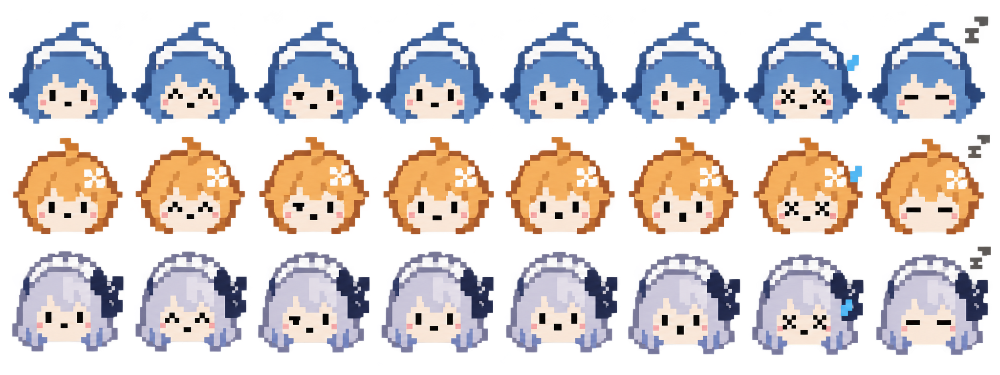

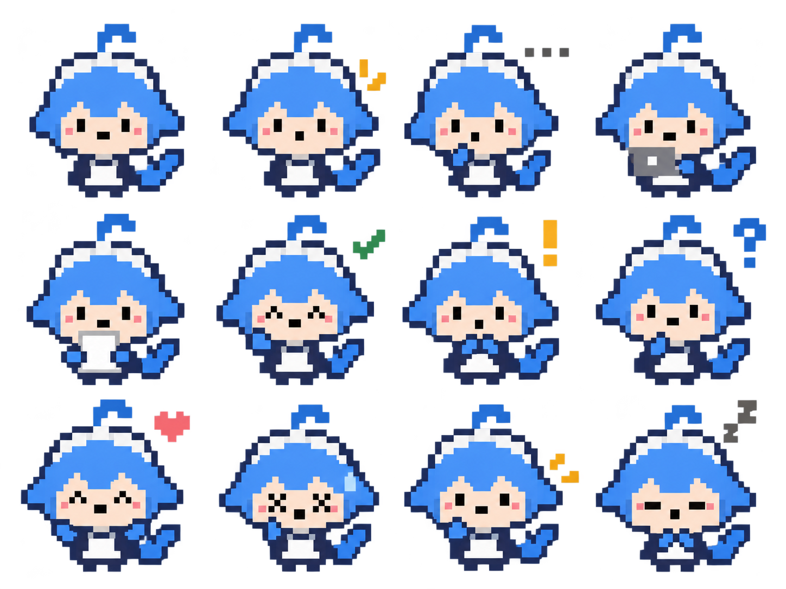

The head comparison reads neutral, happy, thinking, focused, puzzled, surprised, error and sleeping. These are source concepts; the logical 20-by-20 target still needs deterministic pixel-grid cleanup before firmware use.

## Firmware head avatars

Three 4-by-4 sheets contain 48 head expressions. Large faces, stepped silhouettes and strong color identities are intended for small status badges and dialogue portraits. The requested 24-by-24 logical footprint is an art direction, not a verified native sprite resolution. The delivered PNGs are high-resolution source sheets.

| Character | Source sheet |
| --- | --- |
| Whale maid | [16 expressions](../../../assets/images/ai-companions/avatar-whale-v2.png) |
| Claude scholar | [16 expressions](../../../assets/images/ai-companions/avatar-claude-v2.png) |
| Codex companion | [16 expressions](../../../assets/images/ai-companions/avatar-codex-elegant-v1.png) |

Each sheet reads left to right, top to bottom: neutral, cheerful, attentive, thinking; focused, skeptical, puzzled, surprised; nervous, apologetic, sad, frustrated; tired, sleeping, proud, shy. Generated expressions are visual approximations of these intended states; labels are kept outside the artwork.

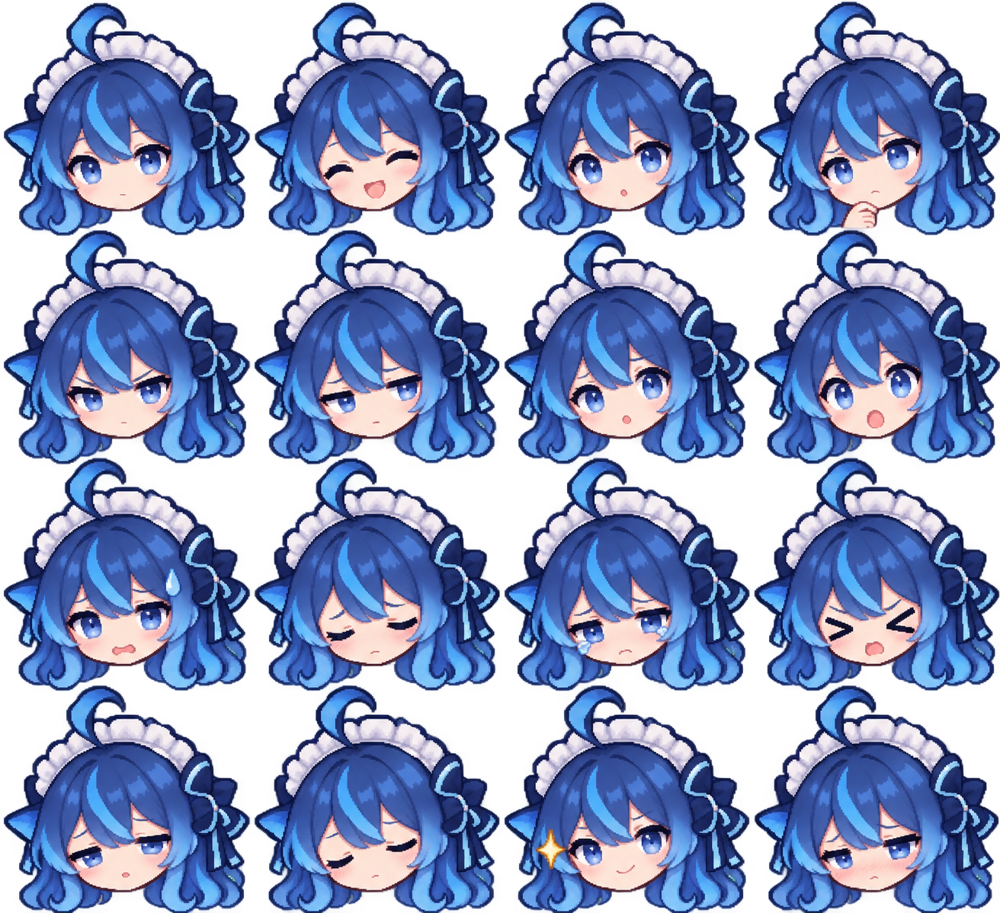

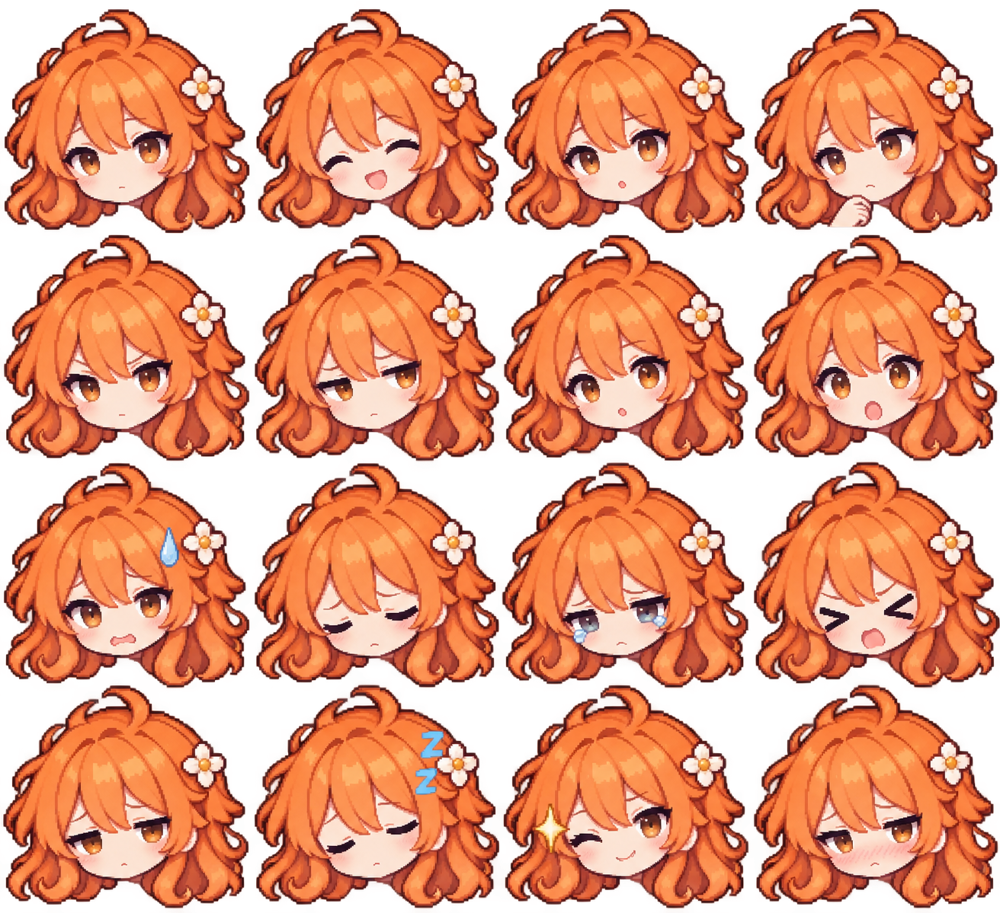

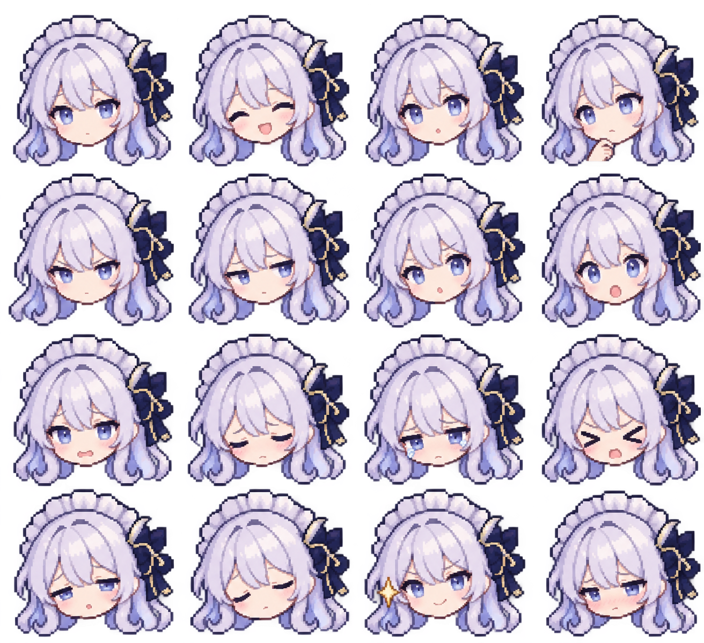

## Firmware full-body concepts

Three 4-by-3 sheets contain 36 work poses. These use finer pixel styling than the head avatars and remain source concepts for an optional larger home-screen character.

| Character | Source sheet |
| --- | --- |
| Whale maid | [12 work poses](../../../assets/images/ai-companions/fw-whale-v2.png) |
| Claude scholar | [12 work poses](../../../assets/images/ai-companions/fw-claude-v2.png) |
| Codex companion | [12 work poses](../../../assets/images/ai-companions/fw-codex-elegant-v1.png) |

Work poses read left to right, top to bottom: ready, listening, thinking, typing; reading, checking, waiting for approval, confused; celebrating, error, retry, resting.

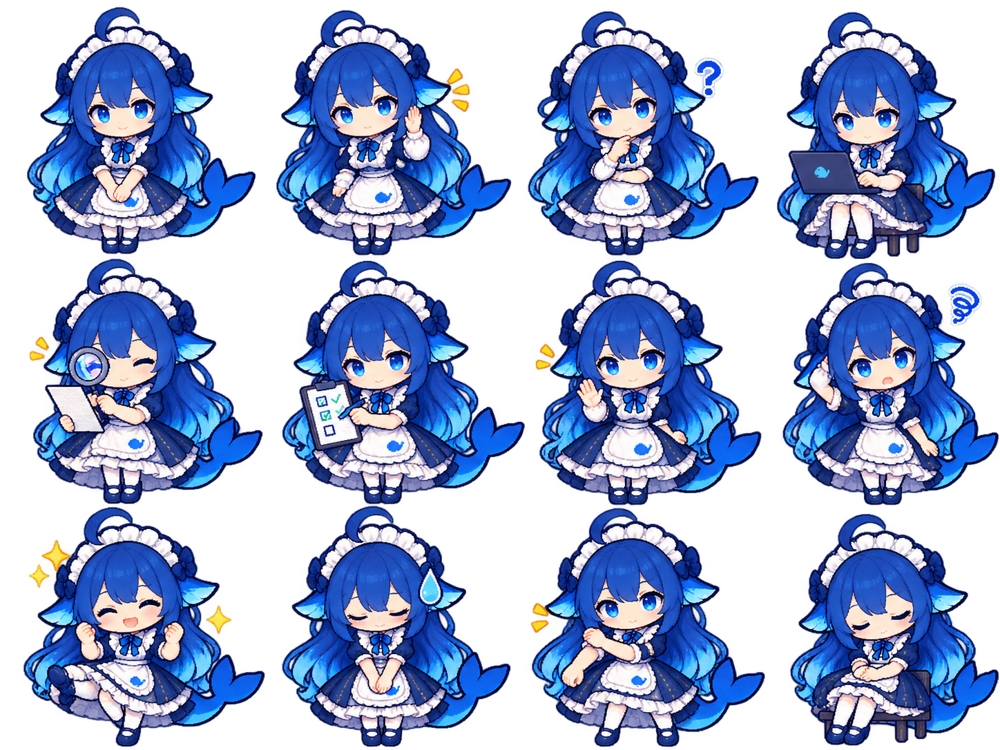

## App chibi illustrations

Four 4-by-3 sheets contain 48 poses: the same twelve work poses for each character, plus twelve extra whale emotions. Smooth outlines, richer hair and clothing detail, and expressive faces suit an app companion panel or task card.

| Character | Source sheet |
| --- | --- |
| Whale maid | [12 work poses](../../../assets/images/ai-companions/app-whale-v2.png) |
| Claude scholar | [12 work poses](../../../assets/images/ai-companions/app-claude-v2.png) |
| Codex companion | [12 work poses](../../../assets/images/ai-companions/app-codex-elegant-v1.png) |
| Whale emotion expansion | [12 additional poses](../../../assets/images/ai-companions/app-whale-emotions-v2.png) |

Whale expansion order: shy, proud, frustrated, surprised; tired, apologetic, discovery, concentrated reading; overwhelmed multitasking, relieved, enjoying rice, greeting. The rice illustration is an expressive prop, not a proposed feeding mechanic.

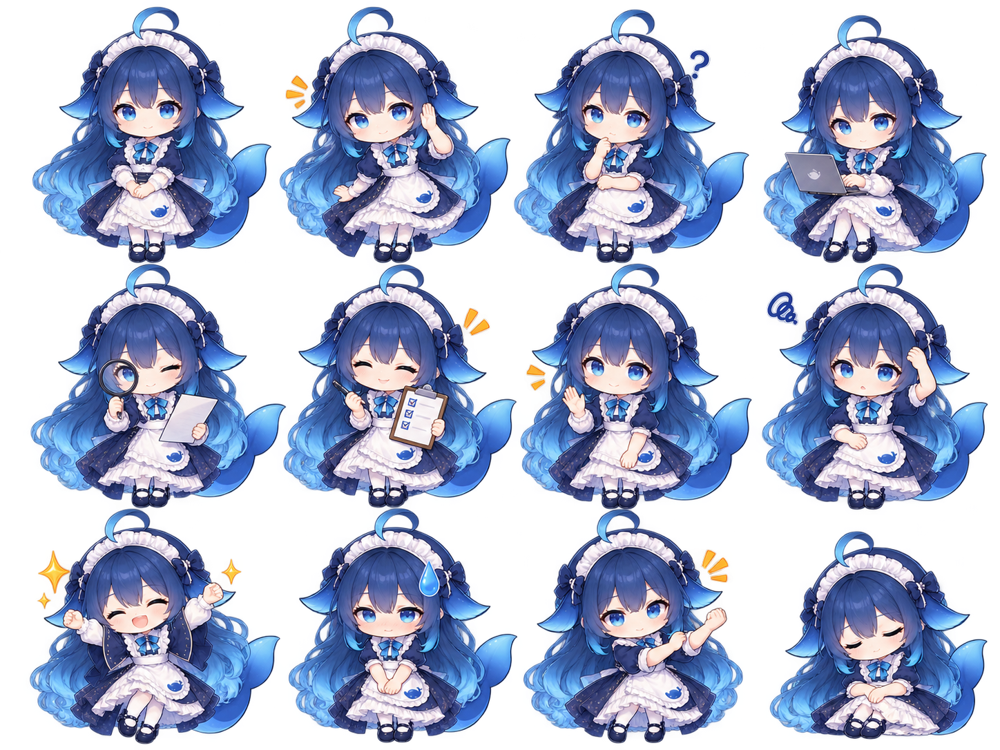

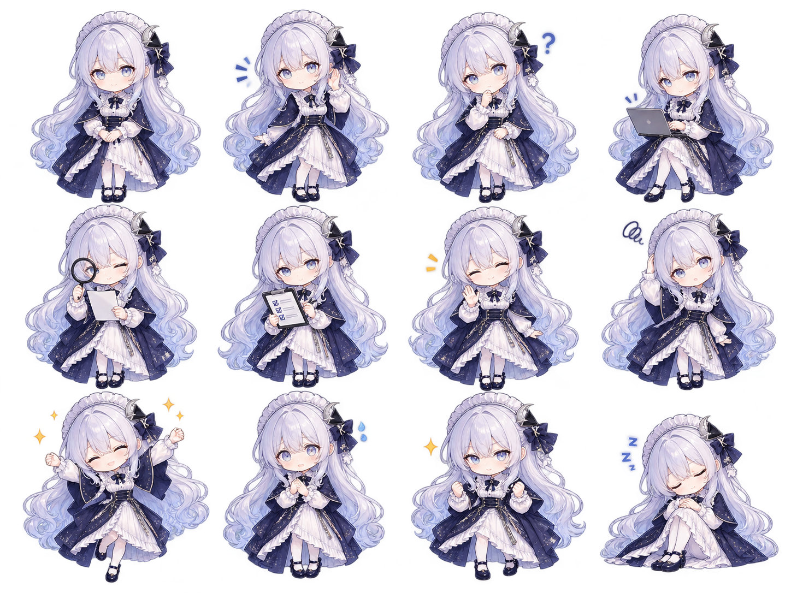

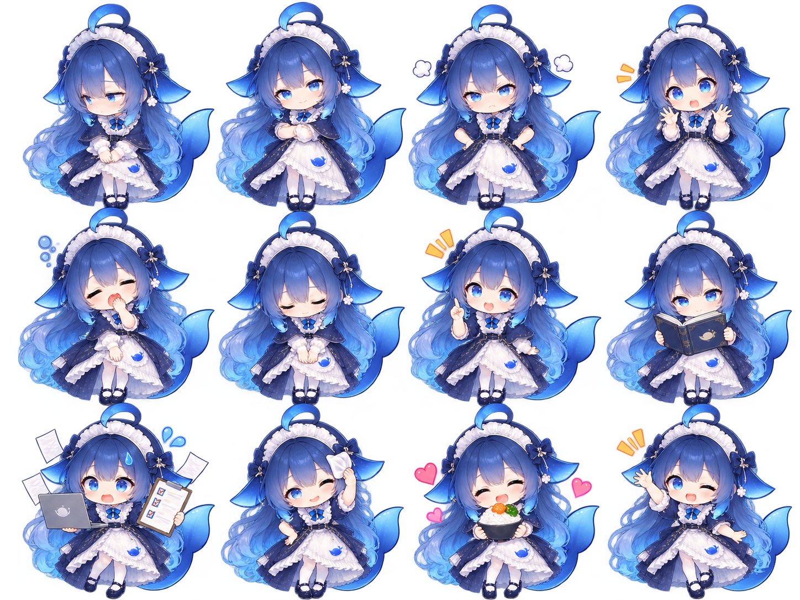

## Xiaoyu pixel-head integration (2026-10-13)

The user chose the earlier [whale pixel heads](../../../assets/images/ai-companions/avatar-whale-v1.png)
for the Xiaoyu App and firmware. The original sheet is unchanged. Reviewed portrait
rectangles supply eight App poses and six firmware moods. Firmware uses a
60×60 indexed C atlas (21,856 Flash bytes) with no PNG decode buffer; the App
draws the source rectangles without bitmap filtering. See the
[asset conversion record](../../../assets/README.md#ai-companion-design-pack)
and [companion guide](../../../companion/README.md#device-firmware).
Physical display and mobile-device acceptance remain pending.

The sleeping expression uses [a separate corrected head](../../../assets/images/ai-companions/avatar-whale-sleep-v5.png),
keeping the [user-approved cheek and chin contour](../../../assets/images/ai-companions/reference-whale-sleep-approved-chin.png)
and changing the brows to relaxed horizontal marks. Sleep, idle, ask and happy
have a subtle 3.6-second breathing loop, with at most four display pixels of
movement on the firmware home screen. The initial device flash and 35-second
startup observation passed, but the user rejected that build's sleeping-face
shape; the revised expression and animation require a new device acceptance.

## Original design-stage sources and integration status

- Artwork was generated for this project. Visual direction follows the [reference collection](ai-character-references.md); no downloaded third-party image was copied into the pack. The emotion expansion uses the generated app whale sheet as its identity reference.
- Whale and Claude designs draw on community personification conventions. Codex now follows the user-provided elegant long-dress reference, with silver-lavender hair, navy bows, ivory/navy layered dress and a starry capelet; horns and tail are removed. The user supplied this reference for visual direction; its original author and reuse license are unknown. Generated artwork does not establish additional rights to underlying character designs or trademarks; do not represent it as official artwork or apply the repository code license as an artwork authorization.
- Exact prompts are retained in [prompts.json](../../../assets/images/ai-companions/prompts.json). Actual dimensions, alpha checks and SHA-256 identities are recorded in [manifest.json](../../../assets/images/ai-companions/manifest.json).
- These are static source sheets, not animation frames or a compiled firmware resource pack. No firmware/app screen, runtime mood contract or Git history was changed by this design iteration.
- Before integration: extract and visually inspect individual cells, clean edge artifacts, align anchors, reduce firmware sprites to an agreed integer grid and palette, convert to the selected LVGL format, and measure Flash/RAM costs. Avoid loading a full source atlas into firmware RAM. Verify small-size expressions and contrast on the board. App assets also need cell extraction and edge inspection.

Build: NOT RUN (asset design only). Host tests: FAIL (static gate stopped at a macOS linker rejecting `--gc-sections`; earlier tests passed). Device tests: NOT RUN. Unverified: cell extraction, exact pixel grid/palette, alpha-edge cleanup, runtime integration, animation and physical-device rendering.

## ChatGPT app head module (2026-10-16)

Redesigned from the user-provided white dragon reference, matching `app-whale-v2.png`: white hair, pale violet eyes, white dragon horns, pointed ears and a knot-shaped hair ornament. This is a smooth HD app chibi head-only sheet, with sixteen expressions in a 4-by-4 grid, not a full-body character or pixel firmware resource. Expression order follows the head-avatar section.

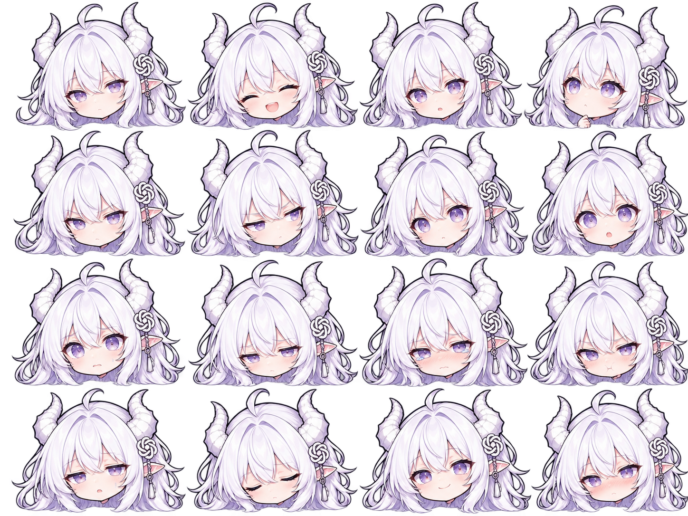

The [user-provided identity reference](../../../assets/images/ai-companions/reference-chatgpt-dragon.png) has unknown original authorship and reuse terms. The generated sheet has alpha transparency; cell extraction, margin alignment and alpha-edge inspection remain before integration. No app code or release was changed.

## Codex app pixel portrait replacement (0.14.1)

The owner selected the ChatGPT white-dragon design to replace the app Codex portraits, preserving Xiaoyu and Claude. The new [pixel source sheet](../../../assets/images/ai-companions/avatar-chatgpt-pixel-v1.png) supplies reviewed idle, happy, thinking and focused cells. `companion/android/tools/PreparePortraits.java` generates transparent 256-by-256 resources; its optional trailing `codex` argument scopes regeneration to this role. Codex rendering uses nearest-neighbor scaling, preserving existing role identity, mood mapping and breathing animation. This changes portraits only, not connections, messages, approvals or firmware protocols.

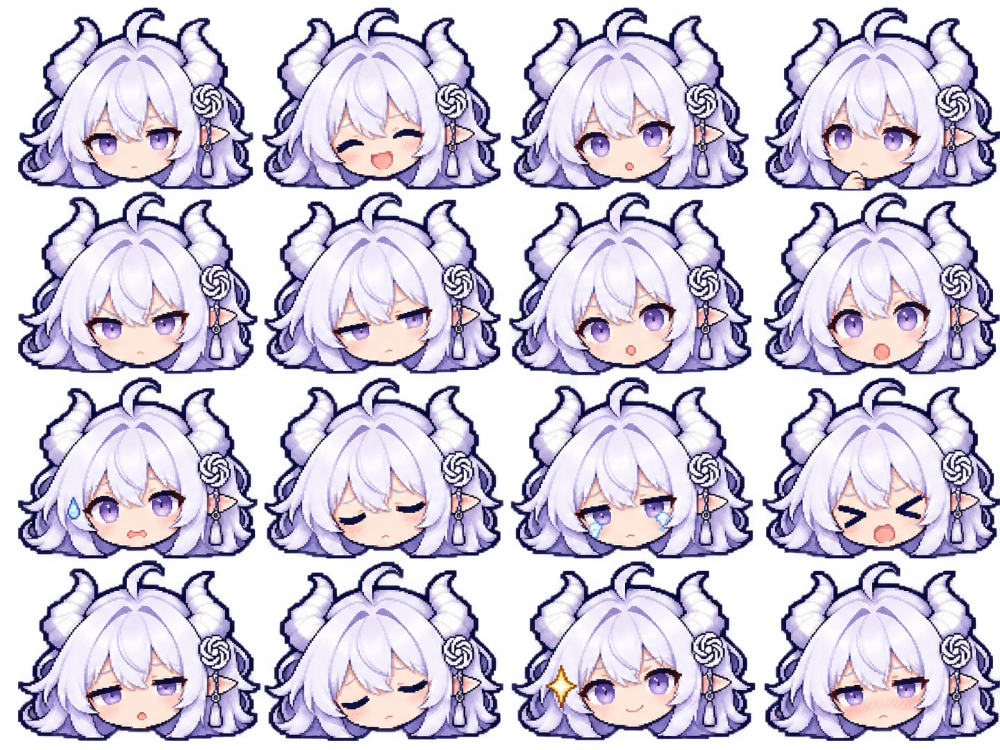

### App integration validation

App 0.14.1 (26) was built from the existing working tree. Runtime source baseline is `e1f5238` plus pre-existing uncommitted work; firmware is unchanged and the installed device version was not inspected. The Android test task passed before editing. After editing, all 95 unit tests and all ABI builds were forcibly rerun with zero failures. The complete `./tools/validate.sh` passed under ESP-IDF 5.5.3. All eight Xiaoyu and Claude portrait hashes remained unchanged, and the four Codex PNGs packaged in the APK match the generated resources pixel for pixel. The running local Runtime advertises version 26 with the verified APK hash; no restart was needed.

Build: PASS. Host tests: PASS. Device tests: NOT RUN. Regression: PASS for host tests and resource invariants; adjacent phone journeys remain unaccepted. First response <= 3s: NOT RUN. Connection recovery: NOT RUN. Multi-end sync: NOT RUN. No real-client latency or convergence samples were collected.

Unverified: phone installation, four expressions, page rendering, cold start/foreground, messaging/approval, reconnect, multi-end synchronization and rendered first response. Recovery: revert these portrait resources and publish with a higher version code, preserving history/settings; do not clear data to roll back.

During delivery another authorized workspace session retained the avatar implementation and source assets in `fb621e2`, then merged Runtime work in `c70c4c4`. The app and firmware source trees did not change in that merge. The avatar release remains based on the tested app content retained in `fb621e2`; the concurrent Runtime merge is not a claim that the running service was restarted or upgraded.
